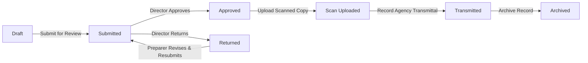

# MinSU DocTrack — TDP Annex Management System

> **Official Mindoro State University (MinSU)** Tulong Dunong Program (TDP) Annex Management & Review Tracking System.

MinSU DocTrack replaces the manual prepare → review → scan → upload → email routine for TDP Annexes 1–10 with a single, role-based, tracked workflow.

---

## 🏛️ Brand Palette (Mindoro State University)

The interface follows the official MinSU green and gold visual identity:

- **Primary Green (`#1B5E20`)**: Navigation bars, headers, primary action buttons, active states
- **Accent Gold (`#F2B705` / `#B88A00`)**: Badges, alert highlights, key action buttons
- **Surface & Page (`#FFFFFF` / `#F6F8F6`)**: Clean, accessible reading backgrounds
- **Typography**: Montserrat (Headings) & Inter (Body) via Google Fonts

---

## 👥 Roles & Pre-configured Demo Accounts

All demo accounts are seeded with the password: **`Password@123`**

| Role | Email | Purpose & Permissions |
|---|---|---|
| **Campus Director** | `director@minsu.edu.ph` | Executive review queue, formal approval, return with comments, executive KPI analytics dashboard |
| **Staff Coordinator** | `staff@minsu.edu.ph` | Prepare Annexes 1–10, submit for review, record transmittals, publish Annex 2 applicant calls |
| **Accounting Officer** | `accounting@minsu.edu.ph` | Prepare and submit financial Annexes (6, 7, 8, 9) |
| **System Admin** | `admin@minsu.edu.ph` | Manage users & roles, inspect outgoing transmittal registry, view full audit logs |
| **Student** | `student@minsu.edu.ph` | Open self-service registration, browse active TDP calls, submit online Annex 2 application, track status |

---

## 📋 TDP Annex Schedule Coverage

| Annex | Document Name | Prepared By | Reviewed By | Action Loop |
|---|---|---|---|---|
| **1** | Submission to Agency | Staff | Director | Preparer records external agency dispatch & Drive links |
| **2** | Call for Applicants | Staff / Student | Director (Analytics) | Public portal, online form submission, unique tracking code |
| **3** | Continuing Billing | Staff | Director | In-app form, Director review queue, approval & stamp |
| **4** | New Billing | Staff | Director | In-app form, Director review queue, approval & stamp |
| **5** | Certificate of Qualified | Staff | Director | Eligibility masterlist endorsement |
| **6** | Certificate of Fund Utilization | Staff / Accounting | Director | Financial reconciliation review & approval |
| **7** | Report of Advance to Debit | Staff / Accounting | Director | Bank debit reference verification |
| **8** | Report of Check Issued | Staff / Accounting | Director | Check disbursement audit record |
| **9** | Payroll | Staff / Accounting | Director | Stipend beneficiary payroll endorsement |
| **10** | TDP Notice of Awards | Staff | Director | Award batch issuance & guidelines |

---

## ⚙️ Tech Stack

- **Framework**: Next.js 16 (App Router, Fullstack)
- **Database**: PostgreSQL
- **ORM**: Prisma 6 (Client & Schema Migrations)
- **Styling**: Tailwind CSS with custom MinSU CSS variables
- **Icons**: Lucide React
- **Authentication**: Server-side database sessions, `HttpOnly` Secure `SameSite=Lax` cookies, bcrypt password hashing
- **Audit Logging**: Immutable event ledger tracking every state transition

---

## 🐳 Docker Quickstart

MinSU DocTrack is fully containerized with Docker and Docker Compose. You do not need to install Node.js or PostgreSQL locally to run the application.

### 1-Command Production Deployment
```bash
# Clone the repository and boot the full stack
docker compose up -d --build
```
This automatically:
1. Provisions a **PostgreSQL 16** container with persistent storage (`minsu_db_data`).
2. Runs health checks until the database is ready.
3. Launches an ephemeral **`db-init`** container to execute Prisma migrations (`prisma db push`) and seed default roles/accounts (`prisma/seed.ts`).
4. Starts the **Next.js** standalone production container on **[http://localhost:3000](http://localhost:3000)**.
5. Exposes PostgreSQL on port **`5432`** for external GUI tools (DBeaver, TablePlus, pgAdmin).

### Containerized Development Mode (with Live Hot-Reloading)
```bash
npm run docker:dev
# or: docker compose -f docker-compose.yml -f docker-compose.dev.yml up --build
```

### Useful Docker Helper Commands
```bash
npm run docker:up      # Start production stack in background
npm run docker:dev     # Start dev mode with live code reload
npm run docker:logs    # Follow Next.js container logs
npm run docker:down    # Stop all containers
npm run docker:clean   # Stop containers and wipe volumes (fresh reset)
```

---

## 🚀 Manual Local Setup (Without Docker)

### 1. Prerequisites
- **Node.js** v20+ or v24+
- **PostgreSQL** running locally or via remote connection

### 2. Environment Configuration
Create `.env` (or `.env.local`):

```env
DATABASE_URL="postgresql://postgres:<password>@localhost:5432/minsu_doctrack?schema=public"
SESSION_SECRET="minsu_doctrack_secure_session_secret_2026"
NEXT_PUBLIC_APP_NAME="MinSU DocTrack"
```

### 3. Database Initialization & Seeding
```bash
# Push Prisma schema to PostgreSQL
npx prisma db push

# Seed initial users (Director, Staff, Accounting, Admin, Student) and Annex 1-10 schemas
npx tsx prisma/seed.ts
```

### 4. Running the Development Server
```bash
npm run dev
```
Open **[http://localhost:3000](http://localhost:3000)** in your browser.

### 5. Building for Production
```bash
npm run build
npm run start
```

---

## 🔄 Document Workflow Lifecycle



- **Draft**: Only the preparer can view and edit.
- **Submitted / Resubmitted**: Appears immediately in the Director's Review Queue.
- **Approved**: Document locked from further tampering; ready for agency dispatch.
- **Returned**: Unlocked for preparer with corrective feedback and annotations.
- **Transmitted**: Official record of dispatch to CHED, UniFAST, or DBM with Google Drive URL tracking.
- **Archived**: Safely retained in institutional archives.

---

## 📚 Official Annex Documentation

Comprehensive guides detailing both the statutory CHED/UniFAST regulatory requirements and MinSU DocTrack system workflows for all 10 Annexes are located in the [`docs/annexes/`](./docs/annexes/) directory:

- 📖 **[Master Annex Matrix & System Workflow Guide](./docs/annexes/README.md)**
- **[Annex 01: Submission to Agency & Masterlist Transmittal](./docs/annexes/annex-01-submission-to-agency.md)**
- **[Annex 02: Call for Applicants & Student Application Intake](./docs/annexes/annex-02-call-for-applicants.md)**
- **[Annex 03: Continuing Billing Statement](./docs/annexes/annex-03-continuing-billing.md)**
- **[Annex 04: New Billing Statement](./docs/annexes/annex-04-new-billing.md)**
- **[Annex 05: Certificate of Qualified Grantees](./docs/annexes/annex-05-certificate-of-qualified.md)**
- **[Annex 06: Certificate of Fund Utilization (COFU)](./docs/annexes/annex-06-certificate-of-fund-utilization.md)**
- **[Annex 07: Report of Advance to Debit (RAD / ADA)](./docs/annexes/annex-07-report-of-advance-to-debit.md)**
- **[Annex 08: Report of Check Issued (RCI)](./docs/annexes/annex-08-report-of-check-issued.md)**
- **[Annex 09: TDP Grantee Stipend Disbursement Payroll](./docs/annexes/annex-09-payroll.md)**
- **[Annex 10: TDP Notice of Awards (NOA)](./docs/annexes/annex-10-notice-of-awards.md)**

