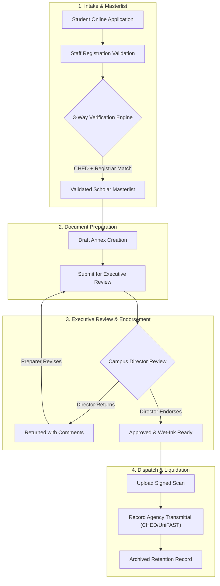

# MinSU DocTrack — TDP Annex Management System

> **Official Mindoro State University (MinSU)** Tulong Dunong Program (TDP) Annex Management, Verification & Review Tracking System.

MinSU DocTrack replaces the manual prepare → review → scan → upload → email routine for TDP Annexes 1–10 with a single, role-based, cryptographically tracked workflow.

---

## 🏛️ Brand Palette (Mindoro State University)

The interface follows the official MinSU green and gold visual identity:

- **Primary Green (`#1B5E20`)**: Navigation bars, headers, primary action buttons, active states
- **Accent Gold (`#F2B705` / `#B88A00`)**: Badges, alert highlights, key action buttons
- **Surface & Page (`#FFFFFF` / `#F6F8F6`)**: Clean, accessible reading backgrounds
- **Typography**: Montserrat (Headings) & Inter (Body) via Google Fonts

---

## 👥 Roles & Pre-configured Demo Accounts

All demo accounts are seeded with the password: **`Password@123`**

| Role | Email | Purpose & Permissions |
|---|---|---|
| **Campus Director** | `director@minsu.edu.ph` | Executive review queue, formal approval, return with comments, executive KPI analytics dashboard, 3-way verification discrepancy review, award certificate signee approvals |
| **Staff Coordinator** | `staff@minsu.edu.ph` | Prepare Annexes 1–5 & 10, submit for review, record transmittals, publish Annex 2 applicant calls, Student Masterlist Validation Queue (`/registrations`), 3-Way Verification Engine (`/verification`), Certificate Designer (`/certificate-editor`), announcements authoring |
| **Accounting Officer** | `accounting@minsu.edu.ph` | Prepare and submit financial Annexes (6, 7, 8, 9), bank debit reconciliation, check registers, general stipend payrolls, multi-tab native ExcelJS export |
| **System Admin** | `admin@minsu.edu.ph` | Manage users & roles, anti-brute-force rate limiting controls, full tamper-evident audit logs & forensics, Landing Page CMS Split-Screen Editor (`/landing-editor`), system branding & logo management, emergency IT announcements |
| **Student** | `student@minsu.edu.ph` | Open self-service registration, 2FA Microsoft Authenticator setup, active TDP calls catalog, online Annex 2 application, tracking code lookup, persistent student profile with RA 10173 identity locking, announcements feed (`/portal/announcements`) |

---

## 📋 TDP Annex Schedule Coverage & Export Capabilities

| Annex | Document Name | Prepared By | Reviewed By | Action Loop & Primary Export |
|---|---|---|---|---|
| **1** | Submission to Agency | Staff | Director | Preparer records external agency dispatch & Drive links; native ExcelJS export |
| **2** | Call for Applicants | Staff / Student | Director (Analytics) | Public portal, online form submission, unique tracking code, student validation queue |
| **3** | Continuing Billing | Staff | Director | In-app form, Director review queue, approval & stamp; 3-tab `Annex3.xlsx` export |
| **4** | New Billing | Staff | Director | In-app form, 1-click applicant sync, Director review queue; 3-tab `Annex4.xlsx` export |
| **5** | Certificate of Qualified | Staff | Director | Eligibility masterlist endorsement under UniFAST MO 01 s. 2024; ExcelJS export |
| **6** | Certificate of Fund Utilization | Staff / Accounting | Director | Financial reconciliation review & approval; 3-signatory `Annex6.xlsx` export |
| **7** | Report of Advance to Debit | Staff / Accounting | Director | Bank debit reference verification & Disbursing Officer oath; `Annex7.xlsx` export |
| **8** | Report of Check Issued | Staff / Accounting | Director | Check disbursement audit record & Cashier register; 4-signatory `Annex8.xlsx` export |
| **9** | Payroll | Staff / Accounting | Director | Stipend beneficiary payroll endorsement, dual-term stipend tracking; `Annex9.xlsx` export |
| **10** | TDP Notice of Awards | Staff | Director | Award batch issuance, Certificate Designer template integration; native Word (`.doc`) export |

---

## 🚀 Key System Capabilities

1. **Microsoft Authenticator & 2FA Extensions**:
   - Time-based One-Time Password (TOTP) algorithm compatible with Microsoft Authenticator and Google Authenticator.
   - Dynamic QR code generation, recovery emergency backup codes, and anti-lockout security preferences.

2. **3-Way Cross-Matching Verification Engine**:
   - Tripartite automated reconciliation cross-matching CHED CSV, Registrar Enrollment CSV, and MinSU System Masterlist datasets.
   - Jaro-Winkler and Levenshtein fuzzy string matching with automated confidence scoring.
   - Discrepancy classifications: `FULLY_VERIFIED`, `NEEDS_ENCODING`, `NOT_ENROLLED`, `SYSTEM_DISCREPANCY`, `POSSIBLE_MATCH`, and `ENROLLED_NON_SCHOLAR`.
   - Manual discrepancy resolution workflows (`CONFIRM` / `DISMISS`) and comprehensive Excel audit export.

3. **Student Masterlist & Registration Queue**:
   - Staff coordinator validation dashboard (`/registrations`) with batch acceptance and rejection controls.
   - Compliance with RA 10173 (Data Privacy Act of 2012): Student ID Number and Full Legal Name locked permanently upon acceptance, while academic and contact information (GWA, phone, address, parents) remain student-editable for renewal.

4. **Certificate of No Other Scholarship & Certificate Designer**:
   - In-app interactive Certificate Designer (`/certificate-editor`) with customizable layout, typography, dimensions (Letter, A4, Legal, Folio), and orientation (Portrait, Landscape).
   - Dynamic signatory positioning, role-based signature blocks, live canvas preview, and one-click template reset.

5. **Campus & Public Announcements System**:
   - Real-time university announcement hub (`/announcements` and `/portal/announcements`).
   - Categorization by `GENERAL`, `URGENT`, `DEADLINE`, `REQUIREMENTS`, and `PAYROLL`.
   - Priority pinning, audience filtering (`ALL`, `STUDENTS`, `PUBLIC`), and configurable push notifications.

6. **Native Multi-Format Document Generation**:
   - Dual-Mode Interactive Suites: instant switching between Interactive Workspace (math, search, validation) and Official Government Canvas replicas.
   - Pixel-perfect multi-tab Excel workbooks generated via **ExcelJS** with embedded government formatting and automated mathematical formulas.
   - Native Microsoft Word (`.doc`) generation for official institutional award letters (Annex 10).
   - Print-optimized CSS `@media print` for browser-based physical printing.

7. **Landing Page CMS Split-Screen Editor**:
   - Split-screen visual editor (`/landing-editor`) for System Administrators.
   - Modular section controls (Hero, Ticker, Features, Stats, FAQ, Contact) with live responsive preview frames (Desktop, Tablet, Mobile) and draft vs. published workflow.

8. **Institutional Branding & Media Assets**:
   - Centralized institutional and partner agency logo management (`/api/branding/logo`).
   - Strict MIME validation, cryptographically randomized paths, and Content-Security-Policy (CSP) headers protecting against SVG XSS vulnerabilities.

9. **Rate Limiting & Defensive Security**:
   - In-memory sliding window rate limiting on authentication and registration routes.
   - System Administrator control toggle to bypass or enforce rate limits during campus-wide mass registration events.
   - Hardened edge HTTP response security headers (X-Frame-Options, CSP, nosniff, CoOP, CoRP).

---

## ⚙️ Tech Stack

- **Framework**: Next.js 16 (App Router, Fullstack React Server Components & Server Actions)
- **Database**: PostgreSQL 16
- **ORM**: Prisma 6 (Client, Type Safety & Automated Migrations)
- **Styling**: Tailwind CSS with custom MinSU design system tokens & CSS variables
- **UI & Primitives**: Radix UI, Lucide React, Apple fluid spring physics animations
- **Document Engines**: ExcelJS (native multi-tab `.xlsx`), HTML-to-Docx (`.doc`), Puppeteer PDF compiler
- **Security & Auth**: Server-side database sessions, `HttpOnly` Secure `SameSite=Lax` cookies, bcryptjs password hashing, Speakeasy / OTPAuth TOTP 2FA
- **Audit Logging**: Immutable event ledger tracking every state transition and security event

---

## 🐳 Docker Quickstart

MinSU DocTrack is fully containerized with Docker and Docker Compose. You do not need to install Node.js or PostgreSQL locally to run the application.

### 1-Command Production Deployment
```bash
# Clone the repository and boot the full stack
docker compose up -d --build
```
This automatically:
1. Provisions a **PostgreSQL 16** container with persistent storage (`minsu_db_data`).
2. Runs health checks until the database is ready.
3. Launches an ephemeral **`db-init`** container to execute Prisma migrations (`prisma db push`) and seed default roles/accounts (`prisma/seed.ts`).
4. Starts the **Next.js** standalone production container on **[http://localhost:9000](http://localhost:9000)**.
5. Exposes PostgreSQL on port **`5432`** for external GUI tools (DBeaver, TablePlus, pgAdmin).

### Containerized Development Mode (with Live Hot-Reloading)
```bash
npm run docker:dev
# or: docker compose -f docker-compose.yml -f docker-compose.dev.yml up --build
```

### Useful Docker Helper Commands
```bash
npm run docker:up      # Start production stack in background
npm run docker:dev     # Start dev mode with live code reload
npm run docker:logs    # Follow Next.js container logs
npm run docker:down    # Stop all containers
npm run docker:clean   # Stop containers and wipe volumes (fresh reset)
```

---

## 🚀 Manual Local Setup (Without Docker)

### 1. Prerequisites
- **Node.js** v20+ or v24+
- **PostgreSQL** running locally or via remote connection

### 2. Environment Configuration
Create `.env` (or `.env.local`):

```env
DATABASE_URL="postgresql://postgres:<password>@localhost:5432/minsu_doctrack?schema=public"
SESSION_SECRET="minsu_doctrack_secure_session_secret_2026"
NEXT_PUBLIC_APP_NAME="MinSU DocTrack"
```

### 3. Database Initialization & Seeding
```bash
# Push Prisma schema to PostgreSQL
npx prisma db push

# Seed initial users (Director, Staff, Accounting, Admin, Student) and Annex 1-10 schemas
npx tsx prisma/seed.ts
```

### 4. Running the Development Server
```bash
npm run dev
```
Open **[http://localhost:9000](http://localhost:9000)** in your browser.

### 5. Building for Production
```bash
npm run build
npm run start
```

---

## 🔄 Document Workflow Lifecycle



- **Draft**: Editable only by the original preparer.
- **Submitted / Resubmitted**: Appears immediately in the Director's Review Queue; locked against tampering.
- **Approved**: Document endorsed by the Campus Director; unlocked for scan upload and agency dispatch.
- **Returned**: Unlocked for preparer with corrective feedback and annotations.
- **Transmitted**: Official record of dispatch to CHED, UniFAST, or DBM with Google Drive URL tracking.
- **Archived**: Safely retained in institutional archives.

---

## 📚 Official Annex Documentation

Comprehensive guides detailing both the statutory CHED/UniFAST regulatory requirements and MinSU DocTrack system workflows for all 10 Annexes are located in the [`docs/annexes/`](./docs/annexes/) directory:

- 📖 **[Master Annex Matrix & System Workflow Guide](./docs/annexes/README.md)**
- **[Annex 01: Submission to Agency & Masterlist Transmittal](./docs/annexes/annex-01-submission-to-agency.md)**
- **[Annex 02: Call for Applicants & Student Application Intake](./docs/annexes/annex-02-call-for-applicants.md)**
- **[Annex 03: Continuing Billing Statement](./docs/annexes/annex-03-continuing-billing.md)**
- **[Annex 04: New Billing Statement](./docs/annexes/annex-04-new-billing.md)**
- **[Annex 05: Certificate of Qualified Grantees](./docs/annexes/annex-05-certificate-of-qualified.md)**
- **[Annex 06: Certificate of Fund Utilization (COFU)](./docs/annexes/annex-06-certificate-of-fund-utilization.md)**
- **[Annex 07: Report of Advance to Debit (RAD / ADA)](./docs/annexes/annex-07-report-of-advance-to-debit.md)**
- **[Annex 08: Report of Check Issued (RCI)](./docs/annexes/annex-08-report-of-check-issued.md)**
- **[Annex 09: TDP Grantee Stipend Disbursement Payroll](./docs/annexes/annex-09-payroll.md)**
- **[Annex 10: TDP Notice of Awards (NOA)](./docs/annexes/annex-10-notice-of-awards.md)**

---

## 🏛️ System & Role UML / SysML Diagrams

MinSU DocTrack provides an exhaustive specification suite of 102 architectural and behavioral diagrams adhering to ASD-STE100 Simplified Technical English across 6 operational scopes:

- 📊 **[System & Role Diagrams Master Matrix](./docs/diagrams/README.md)**
- 🏢 **[Whole-System Architecture Suite (17 Diagrams)](./docs/diagrams/system/README.md)**
- 🛡️ **[System Administrator Suite (17 Diagrams)](./docs/diagrams/admin/README.md)**
- 👔 **[Campus Director Executive Suite (17 Diagrams)](./docs/diagrams/director/README.md)**
- 📋 **[Staff Coordinator Operations Suite (17 Diagrams)](./docs/diagrams/staff/README.md)**
- 💰 **[Accounting Officer Financial Suite (17 Diagrams)](./docs/diagrams/accounting/README.md)**
- 🎓 **[Student Applicant Portal Suite (17 Diagrams)](./docs/diagrams/student/README.md)**
