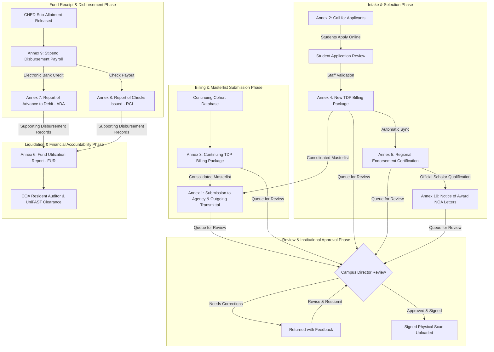
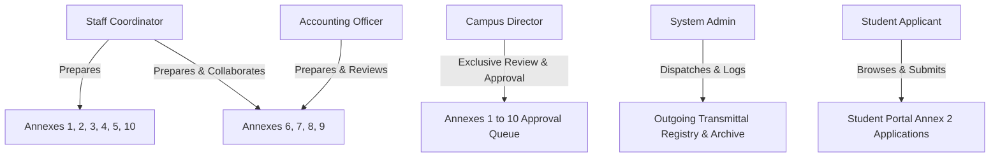

# MinSU DocTrack — Official TDP Annexes 1–10 Documentation

> **Institution:** Mindoro State University (MinSU)  
> **Program:** Tulong Dunong Program Under Tertiary Education Subsidy (TDP-TES) / UniFAST  
> **System:** MinSU DocTrack (TDP Annex Management, Accounting & Tracking System)  
> **Coverage:** Annexes 1 through 10 (Intake, Billing, Verification, Accounting, Payroll, and Award Issuance)

---

## 1. Executive Summary

This documentation suite provides an authoritative, end-to-end operational guide for managing **TDP Annexes 1 through 10** at Mindoro State University. It harmonizes the official statutory requirements mandated by the **Commission on Higher Education (CHED)**, the **Unified Student Financial Assistance System for Tertiary Education (UniFAST)**, and the **Commission on Audit (COA)** with the automated digital workflows implemented in **MinSU DocTrack**.

MinSU DocTrack replaces the fragmented, error-prone manual routine (`prepare → review → scan → upload → email`) with an immutable, role-based pipeline featuring:
- **Dual-Mode Interactive Suites:** Seamless toggling between an **Interactive Workspace** (dynamic editors, live math, search, auto-fill) and the **Official Canvas** (pixel-perfect replicas of government `.xlsx` spreadsheets and `.docx` official award letters).
- **Automated Cross-Annex Data Flow:** 1-click roster imports connecting online student applicant calls (Annex 2) to New Billing statements (Annex 4), regional endorsement certifications (Annex 5), accounting ledgers & registers (Annexes 6, 7, and 8), disbursement payrolls (Annex 9), and individualized Notices of Award (Annex 10).
- **Native Document Generation & Export:** High-fidelity multi-tab Excel workbooks generated via **ExcelJS**, native Microsoft Word (`.doc`) generation, and `@media print` optimized PDF rendering.
- **Auditable Security & Governance:** Cryptographic audit trails, role-based access control (RBAC), and outgoing agency transmittal registries.

---

## 2. Master Annex Matrix & Overview

The following matrix provides an executive summary of all 10 TDP Annexes, including source template structures, authorized roles, preparation cadence, approving authority, external receiving offices, and export formats.

| Annex # | Official Title | Source Template / Layout | Primary Preparer | Approver | Frequency / Cadence | External Body | Primary Purpose & Export Capabilities |
|:---:|---|---|---|---|---|---|---|
| **01** | [Submission to Agency](./annex-01-submission-to-agency.md) | Official Agency Transmittal | Staff Coordinator | Campus Director | Semesterly | CHEDRO MIMAROPA | Transmittal cover letter and compiled grantee masterlist. Supports Excel export and Google Drive transmittal logging. |
| **02** | [Call for Applicants](./annex-02-call-for-applicants.md) | Public Announcement & Portal Intake | Staff Coordinator | Campus Director | Per Academic Term | Student Applicants | Public call, dynamic eligibility guidelines, campus slot quotas, and student portal application pipeline. |
| **03** | [Continuing Billing](./annex-03-continuing-billing.md) | `Annex3.xlsx` (3 Tabs: Form 1, Form 2, Form 3) | Staff Coordinator | Campus Director | Semesterly | CHED / UniFAST | Billing statement & masterlist for continuing grantees. Features 0.5% management fee, reference numbering, and 3-tab ExcelJS export. |
| **04** | [New Billing](./annex-04-new-billing.md) | `Annex4.xlsx` (3 Tabs: Form 1, Form 2, Form 3) | Staff Coordinator | Campus Director | Semesterly (Batch 20.1) | CHED / UniFAST | Billing statement & masterlist for new grantees. Features 1-click Annex 2 intake sync, 0.5% fee calculation, and 3-tab ExcelJS export. |
| **05** | [Certificate of Qualified](./annex-05-certificate-of-qualified.md) | `Annex5.xlsx` (1 Tab: Certification) | Staff Coordinator | Campus Director | Per Selection Batch | UniFAST Executive Director IV | Regional certification under UniFAST MO 01 s. 2024 attesting to genuine CORs. Features live auto-sync from MinSU billings and ExcelJS export. |
| **06** | [Fund Utilization Report (FUR)](./annex-06-certificate-of-fund-utilization.md) | `Annex6.xlsx` (1 Tab: FUR) | Staff / Accounting | Campus Director | Quarterly / Semesterly | CHEDRO / COA Resident Auditor | Official accounting liquidation statement for Funds Received (Stipend + ASC) and MOOE Fund Utilized. Features triple signatories and ExcelJS export. |
| **07** | [Report of Advance to Debit (RADAI)](./annex-07-report-of-advance-to-debit.md) | `Annex7.xlsx` (1 Tab: RADAI) | Staff / Accounting | Campus Director | Per Electronic Payroll | Landbank / COA Resident Auditor | Disbursing Officer check/ADA ledger listing electronic debit advices backing FUR disbursements. Features Disbursing Officer oath and ExcelJS export. |
| **08** | [Report of Checks Issued (RCI)](./annex-08-report-of-check-issued.md) | `Annex8.xlsx` (1 Tab: RCI) | Staff / Accounting | Campus Director | Monthly | Landbank / COA Resident Auditor | Cashier check register listing commercial/MDS checks issued for student stipends (TES) and admin expenses (ASC). Features 4 signatories and ExcelJS export. |
| **09** | [General Payroll](./annex-09-payroll.md) | `Annex9.xlsx` (1 Tab: General Payroll) | Staff / Accounting | Campus Director | Per Payout Event | MinSU Cashier / Disbursing Officer | Official student stipend payout payroll with dual-semester tracking, acknowledgment signatures, 1-click billing sync, and ExcelJS export. |
| **10** | [Notice of Award (NOA)](./annex-10-notice-of-awards.md) | `Annex10.docx` (Single-Page Letter Canvas) | Staff Coordinator | Campus Director | Academic Year Kickoff | Student Awardees / CHEDRO | Formal scholar award notice letter stipulating ₱7,500/sem grant, 6 statutory conditions, Sec. 9 warning, Word (.doc) export, and cohort batch printing. |

---

## 3. End-to-End Program Chronology & Cross-Annex Lifecycle

TDP Annexes operate along an interconnected, synchronized academic and financial pipeline:



---

## 4. Role-Based Access Control (RBAC) Architecture

MinSU DocTrack enforces rigorous institutional boundaries defined in `src/lib/rbac.ts` and middleware guards:



### Institutional Role Summary:
1. **Campus Director:** Executive signing authority. Possesses real-time visibility over pending submissions, single-click approvals, return-with-comments capability, and high-level analytics velocity metrics.
2. **Staff Coordinator:** Operational administrative custodian. Initiates masterlists, manages student registration verification, drafts general annexes, uploads wet-ink signed PDFs, and logs transmission transmittals.
3. **Accounting Officer:** Financial custodian. Collaborates with Staff on fiscal annexes (Annexes 6–9), verifies account ledgers, reconciles bank debit advices, and certifies fund utilization rates.
4. **System Admin:** Governance and technical auditor. Manages role assignments, monitors the immutable system audit trail, and supervises the outgoing transmittal archive.
5. **Student Applicant:** External applicant. Submits continuous registrations and active call applications, verifies tracking codes, and views evaluation results.

---

## 5. Standard Document Status Workflow

Every document created within MinSU DocTrack passes through the strict 7-state lifecycle:

```
[Draft] ───► [Submitted] ───► [Approved] ───► [Uploaded] ───► [Transmitted] ───► [Archived]
                 │                 ▲
                 ▼                 │
            [Returned] ────────────┘ (In-place correction & resubmission)
```

1. **Draft:** Created by Staff or Accounting. Fully editable; isolated from review queues.
2. **Submitted / Resubmitted:** Locked against preparer modifications. Enters the Campus Director's active review queue with full version history.
3. **Returned:** Disapproved by Director with clear remediation comments. Re-enters preparer workspace for targeted revision.
4. **Approved:** Formally endorsed and digitally stamped by the Campus Director. Document content is permanently frozen.
5. **Uploaded:** Wet-ink signed and university-sealed paper document is scanned into PDF format and uploaded into the system record.
6. **Transmitted:** Officially dispatched to CHED, UniFAST, or external agencies. Generates tracking references, delivery receipt logs, and cloud transmittal links.
7. **Archived:** Preserved indefinitely for audit, accreditation, and COA review.

---

## 6. Directory Structure of Annex Documentation

Detailed operational guides for each Annex can be accessed directly below:

- **[Annex 01: Submission to Agency & Masterlist Transmittal](./annex-01-submission-to-agency.md)**
- **[Annex 02: Call for Applicants & Student Intake](./annex-02-call-for-applicants.md)**
- **[Annex 03: Continuing Billing Statement](./annex-03-continuing-billing.md)**
- **[Annex 04: New Billing Statement](./annex-04-new-billing.md)**
- **[Annex 05: Certificate of Qualified Grantees](./annex-05-certificate-of-qualified.md)**
- **[Annex 06: Fund Utilization Report (FUR)](./annex-06-certificate-of-fund-utilization.md)**
- **[Annex 07: Report of Advance to Debit (RAD / ADA)](./annex-07-report-of-advance-to-debit.md)**
- **[Annex 08: Report of Checks Issued (RCI)](./annex-08-report-of-check-issued.md)**
- **[Annex 09: TDP Grantee Stipend Disbursement Payroll](./annex-09-payroll.md)**
- **[Annex 10: TDP Notice of Awards (NOA)](./annex-10-notice-of-awards.md)**
