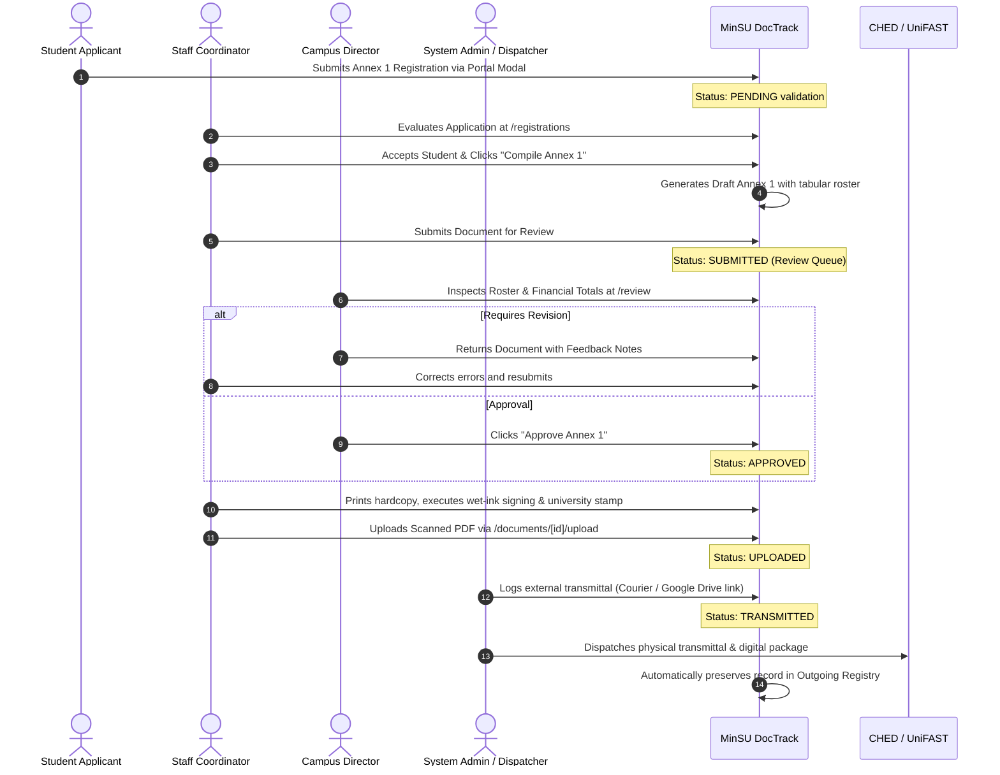

# Annex 01: Submission to Agency & Masterlist Transmittal

> **Document Code:** TDP-ANNEX-01  
> **Official Title:** Submission to Agency / Masterlist of Beneficiaries Transmittal  
> **Primary Creators:** Staff Coordinator (Student Affairs / Scholarship Unit)  
> **Approving Authority:** Campus Director  
> **Receiving Body:** CHED Regional Office / UniFAST Regional Secretariat  
> **System Route:** `/documents/new?annex=1`, `/registrations`, `/api/annex-1/compile`, `/outgoing`  

---

## 1. Overview & Institutional Purpose

**Annex 1** serves as the primary transmittal endorsement and comprehensive masterlist package officially transmitted by Mindoro State University to the Commission on Higher Education (CHED) and the UniFAST Regional Office. It aggregates all thoroughly verified and accepted student applicants into an official cohort list eligible to receive grant subsidies under the Tulong Dunong Program (TDP).

Under the MinSU DocTrack architecture, Annex 1 is not merely a static form; it represents an automated compilation milestone. Students register continuously through the portal (`/portal`), undergo rigorous identity, income, and enrollment verification by Staff Coordinators (`/registrations`), and are subsequently bundled via the Annex 1 Compiler (`/api/annex-1/compile`) into an institutional transmittal endorsed by the Campus Director.

---

## 2. Legal, Policy & CHED/UniFAST Regulatory Basis

1. **Republic Act No. 10931 (Universal Access to Quality Tertiary Education Act):** Establishes the Tertiary Education Subsidy (TES) and Tulong Dunong Program (TDP) frameworks.
2. **Joint Memorandum Circular (CHED-UniFAST):** Mandates State Universities and Colleges (SUCs) to submit validated grantee masterlists with student demographic profiles, degree classifications, and exact semester billing allocations.
3. **Commission on Audit (COA) Circular No. 2012-001:** Enforces guidelines on documentary requirements for government disbursements, requiring that any public fund transfer to students be supported by certified student masterlists and authenticated enrollment certificates.
4. **Data Privacy Act of 2012 (RA 10173):** Safeguards applicant personal and sensitive data during collection, processing, and transmission.

---

## 3. Roles, Stakeholders & RBAC Permissions

| Role | System Permission | Action Required |
|---|---|---|
| **Student Applicant** | Portal Access (`STUDENT`) | Completes the multi-step Continuous Annex 1 Registration modal with authenticated identity, academic, and socio-economic details. |
| **Staff Coordinator** | Create & Compile (`STAFF`) | Reviews pending student applications on the Registrations dashboard, verifies supporting files, accepts/rejects entries, and triggers the batch compile action for Annex 1. |
| **Campus Director** | Approve / Return (`CAMPUS_DIRECTOR`) | Inspects the compiled student roster, validates grand totals, and signs off on the official transmittal or returns for corrective amendments. |
| **Staff Coordinator** | Transmit & Log (`STAFF`) | Records external dispatch details (courier, hand delivery, Google Drive transmittal link, date sent) in the Outgoing Transmittal Registry. |
| **CHED/UniFAST Officer** | External Oversight | Receives the signed Annex 1 transmittal package and student masterlist spreadsheet for sub-allotment validation. |

---

## 4. Required Inputs, Form Fields & Data Schema

Annex 1 incorporates both top-level transmittal metadata and tabular student cohort records.

### Top-Level Transmittal Header (`formSchema`)

| Field ID | Field Label | Data Type | Required | Placeholder / Sample | Description |
|---|---|---|:---:|---|---|
| `target_agency` | Concerned Government Agency | Text | Yes | `CHED MIMAROPA Regional Office` | Name of the recipient governing agency or UniFAST regional unit. |
| `academic_year` | Academic Year & Semester | Text | Yes | `A.Y. 2026–2027, 1st Semester` | Academic period covered by this beneficiary cohort. |
| `transmittal_number` | Transmittal Reference No. | Text | Yes | `MINSU-TDP-2026-001` | Unique institutional transmittal reference identifier. |
| `submission_date` | Date of Submission | Date | Yes | `2026-10-27` | Official date of filing or dispatch. |
| `total_grant_amount` | Total Grant Amount (PHP) | Number | Yes | `750000.00` | Sum of subsidies requested across all compiled grantees in this batch. |
| `remarks` | Cover Letter & Remarks | Textarea | No | `Batch 1 compilation for regular enrolled undergraduates...` | Contextual notes, special circumstances, or transmittal cover notes. |

### Tabular Student Roster Schema (`Annex1StudentData`)

When compiled, Annex 1 embeds individual student records containing:

```typescript
export interface Annex1StudentData {
  students: Array<{
    studentId: string;        // MinSU Student ID (e.g., 2023-01042)
    fullName: string;         // Last Name, First Name, Middle Name
    campus: string;           // Main (Alcate), Calapan, or Bongabong
    program: string;          // Degree program (e.g., BS Information Technology)
    yearLevel: string;        // 1st Year, 2nd Year, 3rd Year, 4th Year
    contactNumber: string;    // Active mobile number
    email: string;            // Official university or student email
    householdIncome: number;  // Documented annual gross family income
    stipendAmount: number;    // Standard semester subsidy (PHP 7,500.00)
  }>;
}
```

---

## 5. Prerequisite Documents & Supporting Attachments

Before an Annex 1 document can be submitted to the Campus Director, the following documentary artifacts must be verified and cataloged:

1. **Certificate of Registration (COR):** Authenticated proof that each listed grantee is officially enrolled in the indicated semester.
2. **Official Grade Reports / Transcript:** For continuing grantees, proof of meeting academic standing requirements without failing or dropped marks.
3. **Proof of Socio-Economic Status:**
   - Certificate of Indigency issued by the applicant's Barangay, or
   - Latest Income Tax Return (ITR) / BIR Certificate of Tax Exemption of parents.
4. **Valid Government/School ID:** Clear scanned copy of student identification.
5. **Signed Privacy Consent:** Signed agreement authorizing MinSU and CHED to process student data in accordance with RA 10173.

---

## 6. Step-by-Step Lifecycle Workflow



### Operational Steps:
1. **Intake & Verification:** Staff accesses the `/registrations` screen, cross-checks student attachments, and marks qualified students as `ACCEPTED`.
2. **Compilation:** Staff selects accepted beneficiaries and triggers `/api/annex-1/compile`, specifying the target regional office, academic period, and remarks.
3. **Review Submission:** The newly compiled document is reviewed in preview mode and submitted directly to the Campus Director.
4. **Director Review & Endorsement:** The Campus Director accesses `/review`, verifies batch size, campus distribution, and budget allocation, then executes 1-click Approval.
5. **Physical Signing & Scan Upload:** The physical transmittal memo and masterlist are printed, signed by the Campus Director, sealed with the university dry seal, scanned, and uploaded as an official PDF.
6. **External Dispatch:** The dispatch officer delivers the package to CHED Regional Office and enters the courier reference, receiver details, and external Google Drive transmittal archive link into `/api/documents/[id]/transmit`.

---

## 7. System & Physical Output Artifacts

1. **Automated PDF Transmittal Package:** A formatted, downloadable PDF generated by the system with formal header, MinSU seal, tabular beneficiary records, and digital signature sign-off blocks.
2. **Official Excel Masterlist Spreadsheet:** Downloadable directly via `/api/annex-1/export-excel?documentId=[id]`, matching CHED’s prescribed `.xlsx` data matrix for direct bulk import into the UniFAST portal.
3. **Cloud Transmittal Record:** An immutable entry in the MinSU DocTrack Outgoing Documents Registry with direct Google Drive transmittal backup link and delivery timestamp.

---

## 8. Audit, Verification & Compliance Checklist

### Pre-Submission Checklist (Staff Coordinator):
- [ ] Every student in the batch is marked as `ACCEPTED` with verified enrollment records.
- [ ] No duplicate student entries exist across campuses (Main, Calapan, Bongabong).
- [ ] The total grant amount perfectly matches `Total Grantees × PHP 7,500.00`.
- [ ] Official transmittal reference follows the institutional numbering syntax (`MINSU-TDP-YYYY-XXX`).

### Executive Review Checklist (Campus Director):
- [ ] Target CHED regional office and semester information are accurate.
- [ ] Overall slot allocation is within the university's approved TDP quota.
- [ ] Campus distribution aligns with the approved allocation plan.

### COA Post-Transmittal Compliance Checklist:
- [ ] Physical stamped receiving copy from CHED/UniFAST is uploaded or filed in the university records unit.
- [ ] Document status in MinSU DocTrack is marked as `TRANSMITTED`.
- [ ] Immutable audit log confirms the identity of the preparer, approver, and transmittal officer.
