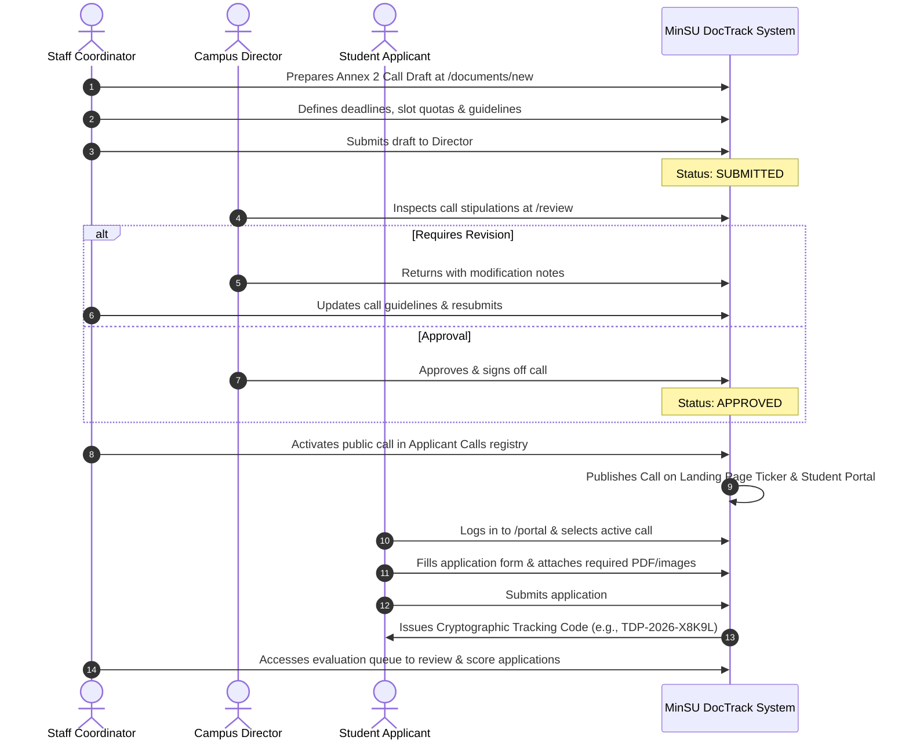

# Annex 02: Call for Applicants & Student Application Intake

> **Document Code:** TDP-ANNEX-02  
> **Official Title:** Call for Applicants & Guidelines Announcement  
> **Primary Creators:** Staff Coordinator (Student Affairs & Services / TDP Office)  
> **Approving Authority:** Campus Director  
> **Receiving Body:** Prospective Student Beneficiaries / General Public  
> **System Route:** `/documents/new?annex=2`, `/portal`, `/portal/apply/[id]`, `/api/applicant-calls`  

---

## 1. Overview & Institutional Purpose

**Annex 2** functions as the formal institutional announcement, guideline charter, and dynamic application form definition for the Tulong Dunong Program at Mindoro State University. It establishes the criteria, campus quotas, required documentary evidence, and submission deadlines for student applicants seeking government educational subsidies.

Within the MinSU DocTrack web system, Annex 2 is deeply integrated into the **Student Portal** (`/portal`). Rather than relying on paper application forms distributed across campuses, Staff Coordinators configure the call parameters electronically. Once approved by the Campus Director and activated, the call becomes visible on the public landing page announcement ticker and student portal, allowing eligible students to submit applications online and track their evaluation progress via cryptographically unique tracking codes.

---

## 2. Legal, Policy & CHED/UniFAST Regulatory Basis

1. **CHED-UniFAST Memorandum on TDP Guidelines:** Mandates transparent, equitable, and merit-cum-need-based selection protocols for all state universities administering TDP slots.
2. **RA 10931 Implementing Rules and Regulations (IRR):** Requires prioritizing students belonging to low-income households, Listahanan-identified families, 4Ps beneficiaries, and marginalized groups.
3. **Anti-Red Tape Act (ARTA / RA 11032):** Directs educational institutions to streamline citizen application processes, establish clear service timelines, and provide digital tracking mechanisms for student applicants.
4. **MinSU Student Handbook & Academic Scholarship Policies:** Enforces minimum academic load and enrollment compliance standards for financial grant applicants.

---

## 3. Roles, Stakeholders & RBAC Permissions

| Role | System Permission | Action Required |
|---|---|---|
| **Staff Coordinator** | Create & Configure (`STAFF`) | Formulates call terms, stipulates qualification criteria, sets slot quotas per campus, establishes deadlines, and builds dynamic application fields. |
| **Campus Director** | Endorse & Activate (`CAMPUS_DIRECTOR`) | Reviews applicant call stipulations, verifies institutional budget and slot allotments, approves the call, and authorizes public opening. |
| **Student Applicant** | Submit Application (`STUDENT`) | Browses active calls in the portal, fills out online application fields, uploads required files, and receives a unique tracking code. |
| **System Admin** | System Uptime & Security (`SYSTEM_ADMIN`) | Monitors platform infrastructure and ensures system uptime throughout deadline surges without accessing application data. |

---

## 4. Required Inputs, Form Fields & Data Schema

Annex 2 defines both the executive administrative call metadata and dynamic student application fields.

### Core Administrative Metadata (`formSchema`)

| Field ID | Field Label | Data Type | Required | Placeholder / Options | Description |
|---|---|---|:---:|---|---|
| `call_title` | Call Title | Text | Yes | `TDP Call for Applicants - 1st Semester A.Y. 2026–2027` | Official headline of the scholarship application cycle. |
| `target_campus` | Eligible Campus | Select | Yes | `All Campuses`, `Main Campus (Alcate)`, `Calapan City Campus`, `Bongabong Campus` | Specific campus scope or university-wide availability. |
| `deadline_date` | Application Deadline | Date | Yes | `2026-11-30` | Strict timestamp after which portal submissions are automatically disabled. |
| `allotted_slots` | Allotted Grantee Slots | Number | Yes | `150` | Maximum authorized recipient count for this cohort. |
| `guidelines` | Qualification Guidelines & Requirements | Textarea | Yes | Narrative text detailing eligibility criteria, income thresholds, and required files. | Complete eligibility requirements displayed prominently on the portal. |

### Dynamic Form Schema for Student Intake

MinSU DocTrack allows Staff to embed custom fields into each applicant call (e.g., Household 4Ps ID, Displaced Worker Parent confirmation, Indigenous People identification). These fields are stored as JSON schema definitions and rendered dynamically in the student interface:

```typescript
export interface DynamicApplicantField {
  id: string;              // e.g., "four_ps_id_number"
  label: string;           // e.g., "4Ps Household ID Number (if applicable)"
  type: "text" | "number" | "select" | "file" | "textarea";
  required: boolean;
  options?: string[];
  placeholder?: string;
}
```

---

## 5. Prerequisite Documents & Supporting Attachments

The Annex 2 guidelines published to students mandate that each applicant upload clear digital attachments prior to submission:

1. **Official Certificate of Registration (COR / Enrolment Form):** Current semester document signed by the campus registrar confirming regular academic load.
2. **Latest Certificate of Grades / Transcript of Records:** Reflecting general weighted average (GWA) without unremoved failing marks or deficiencies.
3. **Barangay Certificate of Indigency:** Stating annual family income below the official poverty threshold or financial distress.
4. **Certificate of Non-Filing of Income Tax / Parent ITR:** Issued by the Bureau of Internal Revenue (BIR).
5. **Government-Issued or Student Identification Card:** Front and back photograph or scan.
6. **Certificate of Membership in Marginalized Sector (Optional):** PWD ID, Solo Parent ID, or Certificate of Tribe Affiliation from NCIP if claiming targeted priority.

---

## 6. Step-by-Step Lifecycle Workflow



### Operational Steps:
1. **Call Formulation:** Staff prepares Annex 2 via `/documents/new?annex=2`, inputting campus allotments, deadline date, and eligibility criteria.
2. **Director Sanction:** Campus Director reviews the call at `/review` to ensure slot totals match UniFAST allocations.
3. **Activation & Public Announcement:** Once approved, the call is marked as active. The public landing page announcement ticker highlights the opening, and the Student Portal displays the application card.
4. **Student Submission:** Eligible students authenticate, fill the dynamic form fields, upload digital proofs, and submit.
5. **Tracking Code Generation:** The system assigns a unique alphanumeric tracking code, providing the student with real-time tracking capabilities.
6. **Evaluation & Handover:** Staff coordinators evaluate applications, moving accepted candidates directly into the Annex 1 Masterlist compiler pipeline.

---

## 7. System & Physical Output Artifacts

1. **Public Guidelines Poster / PDF Notice:** Formatted printable announcement document with MinSU seal, official schedule, and criteria for campus bulletin boards.
2. **Interactive Student Application Record:** Complete digital portfolio containing applicant inputs, uploaded file attachments, submission timestamps, and IP audit trails.
3. **Application Intake Roster (CSV / Excel):** Comprehensive spreadsheet of all submitted applications for offline evaluation and ranking by the scholarship committee.

---

## 8. Audit, Verification & Compliance Checklist

### Coordinator Pre-Launch Checklist:
- [ ] Application deadline provides at least 15 calendar days before portal cutoff.
- [ ] Quota allocation does not exceed total approved slots per campus.
- [ ] Required document attachments are clearly enumerated with maximum file size specifications (5MB per PDF/JPEG).
- [ ] Guidelines explicitly stipulate that falsification of documents results in immediate disqualification.

### Campus Director Review Checklist:
- [ ] Allotted slots correspond to the verified sub-allotment budget.
- [ ] Equal access opportunities are afforded across all MinSU campuses.
- [ ] Clear disclaimer stating that selection is subject to final CHED/UniFAST validation.

### System Intake Integrity Checklist:
- [ ] Portal submission automatically shuts off at 11:59:59 PM on the deadline date.
- [ ] All submitted files are securely saved in `/uploads` with sanitized file paths.
- [ ] System audit logs capture applicant submission events and tracking code assignments.
