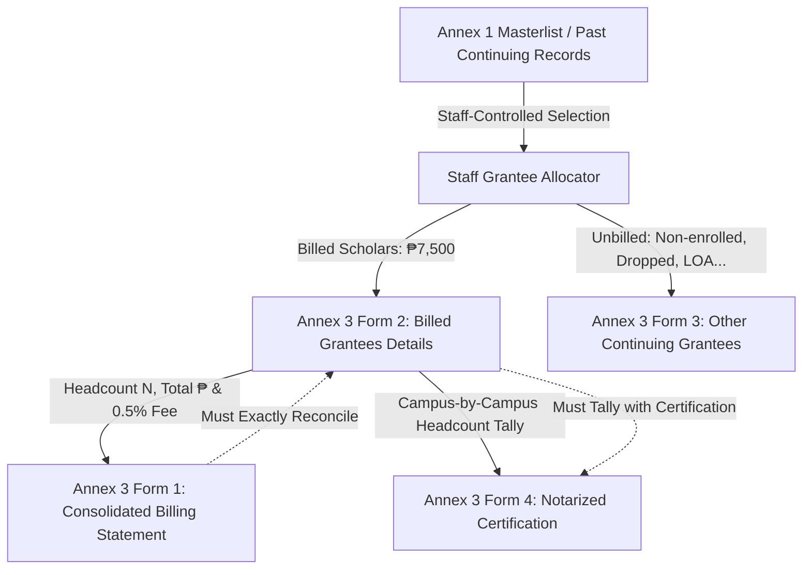

# Annex 03: Continuing Billing Statement (4-Form Suite)

> **Document Code:** TDP-ANNEX-03  
> **Official Title:** Billing Statement & Verification Suite for Continuing Beneficiaries  
> **Primary Creators:** Staff Coordinator (Scholarship / Student Financial Services Unit)  
> **Certifying Authorities:** University Registrar, Head of Accounting  
> **Approving Authority:** University President / Campus Director  
> **Receiving Body:** CHED Regional Office MIMAROPA / UniFAST Budget & Finance Division  
> **System Route:** `/documents/new?annex=3`, `/documents/[id]`, `/api/annex-3/compile`, `/api/annex-3/export-excel`  

---

## 1. Overview & Institutional Purpose

**Annex 3** serves as the official multi-form institutional invoice, continuing grantee masterlist, non-billed scholar status registry, and notarized certification submitted by Mindoro State University (MinSU) to the Commission on Higher Education (CHED) Regional Office MIMAROPA and the UniFAST Regional Secretariat.

Under the Enhanced Guidelines of the Tulong Dunong Program (TDP) pursuant to **UniFAST Joint Memorandum Circular (JMC) No. 02, Series of 2022**, state universities bill for continuing grantees in distinct batches per semester. Continuing grantees are scholars previously validated and awarded official TDP award numbers who have maintained academic retention rules and re-enrolled for the subsequent academic term.

Annex 3 consists of four mandatory constituent documents:
1. **Annex 3 Form 1 – Consolidated TDP Billing Statement**: Official institutional cover invoice requesting sub-allotment release, including total subsidy, 0.5% administrative management fee, and CHEDRO approval blocks.
2. **Annex 3 Form 2 – Consolidated Continuing TDP Grantees Details**: Exhaustive masterlist of billed continuing scholars listed per campus across 15 standard demographic and academic columns.
3. **Annex 3 Form 3 – Other Continuing Grantees**: Registry of continuing scholars who are **not billed** this semester (e.g., dropped, waived, on LOA, transferee, graduated).
4. **Annex 3 Form 4 – Certification**: Notarized institutional certification on university letterhead executed by the University Registrar and approved by the University President, confirming grantee eligibility and campus distribution.

---

## 2. Legal & Regulatory Framework

1. **Republic Act No. 10931 (Universal Access to Quality Tertiary Education Act):** Governs statutory funding and implementation of the Tulong Dunong Program (TDP-TES).
2. **UniFAST Joint Memorandum Circular (JMC) No. 02, Series of 2022:** Prescribes enhanced billing protocols, reporting formats, the 0.5% management fee computation, and notarized certification guidelines.
3. **CHED-UniFAST Tranche & Batch Billing Rules:** Limits HEIs to a maximum of two (2) payment tranches per semester, with distinct batch identifiers per tranche. Each batch represents an isolated group of grantees.
4. **Commission on Audit (COA) Circular No. 2012-001:** Enforces documentary requirements for government disbursements, requiring that all public grant claims be backed by authenticated enrollment certificates and certified rosters.

---

## 3. Four-Form Specifications & Data Continuity

### 3.1. Annex 3 Form 1 – Consolidated TDP Billing Statement

The cover payment claim submitted to CHED Regional Office MIMAROPA.

#### Reference Number Formula:
$$\text{Reference No.} = \text{[REGIONAL CODE]} - \text{[HEI CODE]} - \text{[ACADEMIC YEAR]} - \text{[TERM CODE]} - \text{[TRANCHE NUMBER]} : \text{[BATCH NUMBER]}$$

- **Regional Code:** `MIMAROPA` (Region 4B)
- **HEI Code:** `MINSU` (Mindoro State University)
- **Academic Year:** 4-digit start year (e.g., `2024` for AY 2024–2025)
- **Term Code:** `1` (1st Semester), `2` (2nd Semester)
- **Tranche Number:** `1` or `2` (Maximum 2 tranches per semester)
- **Batch Number:** Batch identifier digit (e.g., `3`, `1`, `15`)
- *Example Reference Number:* `MIMAROPA-MINSU-2024-1-1:3`

#### Financial Calculation Invariants:
1. **Total TDP Subsidy:**
   $$\text{Total Subsidy} = \text{Total Billed Grantees (Form 2)} \times \text{PHP } 7,500.00$$
2. **0.5% Management Fee for Partner Institutions:**
   $$\text{Management Fee} = \text{Total Subsidy} \times 0.005$$
3. **Total TDP-TES Billing Amount:**
   $$\text{Grand Total} = \text{Total Subsidy} + \text{Management Fee}$$

*Sample Calculation (5 Grantees):*
- Total Subsidy: $5 \times 7,500.00 = \text{PHP } 37,500.00$
- Management Fee ($0.5\%$): $37,500.00 \times 0.005 = \text{PHP } 187.50$
- Total Billing Amount: $\text{PHP } 37,687.50$

#### Key Form 1 Fields:
- **Reference Number & Date**
- **HEI Name & Address:** Mindoro State University (Alcate, Victoria, Oriental Mindoro)
- **Recipient Office:** CHED Regional Office MIMAROPA (2F HEDC Bldg., C.P. Garcia Ave., UP Diliman, Quezon City)
- **Checkboxes:**
  - Supporting documents complete and amount claimed proper.
  - "Is this the last batch of billing for this term of AY 2024-2025?" (`Yes` / `No`)
- **HEI Signatories:** Head of Accounting / Authorized Representative, University President / Authorized Representative.
- **CHEDRO Approval Box:** Action to be taken (Excess/Deficient billing noted for further action; Approved for payment).

---

### 3.2. Annex 3 Form 2 – Consolidated Continuing TDP Grantees Details

The master list of currently enrolled continuing grantees who are billed in this submission. Grantees are grouped and tabulated **per campus** (Main Campus Alcate, Calapan Campus, Bongabong Campus).

#### 15-Column Tabular Schema:
| Col # | Header Name | Data Type | Sample Value | Notes |
|:---:|---|---|---|---|
| 1 | **5-digit Control Number** | String | `00001` | Sequential zero-padded format |
| 2 | **Student Number** | String | `2023-01042` | MinSU Official Student ID |
| 3 | **TDP Award Number** | String | `2024-TDP-4060-00001` | Official CHED TDP Award Number |
| 4 | **Last Name** | String | `DELA CRUZ` | Student's legal surname |
| 5 | **Given Name** | String | `JUAN` | Student's given name |
| 6 | **Middle Initial** | String | `P.` | Single letter with dot |
| 7 | **Sex at Birth** | String | `M` | `M` or `F` |
| 8 | **Birthdate** | String | `05/14/2004` | Format: `MM/DD/YYYY` |
| 9 | **Degree Program** | String | `BS Information Technology` | Official enrolled curriculum |
| 10 | **Year Level** | String | `2` | Numeric level (1–5) |
| 11 | **E-mail Address** | String | `juan.delacruz@minsu.edu.ph` | Active student email |
| 12 | **Phone Number** | String | `09171234567` | 11-digit mobile |
| 13 | **TDP Batch** | String / Num | `3` | Batch number for this billing |
| 14 | **Semester Amount** | Number | `7500.00` | Statutory semester stipend |
| 15 | **TOTAL AMOUNT** | Number | `7500.00` | Sum per student (PHP) |

#### Form 2 Signatories:
- Prepared by: **HEI TES Focal Person / Scholarship Coordinator**
- Certified as to correctness of enrollment data: **HEI Registrar**
- Certified as to correctness of financial data: **HEI Chief Accountant**
- Approved by: **HEI President**

---

### 3.3. Annex 3 Form 3 – Other Continuing Grantees

Roster of continuing TDP grantees who are **NOT billed** in this cycle. It tracks scholars who were part of previous cohorts but cannot be funded this term.

#### Tabular Schema:
- Columns 1 through 10 match Form 2 (Control No, Student No, Award No, Full Name, Sex, Birthdate, Program, Year Level).
- **Column 11: Status** — Strictly limited to one of the 6 official CHED categories:
  - `not enrolled`
  - `dropped`
  - `waived`
  - `on LOA` (Leave of Absence)
  - `transferee`
  - `graduated`
- **Column 12: Remarks** — Explanatory narrative (e.g., "Transferred to BatStateU 2nd Sem", "Filed LOA due to medical reasons", "Completed degree requirements Summer 2024").
- **Financials:** Contains no billing amounts ($0.00$).

#### Form 3 Signatories:
- Prepared by: **HEI TES Focal Person / Scholarship Coordinator**
- Certified by: **HEI Registrar**
- Approved by: **HEI President**

---

### 3.4. Annex 3 Form 4 – Certification

Formal letterhead document issued by the university and executed under oath before a Notary Public.

#### Content & Certification Text:
1. **Institutional Header:** Mindoro State University letterhead with address and contact details.
2. **Certification Statement:** 
   > *"This is to certify that the total number of TDP grantees by campus as shown below, are qualified to avail of the Tulong Dunong Program (TDP) under R.A. No. 10931 also known as Universal Access to Quality Tertiary Education (UAQTE) for the [Semester] of Academic Year [Year]."*
3. **Campus & Batch Breakdown Table:**
   | Name of Campus | Batch Number | Number of TDP Grantees |
   |---|:---:|:---:|
   | Main Campus (Alcate, Victoria) | Batch 3 | 2 |
   | Calapan Campus | Batch 3 | 2 |
   | Bongabong Campus | Batch 3 | 1 |
   | **Total** | | **5** |
4. **Accuracy Clause:** 
   > *"This further certifies that the students' information indicated in the billing statement of the Annex 3 - Tulong Dunong Program Continuing Form 2 is accurate and complete."*
5. **UniFAST Citation:** 
   > *"This certification is being issued in accordance with the UniFAST Memorandum Circular (JMC) No. 02 Series of 2022, on the Enhanced Guidelines of the Tulong Dunong Program (TDP)."*
6. **Signatures & Jurat:**
   - Certified by: **University Registrar** (Signature over printed name)
   - Approved by: **University President** (Signature over printed name)
   - **Notarial Acknowledgment / Jurat Block** for notary public attestation.

---

## 4. Cross-Annex Data Carryover & Staff Control

### Why Data Carryover is Staff-Controlled:
Continuing billing requires deliberate human validation because a student who was enrolled in the previous semester may have changed status (dropped subjects, transferred, filed LOA, or graduated). MinSU DocTrack provides an **Interactive Grantee Allocator**:

1. **Source Ingestion:** Staff loads candidate records from approved Annex 1 masterlists or previous continuing rosters for the target batch.
2. **Interactive Triage:** Staff inspects each candidate student and assigns them to:
   - **Form 2 (Billed):** Active, regular enrolled continuing scholars eligible for the ₱7,500.00 stipend.
   - **Form 3 (Other):** Non-billed continuing scholars. Staff selects the exact retention status and types audit remarks.
3. **Award Number Management:** The system pre-fills suggested provisional award numbers (e.g. `2024-TDP-4060-XXXXX`), allowing Staff to edit or enter the official CHED-assigned award number inline.
4. **Automatic Reconciliation:**
   - Form 1 total headcount and grand billing automatically derive from Form 2 rows.
   - Form 4 campus summary table automatically tallies the active Form 2 headcount per campus.

---

## 5. Technical Implementation in MinSU DocTrack

### System Routes & Components:
- **Creator (`/documents/new?annex=3`):** `Annex3Creator` component featuring real-time reference number generation, Grantee Allocator with drag/toggle buckets, and instant math verification.
- **Reviewer / Viewer (`/documents/[id]`):** `Annex3Viewer` component featuring a 4-tab interface mirroring the official CHED layout:
  - Tab 1: Form 1 Cover Billing Statement
  - Tab 2: Form 2 Continuing Grantees Details Table
  - Tab 3: Form 3 Other Continuing Grantees Table
  - Tab 4: Form 4 Notarized Certification Letter
- **Excel Generator (`/api/annex-3/export-excel`):** Outputs a multi-sheet `.xlsx` workbook containing all 4 forms formatted with CHED styling, borders, and mathematical totals.
