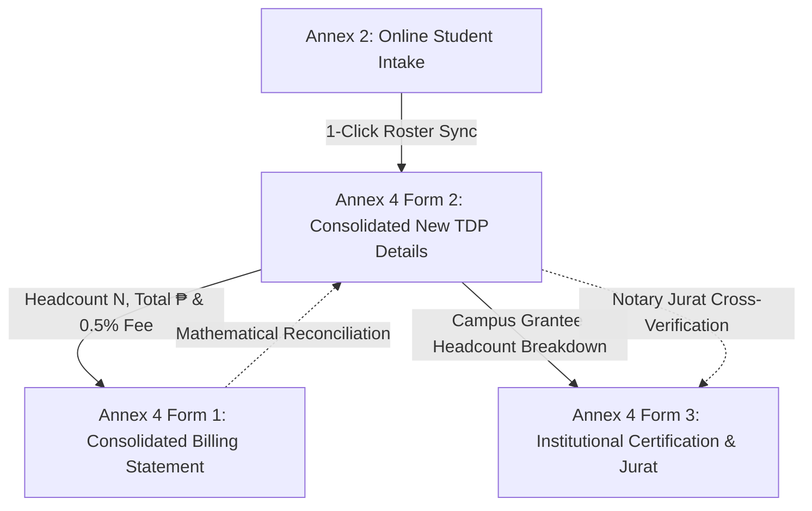
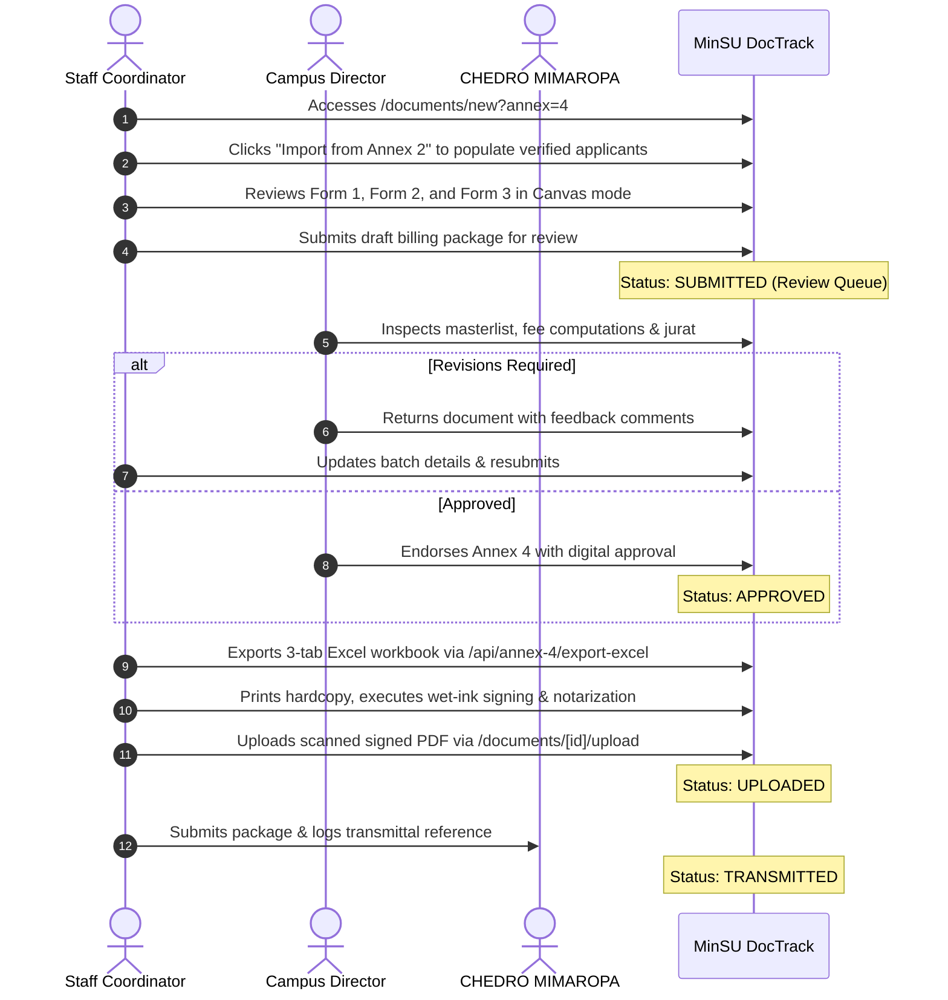

# Annex 04: Consolidated New TDP Billing Package (3-Tab Suite)

> **Document Code:** TDP-ANNEX-04  
> **Official Title:** Consolidated New TDP Billing Statement & Masterlist Package (Batch 20.1)  
> **Primary Creators:** Staff Coordinator (Scholarship & Student Financial Services Unit)  
> **Certifying Authorities:** Focal Person, Registrar, Chief Accountant  
> **Approving Authority:** University President / Campus Director  
> **Receiving Body:** CHED Regional Office MIMAROPA / UniFAST Budget & Finance Division  
> **System Route:** `/documents/new?annex=4`, `/documents/[id]`, `/api/annex-4/export-excel`  

---

## 1. Overview & Institutional Purpose

**Annex 4** serves as the initial billing statement, student masterlist, and notarized institutional certification submitted by Mindoro State University (MinSU) to CHED Regional Office MIMAROPA and the UniFAST Regional Secretariat to fund **newly qualified, first-time student beneficiaries** under the Tulong Dunong Program (TDP-TES).

While Annex 3 bills for continuing scholars already enrolled in the UniFAST registry, Annex 4 represents the financial mobilization for fresh awardees selected through competitive application and validation (Annex 2). The official template corresponds to **Batch 20.1** and consists of three synchronized tabs matching `Annex4.xlsx`:

1. **Annex 4 Form 1 – Consolidated TDP Billing Statement**: Cover payment request detailing the total new grantees, the ₱7,500.00/sem stipend claim, the statutory **0.5% administrative management fee**, institutional reference numbering, and CHEDRO evaluation blocks.
2. **Annex 4 Form 2 – Consolidated New TDP Details**: 15-column per-campus masterlist of newly verified grantees with live 1-click synchronization from online Annex 2 applicant calls.
3. **Annex 4 Form 3 – Certification**: Official institutional letterhead certification executed by the TES Focal Person, Registrar, Chief Accountant, and University President, backed by an official Notarization Jurat.

---

## 2. Legal & Regulatory Framework

1. **Republic Act No. 10931 (Universal Access to Quality Tertiary Education Act):** Establishes the Tertiary Education Subsidy (TES) and Tulong Dunong Program (TDP).
2. **UniFAST Joint Memorandum Circular (JMC) No. 02, Series of 2022:** Prescribes enhanced billing protocols for new awardees, 0.5% management fee calculation, and notarized jurats.
3. **CHED-UniFAST Tranche & Batch Billing Guidelines:** Limits billing submissions to two (2) payment tranches per semester, requiring strict batch identification (e.g., Batch 20.1) and verification of non-duplication against national student assistance registries.
4. **Commission on Audit (COA) Circular No. 2012-001:** Enforces documentary requirements for government disbursements, requiring that initial billing claims be supported by authenticated enrollment records (CORs) and low-income documentation.

---

## 3. Three-Tab Architecture & Data Structure

### 3.1. Annex 4 Form 1 – Consolidated TDP Billing Statement
- **Reference Number Formula:** `[REGION]-[HEI CODE]-[AY]-[TERM]-[TRANCHE]:[BATCH]`  
  *Example:* `MIMAROPA-MINSU-2024-2-1:20.1`
- **Total Beneficiary Billing:** $\text{New Grantees} \times \text{PHP } 7,500.00$
- **Management Fee (0.5%):** $\text{Total Beneficiary Billing} \times 0.005$
- **Total Billing Claim:** $\text{Total Beneficiary Billing} + \text{Management Fee}$
- **Signatory Blocks:** Prepared by Disbursing Officer / Coordinator, Certified by Chief Accountant, Approved by SUC President, and Evaluated by CHEDRO MIMAROPA.

### 3.2. Annex 4 Form 2 – Consolidated New TDP Details
15 mandatory columns:
1. Control No.
2. Student ID No.
3. TDP Award No. (Format: `TDP-2023-IVB-XXXXX`)
4. Last Name
5. Given Name
6. Middle Name
7. Extension Name (Jr., III)
8. Sex (Male / Female)
9. Birthdate (`YYYY-MM-DD`)
10. Degree Program
11. Year Level (1 to 5)
12. Contact Number
13. Email Address
14. Batch Assignment (e.g. `20.1`)
15. Billed Amount (₱7,500.00)

### 3.3. Annex 4 Form 3 – Institutional Certification & Jurat
- **Campus Distribution Table:** Breakdown of new scholars across MinSU Main (Alcate), Calapan, and Bongabong campuses.
- **Certification Oath:** Sworn attestation that candidates met academic, socio-economic, and residency requirements without receiving duplicate national subsidies.
- **Notarization Jurat:** Subscribed and sworn before a Notary Public, specifying competent evidence of identity (government IDs) and official documentary stamps.

---

## 4. Roles, Stakeholders & RBAC Permissions

| Role | System Permission | Action Required |
|---|---|---|
| **Staff Coordinator** | Prepare & Import (`STAFF`) | Syncs accepted applicants from Annex 2 calls, verifies enrollment documents, edits masterlist details, and prepares billing package. |
| **Accounting Officer** | Financial Reconciliation (`ACCOUNTING`) | Audits the 0.5% administrative fee, reconciles total claims against fund allotments, and reviews payment accounts. |
| **Campus Director** | Executive Approval (`CAMPUS_DIRECTOR`) | Reviews masterlist distribution, verifies non-duplication compliance, signs off on billing package, or returns with notes. |
| **Staff Coordinator** | Outgoing Transmittal (`STAFF`) | Dispatches the endorsed billing statement to CHEDRO MIMAROPA and logs the tracking reference in the Outgoing Registry. |

---

## 5. Step-by-Step Lifecycle Workflow

---

## 6. System & Physical Output Artifacts

1. **Official 3-Tab Excel Workbook:** Downloadable directly via `/api/annex-4/export-excel?documentId=[id]`, reproducing `Annex4.xlsx` (Form 1, Form 2, Form 3).
2. **Official Notice of Awards Linkage:** Approved grantees under Annex 4 are automatically eligible to receive personalized Notice of Award (NOA) letters under Annex 10.
3. **Disbursement Payroll Baseline:** Establishes the student masterlist for the first semester payout under General Payroll (Annex 9).
