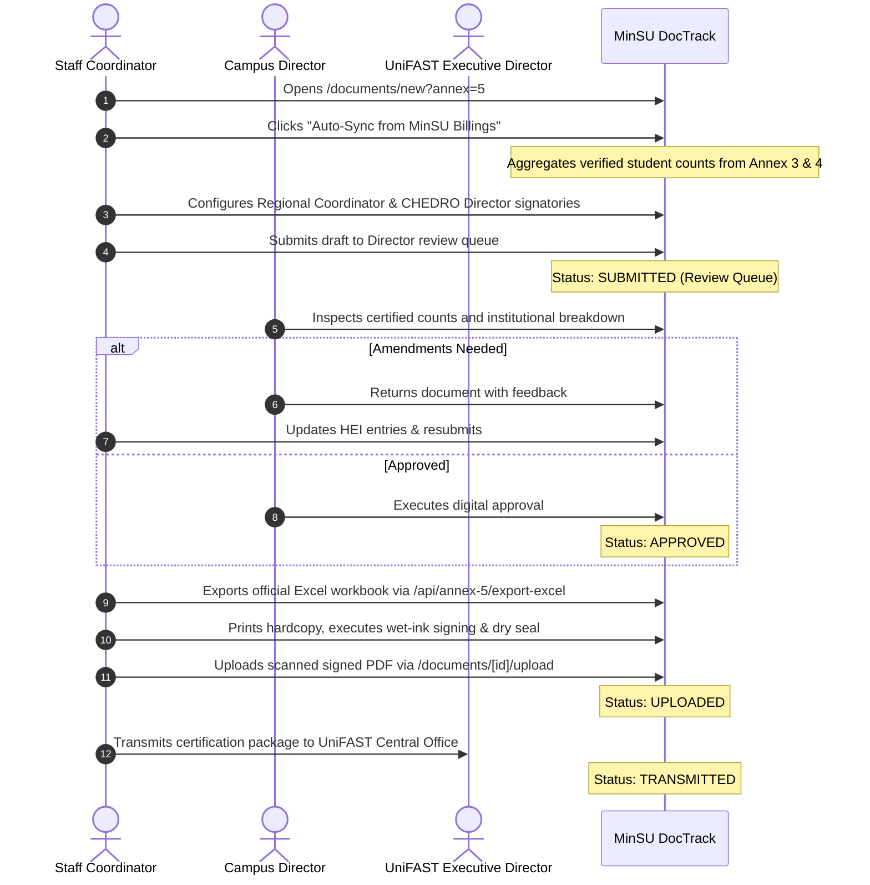

# Annex 05: Regional Endorsement Certification (TDP Form – Annex 5)

> **Document Code:** TDP-ANNEX-05  
> **Official Title:** TDP Form – Annex 5: Regional Certification to UniFAST Secretariat  
> **Source Template:** `Annex5.xlsx` (`Certification` Tab)  
> **Primary Creators:** Staff Coordinator (TDP Regional Focal Person / SUC Coordinator)  
> **Endorsing Authority:** CHEDRO Regional Coordinator & CHEDRO Director IV  
> **Receiving Body:** Atty. Ryan L. Estevez, OIC, Office of the Executive Director IV, UniFAST Secretariat  
> **System Route:** `/documents/new?annex=5`, `/documents/[id]`, `/api/annex-5/export-excel`  

---

## 1. Overview & Institutional Purpose

**Annex 5** serves as the official regional-level certification submitted from the Commission on Higher Education (CHED) Regional Office to the UniFAST Secretariat in Quezon City. While earlier annexes are drafted by individual higher education institutions and transmitted to CHEDRO, Annex 5 represents the consolidated regional endorsement certifying that verified and validated grantees from regional HEIs are qualified for fund release.

Addressed to **Atty. Ryan L. Estevez**, Officer-in-Charge of the Office of the Executive Director IV, UniFAST, the document certifies that:
1. Grantees enrolled in the specified semester and academic year have undergone comprehensive institutional verification and regional validation.
2. The Certificates of Registration (COR) or Registration Forms with Assessment submitted by qualified grantees are authentic and genuine.
3. The certification is issued pursuant to the UniFAST Secretariat Memorandum Order (e.g. MO No. 01 series 2024) to facilitate the release of TDP funds under the Implementing Rules and Regulations (IRR) of **Republic Act No. 10931**.

Within MinSU DocTrack, Annex 5 features an intelligent **Auto-Sync from MinSU Billings** capability, which aggregates verified grantee counts directly from active Annex 3 (Continuing) and Annex 4 (New) billing packages to maintain automated institutional accuracy.

---

## 2. Legal & Regulatory Framework

1. **Republic Act No. 10931 (Universal Access to Quality Tertiary Education Act):** Establishes the statutory framework for tertiary student subsidies and authorizes fund disbursements through UniFAST.
2. **UniFAST Secretariat Memorandum Order No. 01, Series of 2024:** Prescribes the mandatory regional endorsement protocol, verification standards, and authentic COR substantiation requirements.
3. **Commission on Audit (COA) Circular No. 2012-001:** Requires that national educational subsidies released to regional institutions be attested by the regional directorate with certified HEI grantee schedules.

---

## 3. Form Architecture & Data Structure

```mermaid
graph TD
    A3[Annex 3: Continuing Billing Masterlist] -->|Auto-Sync Verified Counts| A5[Annex 5: Regional Certification Suite]
    A4[Annex 4: New Billing Masterlist] -->|Auto-Sync Verified Counts| A5
    A5 -->|Consolidated Regional Schedule| Sheet[Annex 5 Official Sheet Canvas]
    Sheet -->|Single-Tab Workbook| Excel[/api/annex-5/export-excel]
```

### 3.1. Header & Identification Blocks
- **Header Insignia:** Commission on Higher Education (CHED) seal and UniFAST Secretariat logo.
- **Form Label:** Top-right `TDP Form - Annex 5`.
- **Addressee Block:**  
  `FOR: ATTY. RYAN L. ESTEVEZ`  
  `Officer-in-Charge, Office of the Executive Director IV`  
  `UniFAST Secretariat, Ground Floor, Bldg. E, UP Ayala Land Technohub Complex, Quezon City`
- **Endorsement Narrative:** Express endorsement of enrolled TDP beneficiaries in regional HEIs citing the active UniFAST Memorandum Order, Term, and Academic Year.

### 3.2. Regional HEI Grantee Schedule Table
A 4-column master summary table:
1. **SEQ**: Sequential numerical index (e.g. `1, 2, 3...`).
2. **NAME OF HEI**: Full institutional name (e.g. `Mindoro State University`, `Marinduque State College`, `Romblon State University`).
3. **HEI TYPE**: Institutional governance classification (`SUC`, `LUC`, `Private HEI`).
4. **NUMBER TDP GRANTEES**: Verified grantee headcount per institution.
5. **Total**: Dynamic summation row calculating the total regional beneficiary population.

### 3.3. Attestation & Regional Signatories
- **Authenticity Attestation:** Sworn declaration that all submitted Certificates of Registration and enrollment assessment forms are genuine.
- **Signatory Blocks:**
  - **Verified and Validated by:** Regional Coordinator (Scholarship & Grant Unit).
  - **Attested by:** Director IV, CHED Regional Office (e.g. Dr. Edna Imelda F. Legazpi).

---

## 4. Roles, Stakeholders & RBAC Permissions

| Role | System Permission | Action Required |
|---|---|---|
| **Staff Coordinator** | Prepare & Sync (`STAFF`) | Initiates Annex 5, clicks "Auto-Sync from MinSU Billings" to calculate exact grantee counts, adds regional HEI rows, and submits to the review queue. |
| **Accounting Officer** | Budget Review (`ACCOUNTING`) | Inspects total certified grantee counts to cross-verify funding allocation totals under the active GAA budget. |
| **Campus Director** | Executive Review (`CAMPUS_DIRECTOR`) | Validates institutional numbers against university enrollment databases and issues institutional endorsement. |
| **Regional Secretariat** | Regional Validation | Validates regional allocations and submits the signed Annex 5 certification to the UniFAST Executive Director for fund release. |

---

## 5. Step-by-Step Lifecycle Workflow



---

## 6. System & Physical Output Artifacts

1. **Official Single-Tab Excel Workbook:** Downloadable via `/api/annex-5/export-excel?documentId=[id]`, matching the cell formatting, column widths, thin borders, and headers of `Annex5.xlsx`.
2. **Official Printed Endorsement Letter:** Standard government letter layout formatted via `@media print` with dual CHED-UniFAST logos and signature lines.
3. **Audit Trail Record:** Immutable digital log documenting the sync timestamp and preparer credentials.
