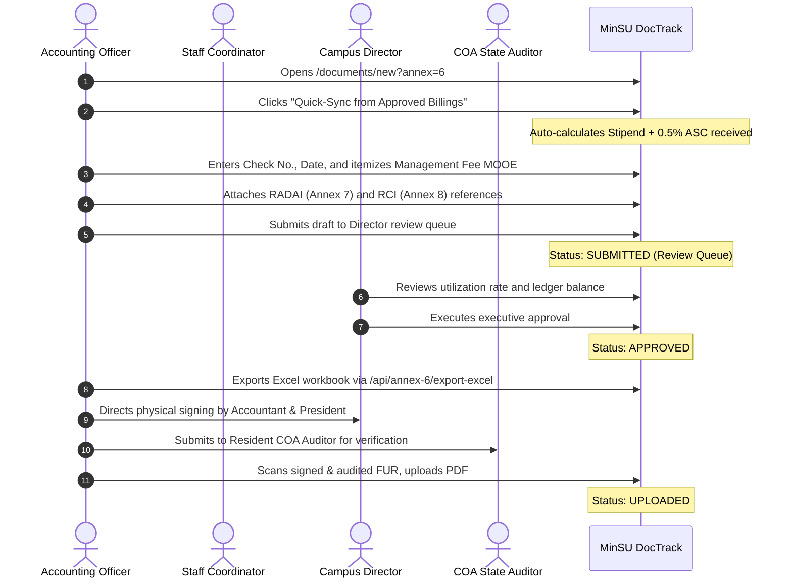

# Annex 06: Fund Utilization Report (FUR)

> **Document Code:** TDP-ANNEX-06  
> **Official Title:** Fund Utilization Report (FUR) & Financial Liquidation  
> **Source Template:** `Annex6.xlsx` (`FUR` Tab)  
> **Primary Creators:** Accounting Officer & Staff Coordinator (`Role.ACCOUNTING`, `Role.STAFF`)  
> **Certifying Authorities:** Chief Accountant, SUC President, Resident COA State Auditor  
> **Approving Authority:** Campus Director  
> **Receiving Body:** Commission on Audit (COA) / UniFAST Financial Management Service / DBM  
> **System Route:** `/documents/new?annex=6`, `/documents/[id]`, `/api/annex-6/export-excel`  

---

## 1. Overview & Institutional Purpose

**Annex 6**, officially titled the **Fund Utilization Report (FUR)**, represents the paramount institutional liquidation, fiscal accountability, and audit compliance document under the Tulong Dunong Program (TDP-TES). It accounts for all financial sub-allotments received by Mindoro State University from the national government (via CHED and UniFAST) and establishes the official liquidation balance against actual student stipend payouts and authorized administrative expenditures.

The FUR is co-managed by the **Accounting Officer** and the **Staff Coordinator**. Crucially, the FUR cites and is legally backed by the attached disbursement reports:
1. **Report of Checks Issued (RCI - Annex 8):** For commercial and MDS checks drawn.
2. **Report of Advice to Debit Account Issued (RADAI - Annex 7):** For electronic bank credit payouts.

Annex 6 itemizes both the **MOOE – Stipend** disbursements paid directly to student scholars and the **MOOE – Management Fee** expenditures utilized by the university for program administration (supplies, communication, monitoring travel, and honoraria).

---

## 2. Legal & Regulatory Framework

1. **COA Circular No. 94-013 & COA Circular No. 2012-001:** Prescribes standard rules and regulations on the grant, utilization, and liquidation of funds transferred to implementing government entities and state universities.
2. **UniFAST Financial Management Guidelines:** Mandates that state universities achieve a minimum fund utilization threshold ($\ge 90\%$) and submit a fully verified FUR before subsequent academic semester sub-allotments can be released.
3. **General Appropriations Act (GAA) Cash Budgeting System:** Dictates annual fund validity periods; unutilized balances beyond the fiscal year must be accounted for or remitted to the National Treasury (BTr).
4. **Government Accounting Manual (GAM for SUCs):** Governs accounting treatments for MOOE student assistance accounts and administrative overhead funds.

---

## 3. Form Architecture & Financial Calculation Model

```mermaid
graph TD
    FundsRec[Funds Received: Check No., Date, Stipend + ASC] --> FUR[Annex 6: Fund Utilization Report FUR]
    RCI[Annex 8: Checks Issued RCI] -->|Supporting Records| Utilized[Less: Fund Utilized]
    RADAI[Annex 7: Debit Advices RADAI] -->|Supporting Records| Utilized
    Utilized -->|MOOE - Stipend Payouts + MOOE - Admin Management Fee| FUR
    FUR --> EndingBal[Ending Unutilized Balance & Triple Signatory Clearance]
    FUR --> Excel[/api/annex-6/export-excel]
```

### 3.1. Header & Institutional Identification
- **Seals:** Commission on Higher Education (CHED) Seal and Mindoro State University Seal.
- **HEI Information:** Name of HEI (`Mindoro State University`), Address of HEI (`Alcate, Victoria, Oriental Mindoro`), Covered Period (`e.g. October 1, 2024 to March 31, 2025`).

### 3.2. Funds Received Section
- **Check Details:** Check Number (e.g. `MDS-2024-009182`) and Check Date.
- **Total Stipend:** Cumulative student stipend allocation received (PHP).
- **Total ASC:** Administrative Support Cost allocation (0.5% management fee).
- **Subtotal Funds Received:** $\text{Total Stipend} + \text{Total ASC}$.

### 3.3. Less: Fund Utilized Section
- **MOOE – Stipend:** Total cash stipends disbursed to verified scholars (mandatorily backed by attached RCI / RADAI reports).
- **MOOE – Management Fee:** Itemized breakdown of administrative operational expenses:
  - Supplies & Materials
  - Communication Expenses (Internet, postage, notifications)
  - Travel & Transportation (On-site campus validation, regional meetings)
  - Honoraria & Overtime Services
  - Other Incidental Expenses
- **Total Funds Utilized:** $\text{MOOE Stipend Utilized} + \text{MOOE Management Fee Utilized}$.

### 3.4. Ending Balance & Utilization Rate
$$\text{Ending Balance} = \text{Subtotal Funds Received} - \text{Total Funds Utilized}$$
$$\text{Utilization Rate (\%)} = \left( \frac{\text{Total Funds Utilized}}{\text{Subtotal Funds Received}} \right) \times 100$$

### 3.5. Triple Signatory Clearance Hierarchy
1. **Certified Correct:** Chief Accountant / Head of Accounting Division.
2. **Approved by:** University President / Campus Director.
3. **Verified by:** Resident COA State Auditor (Commission on Audit).

---

## 4. Roles, Stakeholders & RBAC Permissions

| Role | System Permission | Action Required |
|---|---|---|
| **Accounting Officer** | Lead Co-Author (`ACCOUNTING`) | Cites check numbers, reconciles disbursement ledgers against Annexes 7 and 8, itemizes management fee expenses, and certifies correct. |
| **Staff Coordinator** | Co-Author (`STAFF`) | Confirms total student stipend payouts from Annex 9 payrolls and syncs active billing records. |
| **Campus Director** | Executive Approval (`CAMPUS_DIRECTOR`) | Inspects financial balances, inquires on unutilized balances, and signs as Head of Entity. |
| **COA Resident Auditor** | State Audit Verification | Audits supporting RADAI/RCI disbursement records and executes verification sign-off. |

---

## 5. Step-by-Step Lifecycle Workflow



---

## 6. System & Physical Output Artifacts

1. **Official Single-Tab Excel Workbook:** Downloadable via `/api/annex-6/export-excel?documentId=[id]`, matching the cell formatting, column widths, merged ranges, and double-underline accounting totals of `Annex6.xlsx`.
2. **Standard Government Accounting Paper Canvas:** Formatted via `@media print` with dual insignia and signature blocks.
3. **Liquidation Clearance Certificate:** Official transmittal record enabling the release of subsequent semester funding tranches.
