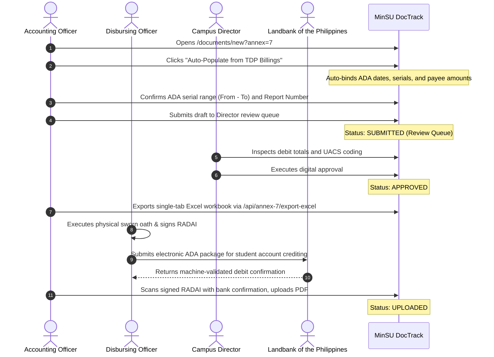

# Annex 07: Report of Advice to Debit Account Issued (RADAI)

> **Document Code:** TDP-ANNEX-07  
> **Official Title:** TDP Form – Annex 7: Report of Advice to Debit Account Issued (RADAI)  
> **Source Template:** `Annex7.xlsx` (`RADAI` Tab)  
> **Primary Creators:** Disbursing Officer, Cashier & Accounting Officer (`Role.ACCOUNTING`, `Role.STAFF`)  
> **Certifying Authority:** Disbursing Officer / Cashier  
> **Approving Authority:** Campus Director  
> **Receiving Body:** Landbank of the Philippines / COA Resident Auditor / UniFAST Finance  
> **System Route:** `/documents/new?annex=7`, `/documents/[id]`, `/api/annex-7/export-excel`  

---

## 1. Overview & Institutional Purpose

**Annex 7**, designated as **TDP Form – Annex 7: Report of Advice to Debit Account Issued (RADAI)**, is the official government banking and cash disbursement report used by Mindoro State University's Disbursing Officer or Cashier to catalog and attest to every Advice to Debit Account (ADA) issued during a covered period.

An Advice to Debit Account (ADA) is the binding electronic instrument instructing the servicing government depository bank (Landbank of the Philippines) to debit the university's Modified Disbursement System (MDS) account and credit the individual ATM accounts of student scholars or institutional payees. 

Crucially, **Annex 7 (RADAI)**, together with **Annex 8 (RCI)**, serves as the mandatory supporting accounting documentation cited directly in the **Fund Utilization Report (FUR - Annex 6)**. Without an authenticated RADAI establishing the serial numbers, disbursement vouchers, and debit amounts, student electronic disbursements cannot be recognized as legally liquidated under state audit rules.

---

## 2. Legal & Regulatory Framework

1. **Executive Order No. 170 (Adoption of Digital Payments for Government Disbursements):** Mandates state universities to utilize electronic payment modalities for the disbursement of student subsidies and benefits.
2. **Government Accounting Manual (GAM) for SUCs (Volume II, Standard Operating Procedures):** Regulates the preparation and submission of the Report of Advice to Debit Account Issued (RADAI) by designated Disbursing Officers.
3. **COA Circular No. 2013-005 (Audit of Electronic Disbursements):** Outlines specific documentary requirements for verifying electronic bank debits, requiring that ADAs be supported by approved payrolls, UACS codes, and bank-validated execution confirmations.
4. **UniFAST Operational Guidelines:** Dictates that electronic debit advices must cite approved billing package numbers and disbursement voucher references.

---

## 3. Form Architecture & Data Structure

```mermaid
graph TD
    Billings[Approved TDP Billings & Payrolls] -->|Auto-Populate Disbursements| RADAI[Annex 7: RADAI Suite]
    RADAI -->|9-Column Accounting Ledger| Canvas[Official RADAI Sheet Canvas]
    Canvas -->|Certifies ADA Serial Range| Oath[Disbursing Officer Sworn Certification Oath]
    Canvas -->|Direct Supporting Schedule| FUR[Annex 6: Fund Utilization Report FUR]
    Canvas -->|Single-Tab Workbook| Excel[/api/annex-7/export-excel]
```

### 3.1. Identification Header
- **Insignia:** Commission on Higher Education (CHED) Seal and UniFAST Secretariat Seal.
- **Top Label:** `TDP Form - Annex 7`.
- **Covered Period:** Period Covered (e.g. `March 1 to March 31, 2026`).
- **Entity Details (Left):** Entity Name (`Mindoro State University`), Fund Cluster (`01 - Regular Agency Fund / 05 - Internally Generated`), Bank Name / Account No. (`Landbank of the Philippines - MDS Account # 1234-5678-90`).
- **Control Metadata (Right):** Report No. (e.g. `RADAI-2026-03-001`), Sheet No. (e.g. `Sheet 1 of 1`).

### 3.2. Nine-Column Accounting Ledger Table
1. **ADA Date:** Date of issuance and banking presentation (`YYYY-MM-DD`).
2. **ADA Serial No.:** Official sequential bank debit advice number (e.g. `ADA-2026-03-0101`).
3. **DV / Payroll No.:** Approved Disbursement Voucher or Annex 9 Payroll reference.
4. **ORS / BURS No.:** Obligation / Budget Utilization Request and Status reference.
5. **Responsibility Center Code:** University cost-center identifier (e.g. `RCC-04-001`).
6. **Payee:** Recipient grantee, Landbank ATM cardholder roster, or Special Disbursing Officer.
7. **UACS Object Code:** Unified Accounts Code Structure classification (e.g. `5-02-02-010 - Scholarships/Grants Expenses`).
8. **Nature of Payment:** Operational description (`TDP-TES Student Stipends - 1st Semester A.Y. 2026-2027`).
9. **Amount:** Debit transfer amount formatted in Philippine Peso (`₱#,##0.00`).
10. **Total Row:** Formal accounting double-underline summation of all ADA debits issued during the period.

### 3.3. Disbursing Officer Sworn Certification Oath
The report concludes with the standard government accounting oath:
> *"I hereby certify that this Report of Advice to Debit Account Issued in **[N]** sheet(s) is a full, true and correct statement of all Advice to Debit Account (ADA) Nos. **[From]** to **[To]** issued by me during the period stated above and that each ADA was made in the prescribed form."*

- **Signatory:** Signature over Printed Name of Disbursing Officer / Cashier, Official Designation, and Date Signed.

---

## 4. Roles, Stakeholders & RBAC Permissions

| Role | System Permission | Action Required |
|---|---|---|
| **Accounting Officer** | Lead Co-Author (`ACCOUNTING`) | Formulates ADA entries, reconciles DV/ORS numbers, checks UACS codes, and auto-populates from approved TDP billings. |
| **Staff Coordinator** | Co-Author (`STAFF`) | Verifies student payee rosters and confirms that bank account details correspond to verified grantees. |
| **Disbursing Officer** | Cashier Certification | Executes the sworn certification oath certifying the integrity of the ADA serial range. |
| **Campus Director** | Executive Oversight (`CAMPUS_DIRECTOR`) | Evaluates the monthly debit schedule as university head and reviews financial velocity. |
| **COA Resident Auditor** | Audit Liquidation | Reconciles the RADAI against bank debit memos and confirms proper citation in the FUR (Annex 6). |

---

## 5. Step-by-Step Lifecycle Workflow



---

## 6. System & Physical Output Artifacts

1. **Official Single-Tab Excel Workbook:** Downloadable via `/api/annex-7/export-excel?documentId=[id]`, reproducing the exact cell coordinates, column widths, thin borders, double-underline accounting total, and bordered certification oath block of `Annex7.xlsx`.
2. **Print-Optimized Sheet Canvas:** Formatted via `@media print` for standard 8.5" × 11" letter sheets with filler rows preserving legal government document height.
3. **Audit Liquidation Support:** Directly links into the Fund Utilization Report (Annex 6) as an immutable audit attachment.
