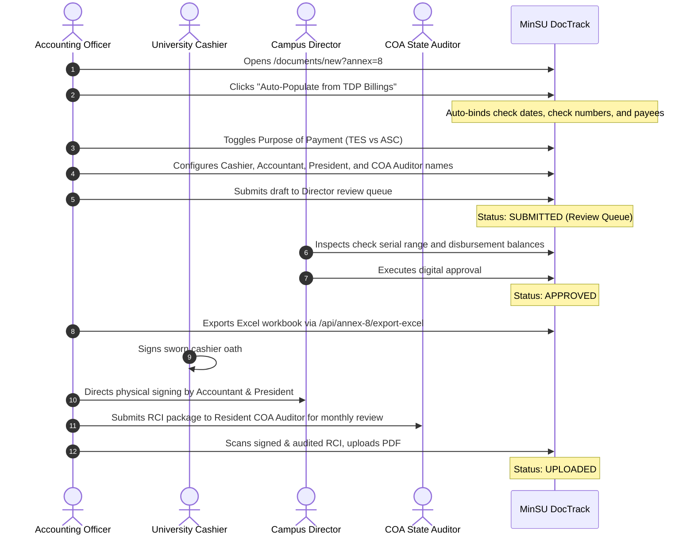

# Annex 08: Report of Checks Issued (RCI)

> **Document Code:** TDP-ANNEX-08  
> **Official Title:** TDP Form – Annex 8: Report of Checks Issued (RCI)  
> **Source Template:** `Annex8.xlsx` (`RCI` Tab) *(Template header discrepancy: labeled "TDP Form – Annex 9" in source)*  
> **Primary Creators:** Cashier, Disbursing Officer & Accounting Officer (`Role.ACCOUNTING`, `Role.STAFF`)  
> **Certifying Authority:** University Cashier (Sworn Certification Oath)  
> **Approving Authorities:** Accountant, University President, Resident COA State Auditor  
> **Receiving Body:** Commission on Audit (COA Resident Auditor) / MinSU Treasury & Cashier  
> **System Route:** `/documents/new?annex=8`, `/documents/[id]`, `/api/annex-8/export-excel`  

---

## 1. Overview & Institutional Purpose

**Annex 8**, officially titled the **Report of Checks Issued (RCI)**, is the formal statutory check register and disbursement report submitted periodically by the University Cashier to record every commercial and Modified Disbursement System (MDS) check drawn on Mindoro State University's bank accounts for Tulong Dunong Program (TDP-TES) payments.

While electronic bank debits (Annex 7) represent electronic payments, physical checks remain vital for:
1. Student beneficiaries in remote island or inland barangays lacking ATM card access or whose accounts are temporarily inactive.
2. Direct cash advance checks issued to university Special Disbursing Officers (SDOs) authorized to conduct supervised on-campus payroll payouts.
3. Administrative management fee payments (ASC) for program supplies, monitoring travel, and communication.

Crucially, **Annex 8 (RCI)** and **Annex 7 (RADAI)** serve as the dual supporting accounting documents mandatorily cited in the **Fund Utilization Report (FUR - Annex 6)**. 

*(Note on Source File Discrepancy: The official template file is named `Annex8.xlsx` with tab `RCI`, though its internal header text carries a legacy label of "TDP Form – Annex 9". MinSU DocTrack standardizes this as TDP Form - Annex 8: Report of Checks Issued.)*

---

## 2. Legal & Regulatory Framework

1. **COA Circular No. 97-002 & Government Accounting Manual (GAM for SUCs):** Dictates that all checks drawn by government cashier units must be recorded sequentially in an RCI and submitted to the Resident Auditor within the first ten (10) days of the succeeding month.
2. **Treasury Circular No. 02-2009:** Governs the validity of government commercial checks (valid for 6 months from issue date before becoming stale and requiring cancellation or replacement).
3. **UniFAST Financial Liquidation Framework:** Requires that physical check disbursements be linked directly to signed student payroll acknowledgments (Annex 9) before liquidation credit is recognized.

---

## 3. Form Architecture & Data Structure

```mermaid
graph TD
    Billings[Approved TDP Billings & Payrolls] -->|Auto-Populate Check Disbursements| RCI[Annex 8: RCI Suite]
    RCI -->|Check Register Ledger Table| Canvas[Official RCI Sheet Canvas]
    Canvas -->|Certifies Check Serial Range| CashierOath[Cashier Sworn Certification Oath]
    Canvas -->|Tri-Block Executive Clearance| Signatories[Accountant, President & COA Auditor]
    Canvas -->|Supporting Disbursement Schedule| FUR[Annex 6: Fund Utilization Report FUR]
    Canvas -->|Single-Tab Workbook| Excel[/api/annex-8/export-excel]
```

### 3.1. Header & Institutional Identification
- **Header Insignia:** Commission on Higher Education (CHED) Seal and UniFAST/Institutional Seal.
- **Top Label:** `TDP Form - Annex 8 (RCI)`.
- **Institutional Metadata:** Name of HEI (`Mindoro State University`), Address of HEI (`Alcate, Victoria, Oriental Mindoro`), Date of Report.
- **Identification Fields:** HEI Name on the left, Report No. (e.g. `RCI-2026-03-001`) and Sheet No. (`Sheet 1 of 1`) on the right.

### 3.2. Check Register Table
1. **Check Date:** Date check was drawn and issued (`YYYY-MM-DD`).
2. **Check No.:** Official 7-digit bank check serial number (e.g. `0001001`).
3. **DV / Payroll No.:** Approved Disbursement Voucher or Annex 9 Payroll reference.
4. **Payee:** Payee name (student scholar, SDO, or institutional supplier).
5. **Purpose of Payment:** Strict classification between **TES** (student stipend grant) and **ASC** (administrative support cost / management fee).
6. **Amount:** Check face value formatted in Philippine Peso (`₱#,##0.00`).
7. **Total Row:** Formal accounting double-underline summation of all checks issued during the period.

### 3.3. Cashier Sworn Certification Oath
A bordered sworn oath box:
> *"I hereby certify that this Report of Checks Issued in **[N]** sheet(s) is a full, true and correct statement of all checks issued by me during the period stated above and that each check was made in the prescribed form."*

- **Signatory:** Signature over Printed Name of Cashier / Disbursing Officer, Date Signed.

### 3.4. Quadruple Administrative Signatory Hierarchy
Below the cashier certification box, three executive authorities endorse the register:
1. **Certified Correct:** University Chief Accountant.
2. **Approved:** University President / Campus Director.
3. **Verified:** Resident COA State Auditor (with Official Auditor Title e.g. *State Auditor IV, Audit Team Leader*).

---

## 4. Roles, Stakeholders & RBAC Permissions

| Role | System Permission | Action Required |
|---|---|---|
| **Accounting Officer** | Co-Author (`ACCOUNTING`) | Compiles check numbers from cashier logs, verifies sequential continuity, classifies TES vs ASC, and auto-populates from billing packages. |
| **Cashier / Disbursing Officer** | Custodian & Certifier | Writes physical checks, signs the sworn certification oath, and maintains physical checkbook stubs. |
| **Campus Director** | Executive Approval (`CAMPUS_DIRECTOR`) | Inspects check register totals, reviews cancellations and voided checks, and signs as University Head. |
| **COA Resident Auditor** | State Audit Examination | Reconciles the RCI against cancelled checks, bank statements, and the FUR (Annex 6). |

---

## 5. Step-by-Step Lifecycle Workflow



---

## 6. System & Physical Output Artifacts

1. **Official Single-Tab Excel Workbook:** Downloadable via `/api/annex-8/export-excel?documentId=[id]`, reproducing the exact cell coordinates, column widths, thin borders, double-underline accounting total, and bordered cashier oath block of `Annex8.xlsx`.
2. **Print-Optimized Sheet Canvas:** Formatted via `@media print` with filler rows preserving standard 8.5" × 11" letter page dimensions.
3. **Audit Attachment:** Serves as the mandatory supporting schedule for the Fund Utilization Report (Annex 6).
