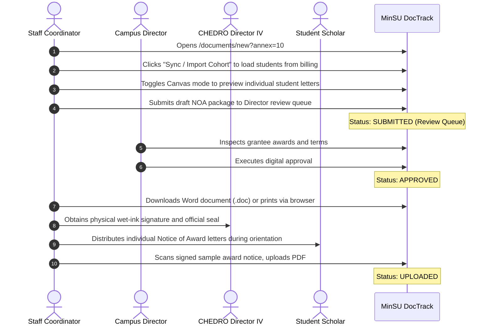

# Annex 10: Notice of Award (NOA)

> **Document Code:** TDP-ANNEX-10  
> **Official Title:** TDP Form – Annex 10: Notice of Award (NOA) *(Template ref: Annex 3 - NOA)*  
> **Source Template:** `Annex10.docx` (Single-Page Government Award Notice Letter)  
> **Primary Creators:** Staff Coordinator (TDP Regional / Institutional Coordinator)  
> **Endorsing Authority:** Director IV / Officer-in-Charge, CHED Regional Office MIMAROPA  
> **Approving Authority:** Campus Director  
> **Receiving Body:** Student Awardee / Grantee  
> **System Route:** `/documents/new?annex=10`, `/documents/[id]`, `/api/annex-10/export-doc`  

---

## 1. Overview & Institutional Purpose

**Annex 10**, officially titled the **Notice of Award (NOA)**, is the formal bilateral grant notice issued by the Commission on Higher Education (CHED) and the UniFAST Regional Office to a student confirming their qualification as an official scholar under the **Tulong Dunong Program under the Tertiary Education Subsidy (TDP-TES)**.

Unlike the multi-column financial ledgers and billing spreadsheets of earlier annexes, Annex 10 is an official, single-page executive award letter. It notifies the student of their unique **TDP Award Number**, establishes their entitlement to **PHP 7,500.00 per semester**, defines the starting academic term and school year, and articulates the six (6) mandatory statutory retention conditions governing grant continuation or termination.

Under MinSU DocTrack, Annex 10 is implemented as an Apple-inspired fluid interactive suite supporting:
- **Individual Scholar Customization:** In-line editing of individual student award parameters and instant letter canvas preview.
- **Cohort Batch Generation & Auto-Sync:** 1-click import from approved Annex 3 / Annex 4 billing packages to generate personalized award notices for entire student cohorts.
- **Batch Print Mode:** Sequential multi-page print layout formatted for standard 8.5" × 11" letter sheets.
- **Microsoft Word (.doc) Export:** Dedicated export endpoint producing fully formatted Word documents matching `Annex10.docx`.

*(Note on Header Label Discrepancy: The Word document template is named `Annex10.docx`, while its top-right corner carries the legacy label `Annex 3 - NOA`. MinSU DocTrack provides an interactive selector allowing users to display `TDP Form – Annex 10 (NOA)` prominently, preserve the exact template label `Annex 3 - NOA`, or display both.)*

---

## 2. Legal & Regulatory Framework

1. **Republic Act No. 10931 (Universal Access to Quality Tertiary Education Act):** Establishes the Tertiary Education Subsidy (TES) and Tulong Dunong Program (TDP).
2. **UniFAST Memorandum Order No. 03, Series of 2024 (Section 9):** Prescribes the grounds, conditions, and administrative due process for the termination and forfeiture of student grants.
3. **General Appropriations Act (GAA):** Governs statutory funding availability and cash ceiling allocations for student financial assistance.
4. **CHED-UniFAST Grantee Retention Rules:** Regulates maximum residency periods, degree completion timelines, and leaves of absence (LOA).

---

## 3. Letterhead Architecture & Document Canvas

```mermaid
graph TD
    Billing[Approved Annex 3 / 4 Billing Packages] -->|1-Click Cohort Sync| Suite[Annex 10: NOA Suite]
    Suite -->|Interactive Table, Parameters & Signatories| Workspace[Workspace Mode]
    Suite -->|Single Scholar or Cohort Batch| Canvas[Official Letter Canvas]
    Canvas -->|Microsoft Word Export| Word[/api/annex-10/export-doc]
    Canvas -->|High-Fidelity PDF / Print| PrintEngine[Browser Print Engine @media print]
```

### 3.1. Corner Identification Metadata
- **Top-Left:** `CHED-UniFAST-NOA`.
- **Top-Right:** Selectable between `TDP Form – Annex 10 (NOA)` and `Annex 3 - NOA`.

### 3.2. Official Letterhead
- **Left Seal:** Commission on Higher Education (CHED) official seal.
- **Center Text:**
  - `Republic of the Philippines`
  - `UNIFIED STUDENT FINANCIAL ASSISTANCE SYSTEM FOR TERTIARY EDUCATION`
  - `Ground Floor, Bldg. E, UP Ayala Land Technohub Complex, Commonwealth Ave., Diliman, Quezon City`
  - `Email: unifastsecretariat@ched.gov.ph`
- **Right Seal:** UniFAST Secretariat official emblem.
- **Title Banner:**
  `TULONG DUNONG PROGRAM UNDER THE TERTIARY EDUCATION SUBSIDY (TDP-TES)`  
  `NOTICE OF AWARD`

### 3.3. Addressee Block
- Calendar Date of Issuance (e.g. `October 28, 2026`).
- Grantee Full Name in bold uppercase (e.g. `JUAN P. DELA CRUZ`).
- Address (Barangay / Street).
- City / Municipality & Postal Code (e.g. `Calapan City, Oriental Mindoro, 5200`).
- Salutation (e.g. `Dear Mr. Dela Cruz:`).

### 3.4. Award Entitlement Paragraph
> *"We are pleased to inform that you are qualified as a TDP-TES grantee with Award No. **TDP-TES[Award No.]**. Subject to availability of funds as provided in the General Appropriations Act and provisions of issuances issued by CHED/UniFAST, you will receive PhP 7,500 per semester starting the **[1st/2nd] Semester of AY [YYYY-YYYY]**. Once qualified, a TDP grantee will continue to receive grants provided that you are enrolled every semester and complies with the documentary requirements, and retention policy of his Higher Education Institution pursuant to the maximum residency rule."*

### 3.5. Six (6) Statutory Compliance Conditions
As a TDP-TES grantee, the student must strictly comply with:
1. **Retention Policy:** Meet the academic retention policy of your HEI;
2. **Transfer / Deferment Approval:** Secure approval from this CHED Regional Office (CHEDRO) for the deferment of your grant or your transfer to another program or College/University;
3. **Leave of Absence (LOA):** Secure an approved leave of absence (LOA) in case of unforeseen circumstances that may prevent enrollment for one term, such as health issues, personal emergencies, or other significant commitments requiring temporary withdrawal from academic responsibilities;
4. **On-Time Completion:** Complete the degree program on time or a year after the period prescribed in their program pursuant to the maximum residency rule;
5. **Authentic Credentials:** Submit only genuine and not falsified or fake documents; and
6. **Non-Duplication:** Not avail of multiple national government-funded assistance, except for Free Higher Education in SUCs and LUCs under R.A. No. 10931 or the Universal Access to Quality Tertiary Education Act and DSWD Assistance to Individuals in Crisis Situation (AICS).

### 3.6. Termination Warning Clause
> *"Please be advised that failure to comply with the above conditions will be grounds for the termination of your grants per Sec. 9 of the UniFAST Memorandum Order No. 3 series 2024."*

### 3.7. Regional Directorate Signature Block
- `Very truly yours,`
- Signature over Printed Name: `[CHEDRO DIRECTOR OR OIC]` (e.g. `DR. EDNA IMELDA F. LEGAZPI`).
- Position: `Director IV`.
- Office: `Office of the Director IV, [CHED Regional Office MIMAROPA]`.

### 3.8. Non-Sale Statutory Footer
Centered in bold italics:  
`***This Notice of Award is not for sale and is issued only once to qualified applicants.***`

---

## 4. Roles, Stakeholders & RBAC Permissions

| Role | System Permission | Action Required |
|---|---|---|
| **Staff Coordinator** | Prepare & Issue (`STAFF`) | Syncs grantees from approved billing rosters, edits notice dates and award numbers, reviews letter canvases, and submits to the review queue. |
| **Campus Director** | Executive Review (`CAMPUS_DIRECTOR`) | Inspects student qualification criteria, confirms institutional quota alignment, and executes digital approval. |
| **CHEDRO Director IV** | Legal Signatory | Executes final official signature and seal on the physical Notice of Award letters. |
| **Student Beneficiary** | Recipient (`STUDENT`) | Receives the signed award notice, preserves their copy, and references the Award Number in future semester continuing billings. |

---

## 5. Step-by-Step Lifecycle Workflow



---

## 6. System & Physical Output Artifacts

1. **Official Microsoft Word Document (.doc):** Downloadable via `/api/annex-10/export-doc`, producing a native Word document matching `Annex10.docx` with XML layout namespaces for single or batch grantee exports.
2. **High-Fidelity Printable Canvas:** Formatted via `@media print` with responsive typography, vector seals, and automated page breaks for bulk printing.
3. **Grantee Award Registry:** Permanent digital database link binding each student's TDP Award Number for subsequent semester continuing claims (Annex 3).
