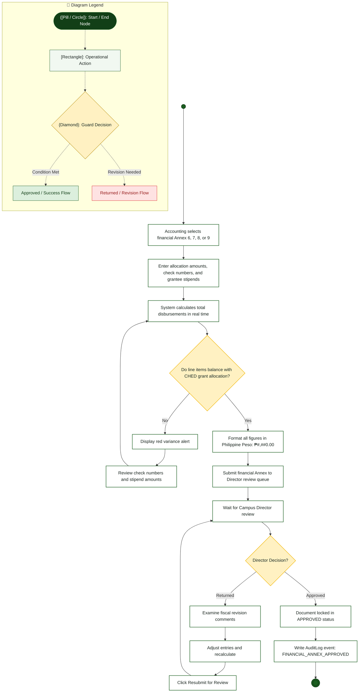

# Accounting Officer — Activity Diagram

> **Role:** `ACCOUNTING`  
> **Diagram Type:** Activity Diagram  
> **Workflow:** Financial Reconciliation & Fiscal Submission Workflow

---

## 1. Purpose

The Activity Diagram shows the step-by-step workflow followed by the Accounting Officer to reconcile grant disbursements, verify peso totals, and submit financial Annexes.

---

## 2. Mermaid Activity Diagram

---

## 3. Diagram Legend & Symbol Guide

| Visual Symbol | Syntax / Node Type | Technical Role | MinSU Domain Meaning |
|---|---|---|---|
| `([Pill / Circle])` | `([Start / End])` / `(( ))` | Initial or terminal workflow boundary | Workflow entry point, queue initiation, terminal archive closure |
| `[Rectangle]` | `["Action"]` | Operational task or software routine | Inspecting forms, computing sums, generating receipt, updating status |
| `{Diamond}` | `{"Decision"}` | Mutually exclusive condition / guard | "Compliance verified?", "Variance == 0.00?", "Quota available?" |
| `──▶` | Solid Line `-->` | Sequential flow transition | Standard forward progression between operational activities |
| `-->|Label|` | Guarded Branch | Conditional execution path | "Yes / Approved", "No / Return with Remarks" |
| 🔲 Subgraph | `subgraph Lane` | Departmental Swimlane Boundary | Segregates duties across roles and authority boundaries |
| 🟢 Green Tone | `#DCEFDD` / `#1B5E20` | Approved State / Forward Flow | Validated submissions, executive approvals, zero-variance checks |
| 🟡 Gold Tone | `#FFF1C2` / `#B88A00` | Evaluation / Inspection Gate | Review queues, quota verification, decision checkpoints |
| 🔴 Red / Rose Tone | `#FEE2E2` / `#DC2626` | Return / Discrepancy Alert | Ineligible applications, returned documents, ledger adjustments |

---

## 4. Workflow Steps

1. Accounting Officer opens the financial document form.
2. Officer inputs LandBank debit accounts, check numbers, and grantee stipends.
3. System automatically calculates sums and remaining balances.
4. If a variance exists between allocation and disbursement, the system alerts the user.
5. Officer adjusts line items until the balance matches zero variance.
6. System formats all amounts as Philippine Peso (`₱#,##0.00`).
7. Officer submits the Annex to the Director's review queue.
8. If returned, Officer adjusts figures according to feedback and resubmits.
9. Upon approval, the document locks against further modifications.
