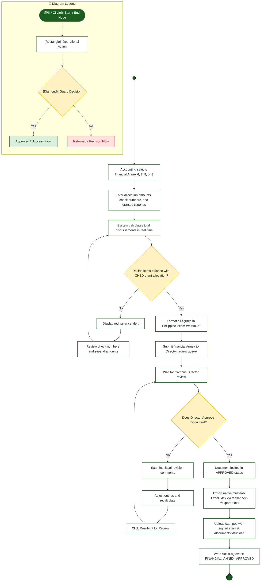
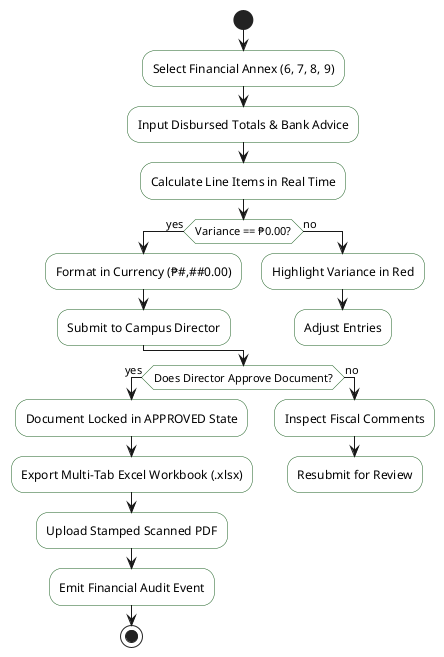

# Accounting Officer — Activity Diagram

> **Role:** `ACCOUNTING`  
> **Diagram Type:** Activity Diagram  
> **Workflow:** Financial Reconciliation, Fiscal Submission & Native Excel Export

---

## 1. Purpose

The Activity Diagram shows the step-by-step workflow followed by the Accounting Officer to reconcile grant disbursements, verify peso totals, submit financial Annexes, and export native multi-tab Excel workbooks.

---

## 2. Mermaid Activity Diagram

---

## 3. Diagram Legend & Symbol Guide

| Visual Symbol | Syntax / Style | UML Activity Concept | MinSU System Implementation |
|---|---|---|---|
| `Start / End` | `(( ))` / `((( )))` | Initial / Final State | Financial workflow begins at Annex selection and ends at signed audit logging |
| `Action` | `[Rectangle]` | Accounting Procedure | Input Data, Calculate Totals, Format Currency, Submit, Export Excel |
| `Decision` | `{Diamond}` | Guard Evaluation | Zero-variance check against grant allocation; Director endorsement decision |

---

## 4. PlantUML Activity Diagram

