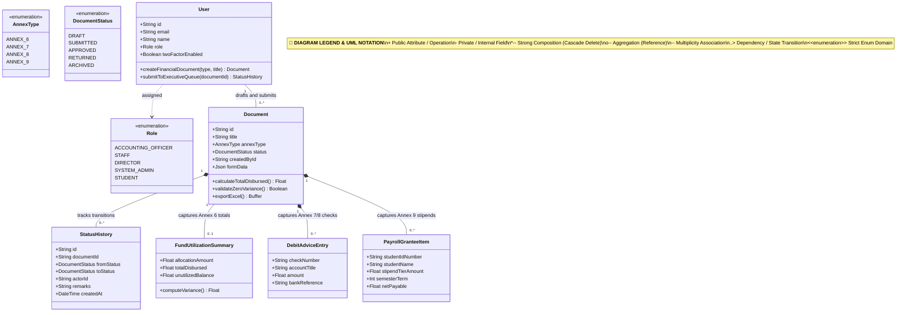

# Accounting Officer — Class Diagram

> **Role:** `ACCOUNTING_OFFICER`  
> **Diagram Type:** Class Diagram  
> **Standard:** UML 2.5 Class Specification

---

## 1. Purpose

The Class Diagram shows the domain models, attributes, operations, and relationships for the Accounting Officer role. It defines entities that manage financial reports (Annexes 6, 7, 8, and 9), zero-variance ledger balancing, multi-tab Excel exports, and 2FA authentication.

---

## 2. Mermaid Class Diagram

---

## 3. Diagram Legend & Symbol Guide

| Symbol / UML Notation | Meaning & Syntax | Technical Function | MinSU Domain Example |
|---|---|---|---|
| `+` | Public Visibility | Readable attribute or callable method | `+validateZeroVariance()`, `+exportExcel()` |
| `-` | Private Visibility | Encapsulated field | Internal hash codes, session secrets |
| `<<enumeration>>` | Enum Classifier | Strict closed set of categorical values | `AnnexType` (`ANNEX_6`, `ANNEX_7`, `ANNEX_8`, `ANNEX_9`) |
| `*--` | Strong Composition | Lifecycle containment (child deleted on parent deletion) | `Document *-- PayrollGranteeItem` |
| `--` | Multiplicity Association | Association relationship between classes | One accounting officer prepares many financial reports |

---

## 4. Operations & Domain Rules

- `validateZeroVariance()` verifies that total disbursed amounts match the official grant allocation down to 0.00 Philippine Pesos.
- `calculateTotalDisbursed()` computes line item sums across checking and debit entries in real time.
- `exportExcel()` invokes `ExcelJS` to stream multi-tab workbooks with automated sum formulas.
- `submitToExecutiveQueue()` elevates balanced financial documents to the Campus Director for endorsement.
