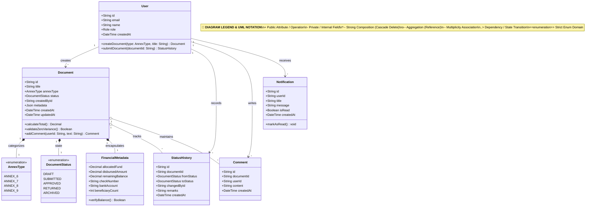

# Class Diagram: Accounting Officer Domain

## 1. Description
This class diagram models the object-oriented structure of the Accounting Officer domain. It defines entities that manage financial reports (Annex 6 Fund Utilization, Annex 7 Advice to Debit Account, Annex 8 Checks Issued, and Annex 9 Beneficiary Payroll). The model enforces Philippine Peso precision, double-entry balance rules, and approval state tracking.

## 2. ASD-STE100 Technical Specifications
- Keep all currency calculations aligned to two decimal places.
- Link each financial document to an accounting author user instance.
- Track all status modifications through immutable history records.
- Notify coordinators and directors during balance transitions.

## 3. Class Diagram (Mermaid)

---

## 4. Diagram Legend & Symbol Guide

| Symbol / UML Notation | Meaning & Syntax | Technical Function | MinSU Domain Example |
|---|---|---|---|
| `+` | Public Visibility | Readable attribute or callable method | `+id`, `+title`, `+submitDocument()`, `+validateZeroVariance()` |
| `-` | Private Visibility | Encapsulated field | Password hashes, system flags, sensitive session tokens |
| `<<enumeration>>` | Enum Classifier | Strict closed set of categorical values | `Role` (`DIRECTOR`, `STAFF`), `DocumentStatus` (`APPROVED`, `SUBMITTED`) |
| `*--` | Strong Composition | Lifecycle containment (child deleted on parent deletion) | `Document *-- StatusHistory`, `Document *-- Comment` |
| `o--` | Weak Aggregation | Referenced association without ownership | `Document o-- User` (Document references author) |
| `--` | Association (`"1" -- "*"`) | Multiplicity mapping between database entities | One user creates many documents or receives notifications |
| `..>` | Dependency | Usage or transition relationship | Domain model transitioning document lifecycle states |

## 5. Entity Responsibilities
- **User (Accounting)**: Submits fund utilization ledgers and balance reconciliations.
- **Document**: Stores core financial metadata, Annex identifiers, and workflow progress.
- **FinancialMetadata**: Contains fund allocation, disbursement totals, check numbers, and recipient tallies.
- **StatusHistory**: Preserves audit trails of financial status changes with timestamps and user identifiers.
