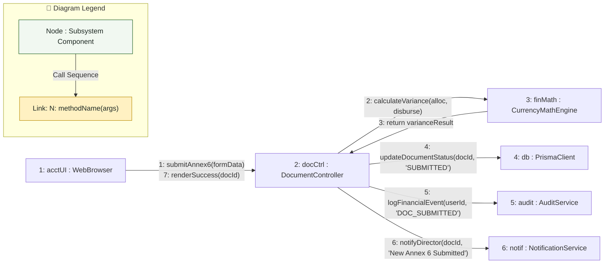

# Communication Diagram: Accounting Officer Domain

## 1. Description
This communication diagram visualizes the structural associations and numbered message exchanges between collaborating objects during an Annex 6 Fund Utilization reconciliation performed by the Accounting Officer.

## 2. ASD-STE100 Technical Specifications
- Number messages sequentially to show execution order.
- Connect collaborating instances through explicit structural links.
- Record audit trails and notification dispatches during financial ledger updates.

## 3. Communication Diagram (Mermaid)

---

## 4. Diagram Legend & Symbol Guide

| Element | Format / Syntax | Technical Meaning | MinSU Implementation Context |
|---|---|---|---|
| Subsystem Node | `[N: name : Class]` | Structural software participant | Controllers, Workflow Engines, Prisma Client, Storage Adapters |
| Link Connector | `-- "..." -->` | Directed communication channel | HTTP request, RPC method call, or database query |
| Numbered Prefix | `1:`, `2:`, `10:` | Chronological message sequence number | Sequential execution order from client event to persistence and UI update |
| Method Signature | `methodName(params)` | Invoked operation contract | `verifyRole(token)`, `checkVariance()`, `writeAuditLog()` |
| 🟢 Green Tone | `#F1F8F1` / `#1B5E20` | Core Subsystem Component | Institutional controllers, persistence adapters, and business engines |
| 🟡 Gold Tone | `#FFF1C2` / `#B88A00` | Guard & Dispatch Relay | Access guards, validation checks, and notification dispatchers |

## 5. Message Sequence Description
- **1**: The Accounting Officer triggers submission of Annex 6 Fund Utilization through the browser interface.
- **2-3**: The controller requests variance calculation from the `CurrencyMathEngine` and verifies 0.00 discrepancy.
- **4**: The controller commits the status change to `SUBMITTED` in the relational database.
- **5**: An immutable audit log entry is recorded for security monitoring.
- **6**: The notification service alerts the Campus Director that an executive financial review is waiting.
- **7**: The browser displays a success confirmation badge to the Accounting Officer.
