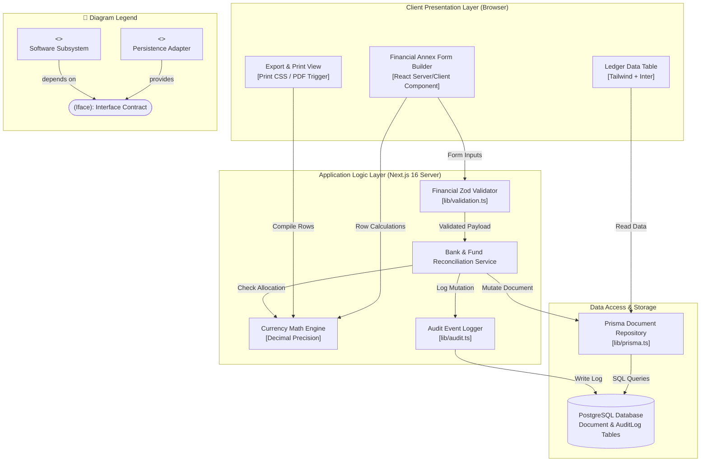

# Component Diagram: Accounting Officer Domain

## 1. Description
This component diagram models the modular software architecture that supports the Accounting Officer subsystem. It shows the client-side financial interface, calculation engines, server actions, and persistence layers that process Annexes 6, 7, 8, and 9.

## 2. ASD-STE100 Technical Specifications
- Separate data presentation from mathematical calculation logic.
- Execute server-side transaction verifications inside the database wrapper.
- Cache currency exchange and formatting filters in dedicated helpers.
- Transmit all audit logs directly to the security logger.

## 3. Component Diagram (Mermaid)

---

## 4. Diagram Legend & Symbol Guide

| Visual Symbol | Syntax / Style | Technical Role | MinSU Architecture Mapping |
|---|---|---|---|
| `<<component>>` Box | `fill:#FFFFFF, stroke:#1B5E20` | Architectural subsystem or service module | Views, Controllers, Auth Services, Document Engines |
| `([Interface Circle])` | `fill:#DCEFDD, stroke:#123F17` | Provided / Required Interface Contract | `IAuthSession`, `IRBACGuard`, `IDocumentWorkflow`, `IDataAccess` |
| 🟨 Data Component | `fill:#FFF1C2, stroke:#F2B705` | Persistence & Storage adapter component | Prisma ORM Client, Local Storage Volume, Google Drive Client |
| `-->` Solid Arrow | Dependency / Consumer | Module calls or requires the interface | View components requiring workflow and auth interfaces |
| `-- provides -->` | Realization / Provider | Module implements or provides the interface | Service layer realizing database or workflow contracts |
| Boundary Subgraph | `subgraph LAYER` | Architectural tier / layer grouping | Presentation, Security, Domain Logic, and Persistence Layers |

## 5. Component Interfaces
- **Currency Math Engine**: Calculates row sums, deductions, and variance against approved agency grants.
- **Bank & Fund Reconciliation Service**: Verifies check disbursements against bank debit allocations.
- **Financial Zod Validator**: Rejects negative balances, missing check numbers, and invalid date entries.
- **Prisma Document Repository**: Persists verified financial ledgers into relational tables.
