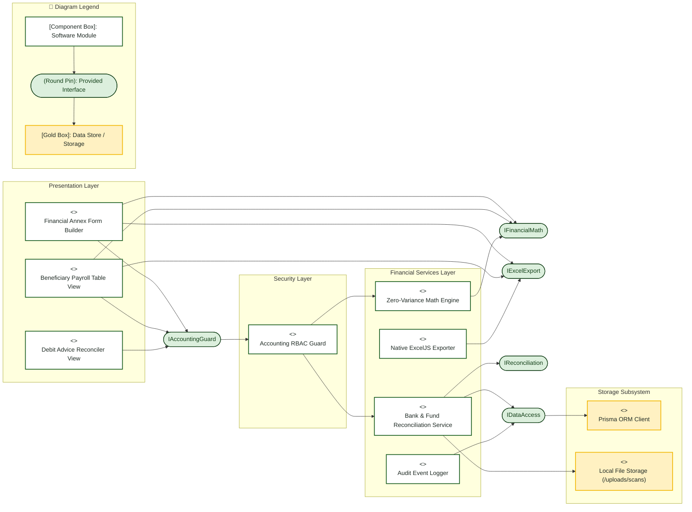

# Accounting Officer — Component Diagram

> **Role:** `ACCOUNTING_OFFICER`  
> **Diagram Type:** Component Diagram  
> **Standard:** UML 2.5 Component Specification

---

## 1. Purpose

The Component Diagram shows the software components, provided interfaces, and required dependencies within the Accounting Officer subsystem, managing Annexes 6, 7, 8, and 9 with zero-variance balancing and native multi-tab Excel generation.

---

## 2. Mermaid Component Diagram

---

## 3. Diagram Legend & Symbol Guide

| Visual Symbol | Syntax / Style | UML Component Meaning | MinSU Implementation |
|---|---|---|---|
| `[Component]` | `["<<component>>\nName"]` | Autonomous modular unit with internal logic | Zero-Variance Math Engine, ExcelJS Exporter, Reconciliation Service |
| `(Interface)` | `(["IName"])` | Formal contract or API boundary | `IFinancialMath`, `IExcelExport`, `IReconciliation` |
| `Solid Arrow` | `-->` | Direct dependency or invocation | Financial UI invokes calculation and export services |
| `Data Component` | Gold Tone `#FFF1C2` | Persistence or storage component | Prisma ORM client adapter |

---

## 4. Component Responsibilities

- **Financial Annex Form Builder (`FinancialUI`)**: Renders dynamic ledgers for Annexes 6, 7, 8, and 9 with real-time currency formatting.
- **Zero-Variance Math Engine (`VarianceEngine`)**: Compares line items against official grant allocations down to 0.00 Philippine Pesos.
- **Native ExcelJS Exporter (`ExcelExporter`)**: Compiles disbursement rosters into native multi-tab `.xlsx` workbooks with dynamic sum formulas.
- **Bank & Fund Reconciliation Service (`ReconcileService`)**: Reconciles Landbank electronic debit advices and MDS check numbers.
