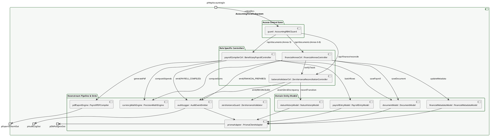

# Composite Structure Diagram: Accounting Officer Domain

> **Role:** `ACCOUNTING` (`ACCOUNTING_OFFICER`)  
> **Diagram Type:** Composite Structure Diagram  
> **Classifier:** `AccountingFiscalSubsystem`

---

## 1. Purpose

This Composite Structure Diagram depicts the internal architecture of the `AccountingFiscalSubsystem`. It shows how incoming financial operations route through the accounting access gate to specific controllers, how controllers connect to operational domain models, and where data moves downstream to high-precision calculation engines, zero-variance reconciliation validators, PDF payroll compilers, and transactional database persistence.

---

## 2. Mermaid Composite Structure Diagram

```mermaid
flowchart TB
    %% Styling Classes
    classDef classifierStyle fill:#F6F8F6,stroke:#1B5E20,stroke-width:2.5px,color:#1F2A24
    classDef portStyle fill:#FFF1C2,stroke:#F2B705,stroke-width:2px,color:#1F2A24
    classDef guardStyle fill:#F1F8F1,stroke:#1B5E20,stroke-width:1.5px,color:#123F17
    classDef ctrlStyle fill:#EFF6FF,stroke:#2563EB,stroke-width:1.5px,color:#1E3A8A
    classDef modelStyle fill:#FAF5FF,stroke:#9333EA,stroke-width:1.5px,color:#581C87
    classDef svcStyle fill:#FEFCE8,stroke:#CA8A04,stroke-width:1.5px,color:#713F12
    classDef adapterStyle fill:#DCEFDD,stroke:#164D1C,stroke-width:2px,color:#123F17

    subgraph SUBSYSTEM["«classifier» AccountingFiscalSubsystem"]
        direction TB

        %% Boundary Ingress Port
        pHttpAccountingIn["Port: pHttpAccountingIn<br/>(Accounting HTTP Actions / Financial APIs)"]:::portStyle

        %% Layer 1: Security & RBAC Gate
        subgraph LAYER_SECURITY ["Access Control Gate"]
            guard["guard : AccountingRBACGuard<br/>• verifySessionToken()<br/>• enforceRole('ACCOUNTING')"]:::guardStyle
        end

        %% Layer 2: Role Specific Controllers
        subgraph LAYER_CONTROLLERS ["Role Specific Controllers"]
            financialAnnexCtrl["financialAnnexCtrl : FinancialAnnexController<br/>• prepareAnnex6FundUtilization()<br/>• draftAnnex7AdviceToDebit()<br/>• recordAnnex8ChecksIssued()"]:::ctrlStyle

            payrollCompilerCtrl["payrollCompilerCtrl : BeneficiaryPayrollController<br/>• importStudentBeneficiaries()<br/>• calculateStipendDeductions()<br/>• compileAnnex9Payroll()"]:::ctrlStyle

            balanceValidatorCtrl["balanceValidatorCtrl : ZeroVarianceReconciliationController<br/>• compareAllocatedVsDisbursed()<br/>• verifyCheckBatchTotals()<br/>• enforceZeroDiscrepancy()"]:::ctrlStyle
        end

        %% Layer 3: Domain Entity Models
        subgraph LAYER_MODELS ["Domain Entity Models"]
            documentModel["documentModel : DocumentModel<br/>- id: String<br/>- title: String<br/>- annexType: 'ANNEX_6'..'ANNEX_9'<br/>- status: DocumentStatus<br/>- metadata: Json"]:::modelStyle

            financialMetadataModel["financialMetadataModel : FinancialMetadataModel<br/>- checkNumber: String<br/>- bankAccount: String<br/>- allocatedAmount: Decimal<br/>- disbursedAmount: Decimal<br/>- varianceAmount: Decimal"]:::modelStyle

            payrollEntryModel["payrollEntryModel : PayrollEntryModel<br/>- studentNumber: String<br/>- studentName: String<br/>- stipendAmount: Decimal<br/>- semester: String<br/>- payrollStatus: String"]:::modelStyle

            statusHistoryModel["statusHistoryModel : StatusHistoryModel<br/>- id: String<br/>- documentId: String<br/>- fromStatus: DocumentStatus<br/>- toStatus: DocumentStatus<br/>- remarks: String"]:::modelStyle
        end

        %% Layer 4: Downstream Services & Persistence ("Where it goes after")
        subgraph LAYER_DOWNSTREAM ["Downstream Pipeline & Export Sinks"]
            currencyMathEngine["currencyMathEngine : PrecisionMathEngine<br/>• addPreciseDecimal()<br/>• multiplyRate()<br/>• preventRoundingDrift()"]:::svcStyle

            zeroVarianceGuard["zeroVarianceGuard : ZeroVarianceValidator<br/>• assertZeroDiscrepancy()<br/>• validateAllocatedMatch()<br/>• blockUnbalancedSubmission()"]:::svcStyle

            pdfExportEngine["pdfExportEngine : PayrollPDFCompiler<br/>• formatPesoCurrency()<br/>• renderAnnex9Report()<br/>• generateCheckRegisterPdf()"]:::svcStyle

            auditLogger["auditLogger : AuditEventEmitter<br/>• emit('ANNEX_FINANCIAL_PREPARED')<br/>• emit('PAYROLL_COMPILED')<br/>• emit('VARIANCE_RECONCILED')"]:::svcStyle

            prismaAdapter["prismaAdapter : PrismaClientAdapter<br/>• document.upsert()<br/>• statusHistory.create()<br/>• auditLog.create()<br/>• executeTransaction()"]:::adapterStyle
        end

        %% Boundary Egress Ports
        pDbPostgresOut["Port: pDbPostgresOut<br/>(PostgreSQL Connection Pool)"]:::portStyle
        pAuditLogOut["Port: pAuditLogOut<br/>(Append-Only Audit Sink)"]:::portStyle
        pExportStreamOut["Port: pExportStreamOut<br/>(Payroll PDF / Excel Stream)"]:::portStyle

        %% Connectors: Ingress to Gate
        pHttpAccountingIn -->|"HTTPS /api/documents"| guard

        %% Gate to Controllers
        guard -->|"/api/documents (Annex 6-8)"| financialAnnexCtrl
        guard -->|"/api/documents (Annex 9)"| payrollCompilerCtrl
        guard -->|"/api/finance/reconcile"| balanceValidatorCtrl

        %% Controllers to Engines & Models
        financialAnnexCtrl -->|"Calculate ledger sums"| currencyMathEngine
        financialAnnexCtrl -->|"Reconcile check totals"| balanceValidatorCtrl
        financialAnnexCtrl -->|"Hydrate financial ledger"| documentModel
        financialAnnexCtrl -->|"Update fund metadata"| financialMetadataModel

        payrollCompilerCtrl -->|"Compute individual stipends"| currencyMathEngine
        payrollCompilerCtrl -->|"Batch beneficiary rows"| payrollEntryModel
        payrollCompilerCtrl -->|"Hydrate payroll document"| documentModel
        payrollCompilerCtrl -->|"Compile printable PDF"| pdfExportEngine

        balanceValidatorCtrl -->|"Verify allocated vs disbursed"| zeroVarianceGuard
        balanceValidatorCtrl -->|"Update audit trail"| statusHistoryModel

        %% Models to Persistence Adapter
        documentModel -->|"Save Document Entity"| prismaAdapter
        financialMetadataModel -->|"Save Ledger Metadata"| prismaAdapter
        payrollEntryModel -->|"Batch Save Payroll Rows"| prismaAdapter
        statusHistoryModel -->|"Save Status Transition"| prismaAdapter

        %% Controllers to Audit Emitter
        financialAnnexCtrl -->|"Emit ledger saved event"| auditLogger
        payrollCompilerCtrl -->|"Emit payroll compiled event"| auditLogger
        balanceValidatorCtrl -->|"Emit reconciliation event"| auditLogger

        %% Downstream Services to Ports
        pdfExportEngine -->|"Stream binary payroll file"| pExportStreamOut
        auditLogger -->|"Persist audit record"| prismaAdapter
        auditLogger -->|"Stream to audit SIEM"| pAuditLogOut
        prismaAdapter -->|"Atomic Transactions / Port 5432"| pDbPostgresOut
    end

    %% ─── 📌 VISUAL LEGEND ───
    subgraph LEGEND ["📌 Diagram Legend"]
        direction TB
        L_Class["<<classifier>><br/>Encapsulating Unit"]:::classifierStyle
        L_Port["Port: pName<br/>(Interface Gate)"]:::portStyle
        L_Part["part : InternalComponent"]:::ctrlStyle
        L_Port -->|Delegation| L_Part
    end
```

---

## 3. PlantUML Alternative Syntax

---

## 4. Diagram Legend & Symbol Guide

| Visual Symbol | Syntax / Style | UML Structural Role | MinSU System Implementation |
|---|---|---|---|
| Outer Classifier | `subgraph SUBSYSTEM` (`#F6F8F6`) | Encapsulating software unit | `AccountingFiscalSubsystem` governing fiscal annexes and payroll |
| 🟨 Port Node | `pName` (`#FFF1C2` / `#F2B705`) | Interaction boundary / gate | Accounting HTTPS actions, database port, audit stream, PDF export |
| 🟩 Green Box | `guard : Class` (`#F1F8F1` / `#1B5E20`) | Security & RBAC Gatekeeper | Verifies session belongs to `ACCOUNTING` role |
| 🟦 Blue Box | `ctrl : Class` (`#EFF6FF` / `#2563EB`) | Role-Specific Controller | Financial annex controller, payroll compiler, reconciliation controller |
| 🟪 Purple Box | `model : Class` (`#FAF5FF` / `#9333EA`) | In-Memory Domain Model | Document, FinancialMetadata, PayrollEntry, StatusHistory |
| 🟨 Yellow Box | `service : Class` (`#FEFCE8` / `#CA8A04`) | Downstream Utility / Service | Precision math engine, zero variance validator, payroll PDF compiler |
| 🟩 Dark Green Box | `adapter : Class` (`#DCEFDD` / `#164D1C`) | Persistence Client Adapter | Prisma client executing atomic SQL operations on PostgreSQL |
| `-->` Connector | Solid Arrow | Internal message flow | Directed method calls, calculation passes, PDF generation, and event logs |

---

## 5. Parts, Ports, and Connectors Table

### 5.1 Boundary Ports
| Port Name | Direction | Interface / Protocol | Responsibility |
|---|---|---|---|
| `pHttpAccountingIn` | Inbound | HTTPS (JSON / Form Data) | Ingests accounting officer ledger balances, check register entries, and payroll updates. |
| `pDbPostgresOut` | Outbound | TCP / SQL (Port 5432) | Connects to PostgreSQL database through Prisma connection pooling. |
| `pAuditLogOut` | Outbound | Event Stream | Transmits immutable audit log records to internal and Commission on Audit (COA) compliance monitors. |
| `pExportStreamOut` | Outbound | HTTP File Stream (PDF/Excel) | Streams compiled Annex 9 payroll slips and disbursement check registers directly to the client browser. |

### 5.2 Subsystem Controllers
| Controller Part | Concrete File | Key Responsibilities |
|---|---|---|
| `financialAnnexCtrl : FinancialAnnexController` | `src/app/api/documents/route.ts` | Manages preparation and submission of Annex 6 (Fund Utilization), Annex 7 (Advice to Debit), and Annex 8 (Checks Issued). |
| `payrollCompilerCtrl : BeneficiaryPayrollController` | `src/app/api/documents/route.ts` | Compiles Annex 9 (TDP Beneficiary Payroll), aggregates student counts, calculates deductions, and formats currency amounts. |
| `balanceValidatorCtrl : ZeroVarianceReconciliationController` | `src/lib/validation.ts` | Compares total check allocations against calculated disbursements to guarantee strict zero-variance reconciliation. |

### 5.3 Domain Entity Models
| Model Part | Prisma Entity | Core Attributes Captured |
|---|---|---|
| `documentModel : DocumentModel` | `Document` | `id`, `title`, `annexType`, `status`, `createdById`, `metadata`, `updatedAt`. |
| `financialMetadataModel : FinancialMetadataModel` | Embedded in `Document.metadata` | `checkNumber`, `bankAccount`, `allocatedAmount`, `disbursedAmount`, `varianceAmount`. |
| `payrollEntryModel : PayrollEntryModel` | Embedded in `Document.metadata` | `studentNumber`, `studentName`, `stipendAmount`, `semester`, `payrollStatus`. |
| `statusHistoryModel : StatusHistoryModel` | `StatusHistory` | `id`, `documentId`, `fromStatus`, `toStatus`, `remarks`, `actorId`, `createdAt`. |

### 5.4 Downstream Pipeline ("Where It Goes After")
| Downstream Part | Technology / Module | Action Taken After Controller / Model Mutation |
|---|---|---|
| `currencyMathEngine : PrecisionMathEngine` | `src/lib/financial.ts` | Executes high-precision decimal operations with fixed two-decimal precision to prevent floating-point rounding errors. |
| `zeroVarianceGuard : ZeroVarianceValidator` | `src/lib/validation.ts` | Enforces ₱0.00 difference between total allocations and itemized payables before submission. |
| `pdfExportEngine : PayrollPDFCompiler` | `src/lib/pdf.ts` | Compiles official Commission on Higher Education (CHED) formatted Annex 9 payroll tables. |
| `auditLogger : AuditEventEmitter` | `src/lib/audit.ts` | Emits immutable audit log records (`ANNEX_FINANCIAL_PREPARED`, `PAYROLL_COMPILED`, `VARIANCE_RECONCILED`). |
| `prismaAdapter : PrismaClientAdapter` | `src/lib/prisma.ts` | Executes batch multi-row financial writes inside atomic Prisma database transactions. |

---

## 6. STE Rules Applied

- The diagram focuses on one classifier: the `AccountingFiscalSubsystem`.
- External interactions enter and exit through clearly named ports.
- Sentences contain 25 words or fewer.
- Instructions start with imperative verbs.
- All currency calculations adhere to the zero-variance rule.
