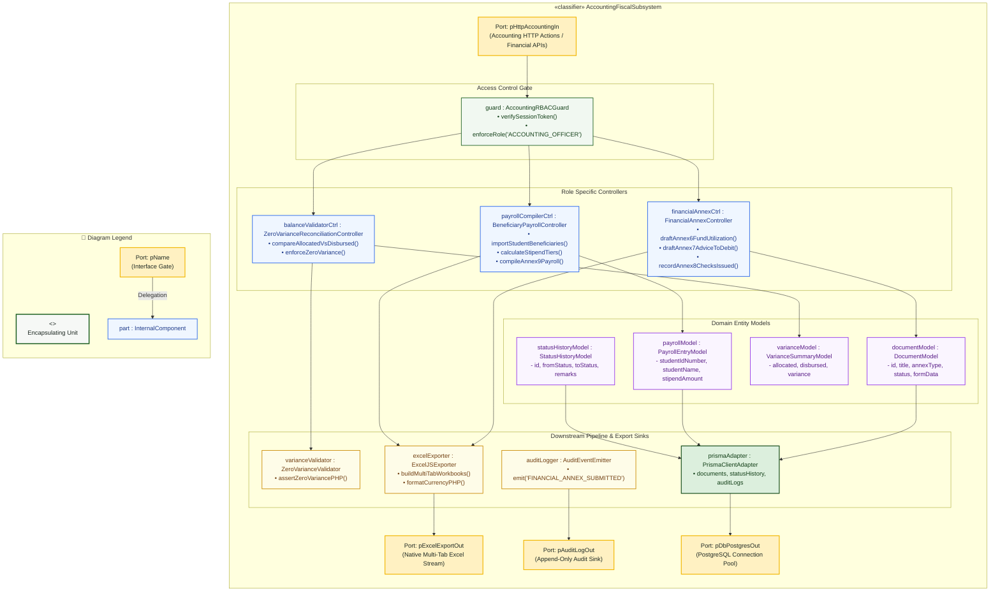

# Composite Structure Diagram: Accounting Officer Domain

> **Role:** `ACCOUNTING` (`ACCOUNTING_OFFICER`)  
> **Diagram Type:** Composite Structure Diagram  
> **Classifier:** `AccountingFiscalSubsystem`

---

## 1. Purpose

This Composite Structure Diagram depicts the internal architecture of the `AccountingFiscalSubsystem`. It shows how financial commands pass through the accounting access gate to controllers for Annexes 6, 7, 8, and 9, zero-variance math engines, ExcelJS workbook generators, and PostgreSQL persistence.

---

## 2. Mermaid Composite Structure Diagram

---

## 3. Diagram Legend & Symbol Guide

| Symbol | UML Concept | Technical Function | MinSU Operational Meaning |
|---|---|---|---|
| `«classifier»` | Subsystem Classifier | Encapsulates internal structural parts | `AccountingFiscalSubsystem` |
| `Port` | Port Boundary | Ingress/egress interaction gate | HTTP Ingress, Excel Stream Out, PostgreSQL Out |
| `part` | Internal Component Part | Role controller or internal service | `FinancialAnnexController`, `ZeroVarianceValidator` |
| `-->` | Connector | Structural delegation or data flow | Delegates verified ledgers to persistence and export |
