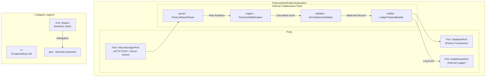

# Composite Structure Diagram: Accounting Officer Domain

## 1. Description
This composite structure diagram depicts the internal architecture, collaboration parts, ports, and connector interfaces within the `FinancialVerificationSubsystem` utilized by the Accounting Officer.

## 2. ASD-STE100 Technical Specifications
- Expose external interaction through typed communication ports.
- Encapsulate calculation and verification services within internal sub-parts.
- Route inbound form data through currency formatting and validation filters.

## 3. Composite Structure Diagram (Mermaid)

---

## 4. Diagram Legend & Symbol Guide

| Visual Symbol | Syntax / Style | UML Structural Role | MinSU System Implementation |
|---|---|---|---|
| Outer Classifier | `subgraph UNIT` (`#F6F8F6`) | Encapsulating software unit | Domain engine or controller containing internal operational logic |
| 🟨 Port Node | `pName` (`#FFF1C2` / `#F2B705`) | Interaction boundary / gate | Inbound HTTP ports, state change events, database ports |
| ⬜ Internal Part | `part : Class` (`#FFFFFF` / `#1B5E20`) | Component instance owned by classifier | Schema validators, state machines, PDF compilers, audit loggers |
| `-->` Connector | Solid Arrow | Internal connector or port delegation | Linking external ports to internal validators and persistent adapters |

## 5. Internal Part Roles
- **FinancialInputParser**: Strips currency formatting symbols and converts text into numerical floats.
- **PrecisionMathEngine**: Computes row totals, payroll deductions, and fund sub-balances without rounding drift.
- **ZeroVarianceValidator**: Compares computed totals against external allocated budgets to enforce zero variance.
- **LedgerPayloadBuilder**: Assembles structured JSON metadata for relational database persistence.
