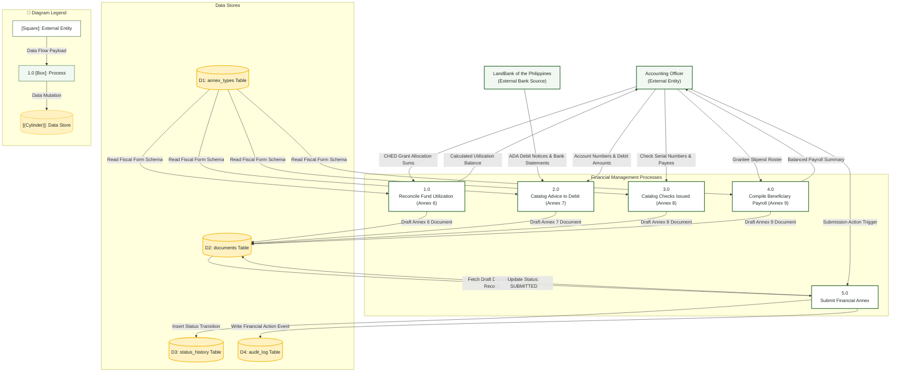

# Accounting Officer — Data Flow Diagram (DFD)

> **Role:** `ACCOUNTING`  
> **Diagram Type:** Data Flow Diagram (Level 1)  
> **Focus:** Fiscal Reconciliations, Bank Debit Audits, and Payroll Submissions

---

## 1. Purpose

The Data Flow Diagram shows how financial metrics, debit notices, and check registers flow from the Accounting Officer through calculation processes to database tables.

---

## 2. Mermaid Data Flow Diagram (Level 1)

---

## 3. Diagram Legend & Symbol Guide

| DFD Element Shape | Gane & Sarson / Yourdon Notation | Technical Role | MinSU System Implementation |
|---|---|---|---|
| `[Rectangle]` | External Entity | Source or sink outside the process boundary | Students, Staff Coordinator, Campus Director, Accounting, CHED Agency |
| `(("((Double Circle))"))` | Context Process (Level 0) | Top-level system boundary | Entire MinSU DocTrack system |
| `["1.0 Process"]` | Operational Process (Level 1) | Data transformation or business logic step | Intake Applications, Validate Annexes, Executive Review, Financials |
| `[("[(Cylinder)]")]` | Persistent Data Store | Relational table or permanent data repository | Users & Sessions, Applications, Documents, Transmittals, Audit Logs |
| `-->|Data Flow|` | Named Flow Arrow | In-transit data packet or payload | Forms, tracking codes, financial records, audit rows |
| 🟢 Green Box | Process Node | Active workflow processing unit | Core backend services and transaction coordinators |
| 🟨 Gold Cylinder | Data Store Node | Persistent PostgreSQL / File store | Secure database tables with RLS and foreign key integrity |

---

## 4. Data Dictionary

- **CHED Grant Allocation Sums**: Total monetary grant transferred to MinSU for TDP scholarship coverage.
- **ADA Debit Notices & Bank Statements**: Official bank confirmations indicating digital account credits.
- **Check Serial Numbers & Payees**: Registry entries for manual checks issued to unbanked student grantees.
- **Grantee Stipend Roster**: Individual student stipend records (`₱10,000.00` per grantee).
- **Balanced Payroll Summary**: Complete verified payroll total matching the bank debit authorization.
