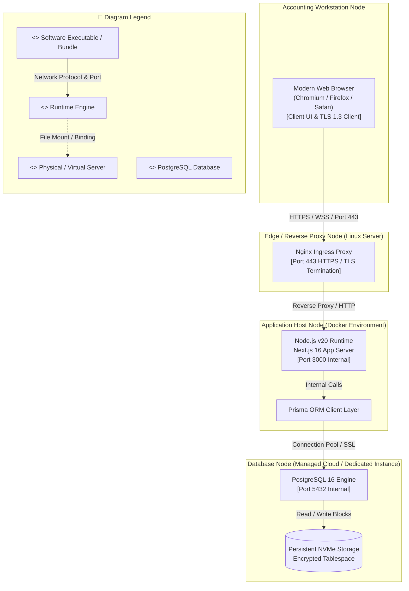

# Deployment Diagram: Accounting Officer Domain

## 1. Description
This deployment diagram maps the runtime hardware, network topologies, and containerized environments for the Accounting Officer subsystem. It illustrates the encrypted connection between the university workstation, the ingress proxy, the Next.js server instance, and the managed PostgreSQL database.

## 2. ASD-STE100 Technical Specifications
- Connect accounting client browsers through encrypted HTTPS connections.
- Terminate TLS certificates at the edge proxy container.
- Run the Next.js application inside an isolated Docker node.
- Store transactional ledger records in a secured database cluster.

## 3. Deployment Diagram (Mermaid)

---

## 4. Diagram Legend & Symbol Guide

| Visual Symbol | Syntax / Style | UML Deployment Role | MinSU Infrastructure Context |
|---|---|---|---|
| `<<device>>` Box | `fill:#F6F8F6, stroke:#1B5E20` | Physical hardware or operating system host | Client Workstation, Ubuntu Linux Server |
| `<<node>>` Container | `fill:#F1F8F1, stroke:#164D1C` | Isolated containerized execution node | Docker containers: reverse-proxy, web-application, postgres-database |
| `<<executionEnvironment>>` | `fill:#FFFFFF, stroke:#2E7D32` | Application runtime or software engine | Node.js 20 LTS, Nginx 1.25 Alpine, Headless Chromium |
| `<<artifact>>` | `fill:#DCEFDD, stroke:#1B5E20` | Packaged deployable binary or file | Next.js standalone build, Prisma engine, nginx.conf |
| 🟨 Database Engine | `fill:#FFF1C2, stroke:#F2B705` | Relational database runtime | PostgreSQL 16 Alpine Server |
| `-->` Solid Arrow | Network Communication Link | Transport protocol and network port | Port 443 (HTTPS), Port 3000 (Internal HTTP), Port 5432 (Internal TCP) |
| `-.->` Dashed Arrow | Storage Mount / Stream | Host volume bind mount or disk I/O | `./uploads` (Signed PDF scans) and `pgdata` (PostgreSQL WAL files) |

## 5. Hardware and Network Nodes
- **Accounting Workstation Node**: Standard university workstation with authenticated session cookie.
- **Edge Node**: Reverse proxy handling security headers (`X-Frame-Options`, `X-Content-Type-Options`) and rate limiting.
- **Application Host Node**: Executes server-side financial business logic, PDF generation, and access control.
- **Database Node**: Encrypted relational store holding financial documents, beneficiary payrolls, and audit logs.
