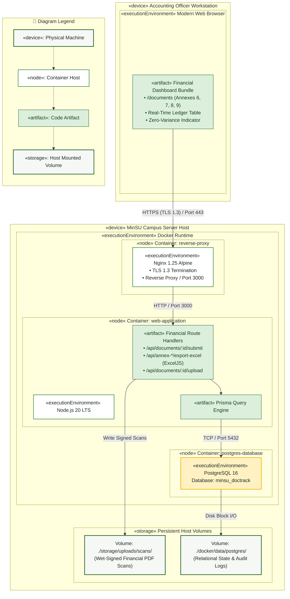

# Accounting Officer — Deployment Diagram

> **Role:** `ACCOUNTING_OFFICER`  
> **Diagram Type:** Deployment Diagram  
> **Standard:** UML 2.5 Deployment Specification

---

## 1. Purpose

The Deployment Diagram shows the hardware devices, Docker container nodes, network protocols, and storage volumes supporting the Accounting Officer financial subsystem.

---

## 2. Mermaid Deployment Diagram

---

## 3. Diagram Legend & Symbol Guide

| Visual Symbol | Syntax / Style | UML Deployment Concept | MinSU Implementation |
|---|---|---|---|
| `«device»` | Double Angle Bracket | Hardware computational machine | Accounting Workstation, MinSU Linux Server |
| `«node»` | Container Box | Virtualized runtime environment | Reverse proxy, Node.js web application, PostgreSQL |
| `«artifact»` | Shaded Component | Executable software code or bundle | Financial SPA, ExcelJS exporter, Prisma engine |
| `«storage»` | Volume Node | File system partition on host | Mounted scans volume, PostgreSQL database blocks |

---

## 4. Deployment Specifications

- **Accounting Workstation**: Executes client-side currency math and renders real-time balanced indicators.
- **Reverse Proxy**: Handles HTTPS encryption and proxies requests to the Next.js application container.
- **Application Container**: Runs the in-memory zero-variance calculator and streams native multi-tab `ExcelJS` files.
- **Database Container**: Persists financial ledger line items, approval transitions, and audit records with disk volume mounting.
