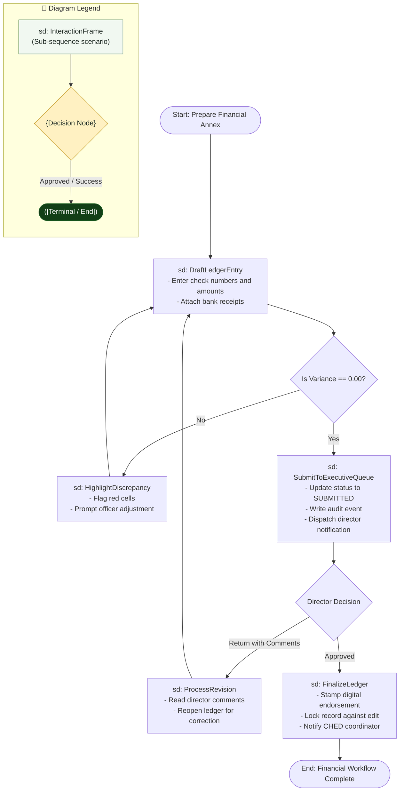

# Interaction Overview Diagram: Accounting Officer Domain

## 1. Description
This interaction overview diagram combines activity decision logic with sequence interaction frames to depict high-level financial preparation, verification, and approval workflows in the Accounting domain.

## 2. ASD-STE100 Technical Specifications
- Decompose complex financial lifecycles into distinct interaction frames.
- Model branch conditions using standard activity decision diamonds.
- Terminate failed validations with appropriate error loops.

## 3. Interaction Overview Diagram (Mermaid)

---

## 4. Diagram Legend & Symbol Guide

| Symbol / Element | Syntax / Type | Technical Meaning | MinSU Interaction Context |
|---|---|---|---|
| `sd: FrameName` | `["sd: ..."]` | Sequence interaction scenario frame | Encapsulates an entire sequence scenario (e.g., `Authenticate`, `ReviewQueue`) |
| `{Decision}` | `{"Decision"}` | Activity decision branch point | Critical decision gate (e.g., approval vs. return, variance check) |
| `([Pill Node])` | `([Start / End])` | Lifecycle start or terminal archive node | Initiating semester operations or locking final records in archive |
| `-->` Solid Arrow | Control Flow Connector | Sequential hand-off between frames | Passing control from one interaction frame to the next |
| `-->|Label|` | Guarded Branch | Conditional scenario path | "Yes: Approved", "No: Discrepancy", "Return with Remarks" |
| 🟢 Green Box | `#F1F8F1` / `#1B5E20` | Successful Workflow Phase | Forward operational processing and executive approval |
| 🟡 Gold Diamond | `#FFF1C2` / `#B88A00` | Institutional Checkpoint | Evaluation queue and zero-variance fiscal math check |

## 5. Flow Decomposition
- **DraftLedgerEntry**: Captures line items, vouchers, check numbers, and recipient totals.
- **HighlightDiscrepancy**: Blocks submission when total disbursement deviates from authorized allocations.
- **SubmitToExecutiveQueue**: Elevates balanced ledgers to executive review with audit tracking.
- **ProcessRevision**: Enables corrective modifications based on director feedback.
- **FinalizeLedger**: Secures the approved document for archival and agency transmittal.
