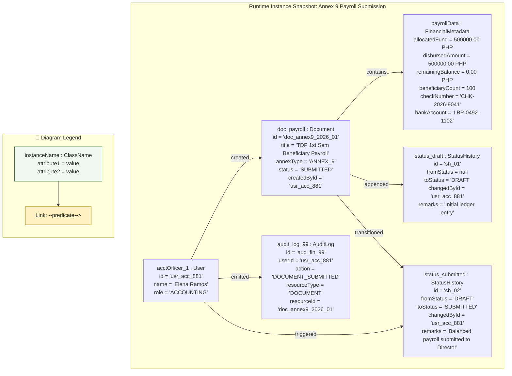

# Object Diagram: Accounting Officer Domain

## 1. Description
This object diagram shows a runtime instance snapshot of an Accounting Officer compiling and reconciling an Annex 9 Beneficiary Payroll document in MinSU DocTrack. It captures concrete attribute values, financial totals, and object associations at the exact moment of document submission.

## 2. ASD-STE100 Technical Specifications
- Display concrete object instances with explicit identifier values.
- Calculate exact currency sums with zero variance between payroll and allocation.
- Show active audit relationships and status history records.

## 3. Object Diagram (Mermaid)

---

## 4. Diagram Legend & Symbol Guide

| Visual Symbol | Syntax / Format | UML Role | MinSU Instance Context |
|---|---|---|---|
| Instance Node | `instanceName : ClassName` | Concrete runtime instance in memory/DB | Active users, specific scholarship calls, concrete annex documents |
| Attribute Values | `attr = 'value'` | Concrete state of instance properties | `status = 'APPROVED'`, `trackingCode = 'TDP-2026-0192'`, `slotQuota = 250` |
| `-->|predicate|` | Directed Association Link | Concrete relationship between runtime objects | User compiles document, director endorses record, transmittal dispatches |
| Subgraph Boundary | `subgraph GroupName` | Domain grouping boundary | Active Users, Intake Instances, Compiled Annexes, Transmittal Audits |
| 🟢 Green Container | `#F1F8F1` / `#1B5E20` | Operational Domain Entities | Authenticated staff/director records and approved scholarship documents |
| 🟡 Gold Node | `#FFF1C2` / `#B88A00` | Financial & Security Linkages | Ledger documents and audit log event tracking |

## 5. Snapshot State Verification
- **Allocated Fund**: ₱500,000.00 matched exactly with 100 student beneficiaries at ₱5,000.00 each.
- **Variance**: ₱0.00 remaining balance, satisfying zero-variance validation rules.
- **State Transition**: Moved from `DRAFT` to `SUBMITTED`, initiating executive review queue notification.
