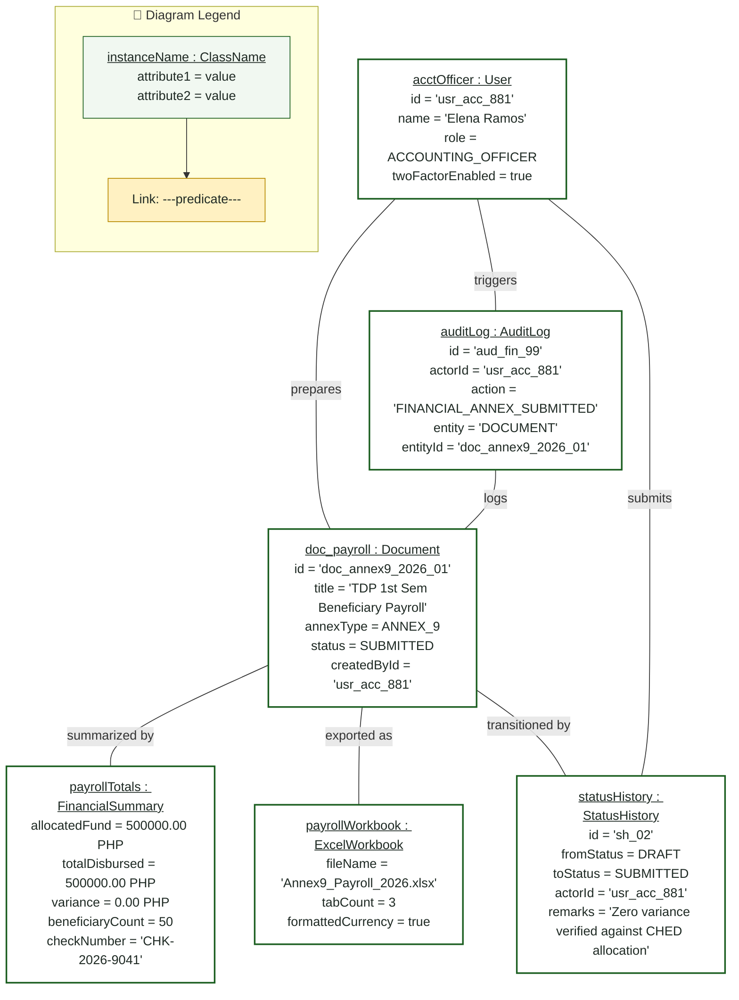

# Accounting Officer — Object Diagram

> **Role:** `ACCOUNTING_OFFICER`  
> **Diagram Type:** Object Diagram  
> **Scenario:** Runtime Snapshot of Annex 9 Payroll Submission & Zero-Variance Reconciliation  
> **Standard:** UML 2.5 Object Specification

---

## 1. Purpose

The Object Diagram shows a concrete runtime snapshot of objects, attribute values, and links created when an Accounting Officer balances an Annex 9 Beneficiary Payroll and submits it to executive review.

---

## 2. Mermaid Object Diagram

---

## 3. Diagram Legend & Symbol Guide

| Visual Symbol | Syntax / Format | UML Role | MinSU Instance Context |
|---|---|---|---|
| `<u>instance : Class</u>` | Underlined Identifier | Concrete runtime object in memory | Accounting Officer, active payroll document, Excel file |
| `attr = 'value'` | Key-Value Assignment | Concrete state of instance properties | `variance = 0.00 PHP`, `status = SUBMITTED` |
| `---predicate---` | Undirected Semantic Link | Association relationship at runtime | Officer prepares document, exports workbook |
| 🟢 Green Container | `#1B5E20` / `#F1F8F1` | Verified Financial Entity | Balanced payroll with zero variance ready for endorsement |

---

## 4. Runtime Object Attributes

- `acctOfficer`: Authenticated accounting user with verified two-factor authentication.
- `doc_payroll`: Official Annex 9 payroll document transitioned to `SUBMITTED`.
- `payrollTotals`: Reconciled figures showing exact ₱0.00 variance between allocation and disbursements.
- `payrollWorkbook`: Native 3-tab `ExcelJS` spreadsheet generated from live grantee line items.
- `auditLog`: Immutable security entry documenting the submission event.
