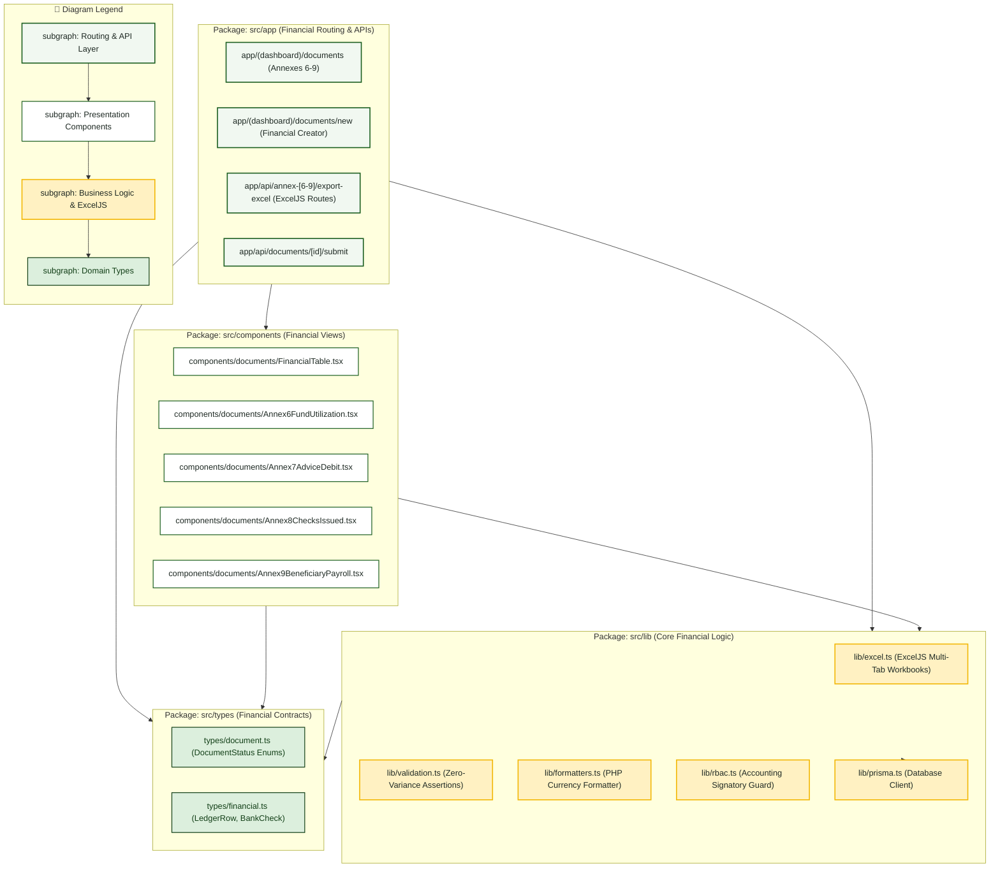

# Accounting Officer — Package Diagram

> **Role:** `ACCOUNTING_OFFICER`  
> **Diagram Type:** Package Diagram  
> **Standard:** UML 2.5 Package Specification

---

## 1. Purpose

The Package Diagram shows the organization of codebase packages, UI modules, calculation utilities, and export libraries that build the Accounting Officer subsystem.

---

## 2. Mermaid Package Diagram

---

## 3. Diagram Legend & Symbol Guide

| Visual Symbol | Syntax / Style | UML Package Concept | MinSU Implementation |
|---|---|---|---|
| `subgraph Pkg` | Folder Container | Architectural Namespace or Directory | `src/app`, `src/components`, `src/lib`, `src/types` |
| `[Module]` | Rectangle with border | Concrete file or sub-package | `excel.ts`, `validation.ts`, `FinancialTable.tsx` |
| `-->` | Directed Dependency | Import or invocation relationship | Financial routes import calculation helpers and components |
| 🟢 Green Tone | `#F1F8F1` / `#1B5E20` | Financial Routing Layer | App router pages and Excel export route handlers |

---

## 4. Package Organization & Separation of Concerns

- **`src/app`**: Exposes financial document drafting views and Excel export routes streaming native `.xlsx` files.
- **`src/components`**: Houses modular ledger views for Annexes 6, 7, 8, and 9 with zero-variance visual indicators.
- **`src/lib`**: Encapsulates `ExcelJS` multi-tab formatting, Philippine Peso currency formatters (`₱#,##0.00`), and role guards.
- **`src/types`**: Declares TypeScript discriminating unions for financial document types and bank check models.
