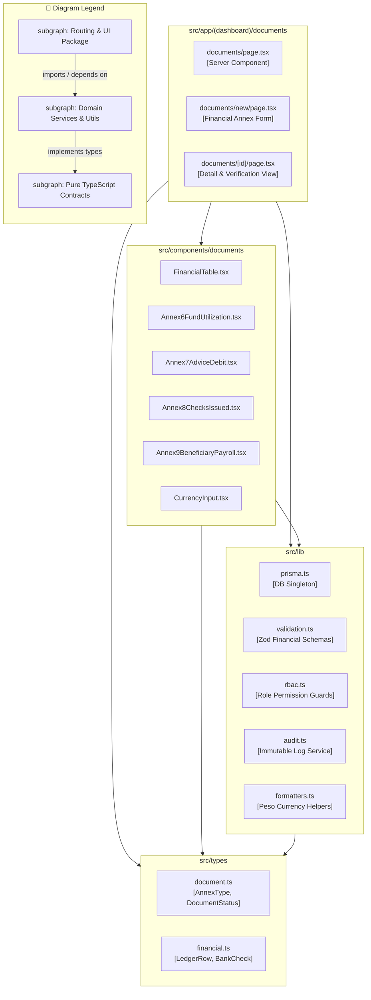

# Package Diagram: Accounting Officer Domain

## 1. Description
This package diagram illustrates the code organization, directory structure, and namespace dependencies supporting the Accounting Officer domain in the MinSU DocTrack application.

## 2. ASD-STE100 Technical Specifications
- Group related route handlers, UI components, and utility modules into separate packages.
- Prevent circular imports between client components and server actions.
- Import data models strictly through the Prisma client adapter package.

## 3. Package Diagram (Mermaid)

---

## 4. Diagram Legend & Symbol Guide

| Visual Symbol | Syntax / Style | UML Package Concept | MinSU DocTrack Codebase Structure |
|---|---|---|---|
| 🟩 Green Folder | `fill:#F1F8F1, stroke:#1B5E20` | Presentation & Routing Package | Next.js App Router (`src/app`) & React components (`src/components`) |
| 🟨 Gold Folder | `fill:#FFF1C2, stroke:#F2B705` | Core Business & Lib Services | Prisma singleton, crypto auth, RBAC guards, PDF compiler (`src/lib`) |
| 🟩 Dark Green Box | `fill:#DCEFDD, stroke:#123F17` | Contract & Persistence Schema | Strictly typed schemas (`src/types`) and ORM definition (`prisma/`) |
| `-->` Solid Arrow | Downward Package Dependency | Upstream module imports or depends on downstream services (strictly unidirectional) |

## 5. Package Responsibilities
- **`src/app/(dashboard)/documents`**: Houses page routes for drafting, viewing, and exporting financial annexes.
- **`src/components/documents`**: Supplies reusable UI widgets for tabular ledger calculation and currency inputs.
- **`src/lib`**: Provides validation schemas, database client access, and currency formatting helpers.
- **`src/types`**: Declares TypeScript types, status enums, and ledger data shapes.
