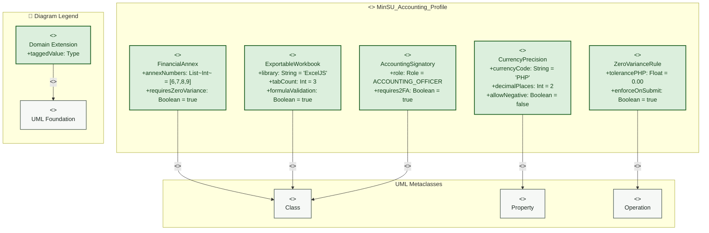

# Accounting Officer — Profile Diagram

> **Role:** `ACCOUNTING_OFFICER`  
> **Diagram Type:** Profile Diagram  
> **Target Domain:** Financial Compliance, Zero-Variance Balancing, and ExcelJS Workbooks

---

## 1. Purpose

The Profile Diagram defines domain-specific UML stereotypes and constraints governing financial annex operations, currency precision rules, zero-variance balancing, and native Excel export configurations.

---

## 2. Mermaid Profile Diagram

---

## 3. Diagram Legend & Symbol Guide

| Visual Symbol | Syntax / Style | UML Profile Mechanism | MinSU Governance Application |
|---|---|---|---|
| `<<metaclass>>` Box | `fill:#F6F8F6, stroke:#55645B` | Core UML base meta-element | Standard UML `Class`, `Property`, or `Operation` |
| `<<stereotype>>` Box | `fill:#DCEFDD, stroke:#1B5E20` | Domain-specific extension | `<<FinancialAnnex>>`, `<<ZeroVarianceRule>>`, `<<CurrencyPrecision>>` |
| `+taggedValue: Type` | Tagged Value Attribute | Metadata property attached to stereotype | `currencyCode = 'PHP'`, `tolerancePHP = 0.00`, `library = 'ExcelJS'` |
| `-- "<<extension>>" -->` | Extension Relationship | Extends metaclass semantics | Connects custom accounting stereotype to standard UML metaclass |

---

## 4. Stereotype Tagged Values & Rules

- **`<<FinancialAnnex>>`**: Restricts authoring permissions exclusively to the `ACCOUNTING_OFFICER` role.
- **`<<CurrencyPrecision>>`**: Formats all numeric amounts in Philippine Peso (`₱#,##0.00`) aligned to two decimal places.
- **`<<ZeroVarianceRule>>`**: Enforces strict equality between grant allocation sums and line item disbursements before submission.
- **`<<ExportableWorkbook>>`**: Directs the generation of native multi-tab `.xlsx` workbooks with live Excel sum formulas.
- **`<<AccountingSignatory>>`**: Enforces two-factor authentication on financial submission and scan upload operations.
