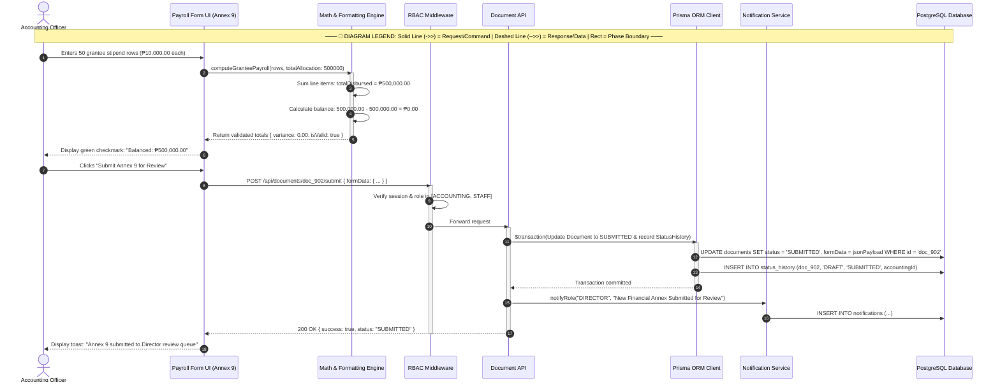

# Accounting Officer — Sequence Diagram

> **Role:** `ACCOUNTING`  
> **Diagram Type:** Sequence Diagram  
> **Scenario:** Financial Verification & Payroll Submission Sequence

---

## 1. Purpose

The Sequence Diagram shows the messages exchanged when the Accounting Officer compiles Annex 9 (Beneficiary Payroll), verifies stipend calculations, and submits the document to the Director.

---

## 2. Mermaid Sequence Diagram

---

## 3. Diagram Legend & Symbol Guide

| Visual / Symbol | Element Type | Technical Role | MinSU DocTrack Context |
|---|---|---|---|
| 👤 `actor` | Human Actor | External user role triggering system operations | Student Applicant, Staff Coordinator, Campus Director, Accounting Officer |
| 🔲 `participant` | System Component | Internal software subsystem or persistence boundary | Web UI, API Endpoint, Workflow Engine, Prisma/PostgreSQL, PDF Compiler |
| ──▶ `->>` | Solid Arrow | Synchronous invocation or command message | Submitting forms, verifying tokens, invoking database writes |
| - - ▷ `-->>` | Dashed Arrow | Return response or data payload | Confirmation slips, tracking codes, PDF binary buffers, query results |
| 🔲 `activate / deactivate` | Activation Lifeline | Period during which a component executes logic | Active request execution on API controllers or PDF engines |
| 🔲 `alt / else` | Conditional Fragment | Decision tree handling alternative workflow paths | Approval vs. Return branching, SLA compliance checks |

---

## 4. Sequence Details

1. Accounting Officer enters stipend rows for student beneficiaries.
2. The client-side math engine verifies that line items balance against the grant allocation.
3. Accounting Officer submits the completed Annex 9.
4. RBAC guard confirms that the user is an authorized `ACCOUNTING` officer.
5. API locks the document and transitions status from `DRAFT` to `SUBMITTED`.
6. System notifies the Campus Director of the pending review.
