# Accounting Officer — State Machine Diagram

> **Role:** `ACCOUNTING_OFFICER`  
> **Diagram Type:** State Machine Diagram  
> **Entity:** Financial Annex Lifecycle (`Annex 6`, `Annex 7`, `Annex 8`, `Annex 9`)  
> **Standard:** UML 2.5 State Machine Specification

---

## 1. Purpose

The State Machine Diagram shows the lifecycle states of financial documents managed by the Accounting Officer, including zero-variance balancing checks and executive approval gates. All decision choices evaluate strictly to binary Yes and No paths.

---

## 2. Mermaid State Machine Diagram

```mermaid
stateDiagram-v2
    direction TB

    [*] --> DRAFT : Create Financial Annex

    state DRAFT {
        [*] --> EnteringLedger
        EnteringLedger --> CalculatingTotals : Enter line item amounts
        CalculatingTotals --> EnteringLedger : Modify figures
    }

    state check_variance <<choice>>
    DRAFT --> check_variance : Officer clicks Submit for Review

    check_variance --> SUBMITTED : [Is Variance == 0.00 PHP? -- Yes]
    check_variance --> DRAFT : [Is Variance == 0.00 PHP? -- No]

    state SUBMITTED {
        [*] --> InExecutiveQueue
        InExecutiveQueue --> UnderDirectorReview : Director opens document
    }

    state review_decision <<choice>>
    SUBMITTED --> review_decision : Director completes review

    review_decision --> APPROVED : [Does Director Approve Document? -- Yes]
    review_decision --> RETURNED : [Does Director Approve Document? -- No]

    RETURNED --> DRAFT : Accounting Officer unlocks form for revision

    state APPROVED {
        [*] --> LockedAgainstEdit
        LockedAgainstEdit --> ReadyForExcelExport : Enable multi-tab .xlsx download
    }

    APPROVED --> UPLOADED : uploadSignedScan() [stamped wet-signatures attached]
    UPLOADED --> ARCHIVED : archiveRecord() [semester liquidation complete]
    ARCHIVED --> [*]

    %% ─── 📌 VISUAL LEGEND ───
    note right of check_variance
        <b>📌 DIAGRAM LEGEND</b>
        ● [*] : Initial / Terminal Boundary
        [StateName] : Active Lifecycle Status
        <<choice>> : Mutually Exclusive Decision Point
        --> : Trigger Event Transition
        [guard] : Guard Rule (Strictly Yes / No)
    end note
```

---

## 3. Diagram Legend & Symbol Guide

| Visual Symbol / Syntax | UML State Machine Concept | Technical Meaning | MinSU Document & Student Lifecycle |
|---|---|---|---|
| `● [*]` | Initial State Node | Point of entry into a lifecycle region | Initial financial annex creation begins |
| `◎ [*]` | Terminal State Node | Final conclusion of lifecycle | Financial document permanently archived |
| `state "Name"` | Composite State | Container holding nested sub-states | `DRAFT` (holds ledger entry), `APPROVED` (holds locked status) |
| `<<choice>>` | Decision Pseudostate | Dynamic evaluation of runtime guard | Decision gate evaluating strictly to **Yes** or **No** |
| `-->` | Transition Arrow | Movement from one state to another | Input, balance, submit, endorse |
| `[guard]` | Transition Guard | Boolean condition that must evaluate to TRUE | `[Is Variance == 0.00 PHP? -- Yes]`, `[Does Director Approve? -- Yes]` |

---

## 4. State Details & Behavioral Constraints

- **`DRAFT`**: Accounting officer enters check numbers, bank references, and stipend figures.
- **`check_variance` Choice**: If line items balance with CHED allocations with ₱0.00 variance (**Yes**), document transitions to `SUBMITTED`. If variance exists (**No**), document remains in `DRAFT`.
- **`SUBMITTED`**: Document is locked against modification and enters the Campus Director review queue.
- **`review_decision` Choice**: If Director endorses document (**Yes**), status transitions to `APPROVED`. If revisions are requested (**No**), status transitions to `RETURNED`.
- **`APPROVED`**: Authorizes native multi-tab `ExcelJS` spreadsheet download and wet-signed scan upload.
- **`UPLOADED`**: Stamped physical PDF is attached and ready for CHED liquidation.
