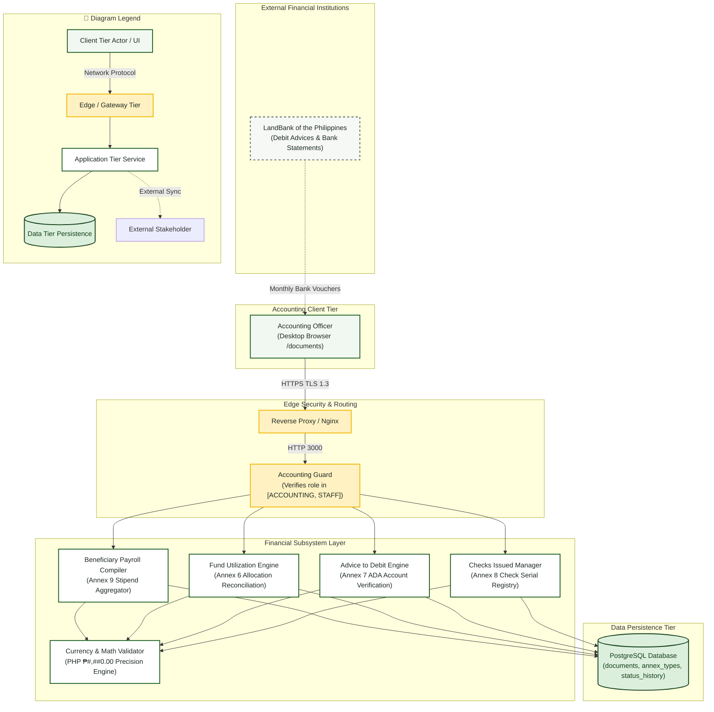

# Accounting Officer — System Architecture Diagram

> **Role:** `ACCOUNTING`  
> **Diagram Type:** System Architecture Diagram  
> **Focus:** Financial Subsystem, Bank Reconciliations, and Disbursement Audits

---

## 1. Purpose

The System Architecture Diagram shows the financial subsystem used by the Accounting Officer to compile Annexes 6, 7, 8, and 9, verify LandBank account debits, and enforce zero-variance reconciliation.

---

## 2. Mermaid System Architecture Diagram

---

## 3. Diagram Legend & Symbol Guide

| Visual Symbol | Syntax / Style | Architectural Tier | MinSU System Implementation |
|---|---|---|---|
| 🟩 Soft Green Box | `fill:#F1F8F1, stroke:#1B5E20` | Client Presentation Tier | Browser clients for Student, Staff, Director, Accounting, and Admin |
| 🟨 Gold Box | `fill:#FFF1C2, stroke:#F2B705` | Edge & Security Gateway Tier | Nginx TLS termination reverse-proxy and Next.js edge RBAC middleware |
| ⬜ White Box | `fill:#FFFFFF, stroke:#1B5E20` | Core Application Tier | Next.js Server Components, Document Engine, Auth Controller, PDF Compiler |
| 🟩 Dark Green Cylinder | `fill:#DCEFDD, stroke:#123F17` | Persistent Data Tier | PostgreSQL 16 relational database (Port 5432) and local storage volumes |
| ◻️ Dashed Border Box | `stroke-dasharray: 5 5` | External Stakeholder / Boundary | CHED/UniFAST regional office and external Google Drive transmittal archive |
| `-->` Solid Arrow | Network & Internal Call | Synchronous HTTPS, WSS, HTTP (port 3000), or TCP (port 5432) |
| `-.->` Dashed Arrow | Out-of-Band Integration | Physical courier shipment or external cloud drive URL synchronization |

---

## 4. Architecture Rules

- Access to financial Annex creation endpoints is restricted to `ACCOUNTING` and authorized `STAFF`.
- The `Currency & Math Validator` guarantees that line items balance to zero variance against grant allocations.
- All monetary records require two decimal digits of precision in Philippine Peso (`₱#,##0.00`).
