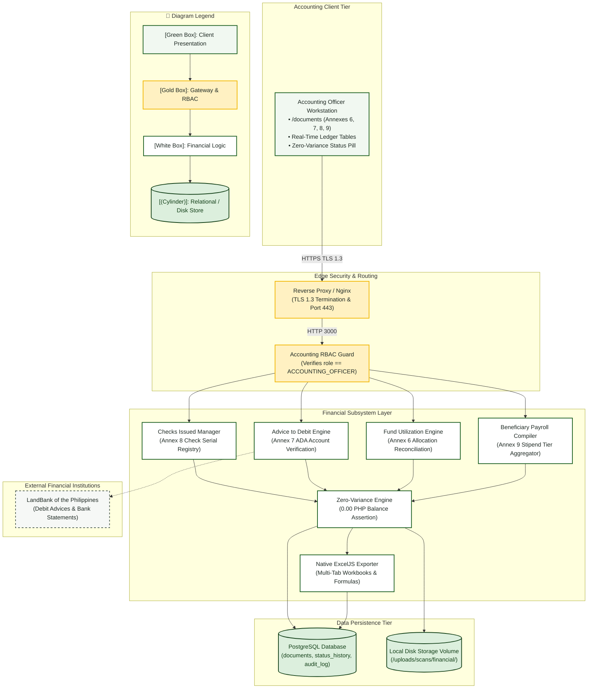

# Accounting Officer — System Architecture Diagram

> **Role:** `ACCOUNTING_OFFICER`  
> **Diagram Type:** System Architecture Diagram  
> **Focus:** Financial Subsystem, Zero-Variance Balancing, ExcelJS Exports & Bank Reconciliations

---

## 1. Purpose

The System Architecture Diagram shows the multi-tier architecture used by the Accounting Officer, including financial ledger views, edge authorization, zero-variance math engines, native ExcelJS workbook generators, and PostgreSQL storage.

---

## 2. Mermaid System Architecture Diagram

---

## 3. Diagram Legend & Symbol Guide

| Visual Symbol | Syntax / Style | Tier Concept | MinSU Implementation |
|---|---|---|---|
| Client Tier | `#F1F8F1` Box | User Workstation Presentation | Next.js browser views for financial management |
| Edge Tier | `#FFF1C2` Box | Gateway & Authorization | Reverse proxy and `AccountingRBAC` validator |
| Application Tier | `#FFFFFF` Box | Financial Domain Logic | Zero-variance math engine, ExcelJS exporter |
| Persistence Tier | Cylinder Shape | Relational & Disk Storage | PostgreSQL database and mounted scans volume |

---

## 4. Tier Responsibilities

- **Client Tier**: Renders currency fields in Philippine Peso (`₱#,##0.00`) and highlights unbalanced rows in red.
- **Edge Tier**: Restricts financial annex authoring strictly to `ACCOUNTING_OFFICER` sessions.
- **Application Tier**: Calculates allocation sums, validates zero-variance equality, and streams multi-tab Excel workbooks.
- **Persistence Tier**: Records immutable financial audit records and stores wet-signed scanned copies.
