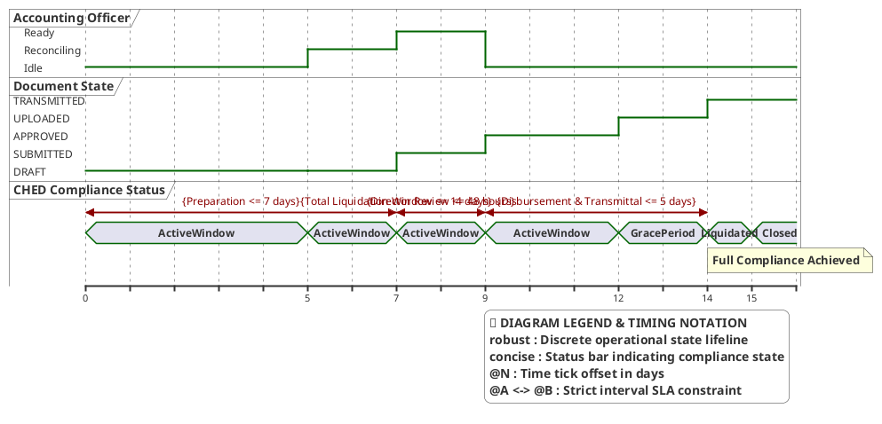

# Accounting Officer — Timing Diagram

> **Role:** `ACCOUNTING`  
> **Diagram Type:** Timing Diagram  
> **Scenario:** Semester Disbursement & Liquidation Compliance Deadlines  
> **Standard:** UML 2.5 Timing Specification

---

## 1. Purpose

The Timing Diagram shows how the states of financial documents and liquidation windows change over an exact timeline. It shows time constraints mandated by university policy and CHED liquidation guidelines.

---

## 2. PlantUML Timing Diagram

---

## 3. Diagram Legend & Symbol Guide

| Notation / Element | Type / Syntax | Temporal Role | MinSU Operational Application |
|---|---|---|---|
| `robust "Lifeline"` | Discrete State Lifeline | Tracks operational state transitions over time | `Accounting` (Officer activity), `DocState` (Draft, Submitted, Approved, Transmitted) |
| `concise "Status"` | Status Interval Bar | Tracks statutory compliance phase | `Compliance` (`ActiveWindow`, `GracePeriod`, `Liquidated`, `Closed`) |
| `@N` | Time Tick Offset | Calendar day marker from grant allocation release | `@0` (Grant release), `@7` (Submission), `@9` (Approval), `@14` (Liquidation) |
| `@A <-> @B : {Rule}` | Time Constraint Interval | Hard regulatory turnaround window | Preparation (<= 7d), Review (<= 48h), Disbursement (<= 5d), Total Window (<= 14d) |
| `note bottom of ...` | Event Milestone Callout | Operational trigger annotation | Submitted for review, 48h SLA endorsement, full liquidation achieved |

---

## 4. Timeline & State Transitions

| Milestone | Time (Days) | Document State | Accounting State | Time Constraint & Description |
|---|---|---|---|---|
| **Allocation Release** | `T + 0d` | `DRAFT` | `Idle` | Grant allocation arrives in university LandBank account. |
| **Data Ingestion** | `T + 5d` | `DRAFT` | `Reconciling` | Accounting compiles payroll and bank debit vouchers. |
| **Review Submission** | `T + 7d` | `SUBMITTED` | `Ready` | Document submitted within 7-day preparation target. |
| **Director Approval** | `T + 9d` | `APPROVED` | `Idle` | Executive endorsement completed within 48-hour SLA. |
| **Hardcopy Scan** | `T + 12d` | `UPLOADED` | `Idle` | Signed hardcopy uploaded into DocTrack. |
| **Agency Liquidation** | `T + 14d` | `TRANSMITTED` | `Idle` | Package dispatched to CHED within 14-day liquidation deadline. |

---

## 5. STE Rules Applied

- The horizontal time axis uses days as the standard unit.
- State transitions are clearly aligned to timeline milestones.
- Time constraints show exact durations (for example, `<= 48 hours`).
