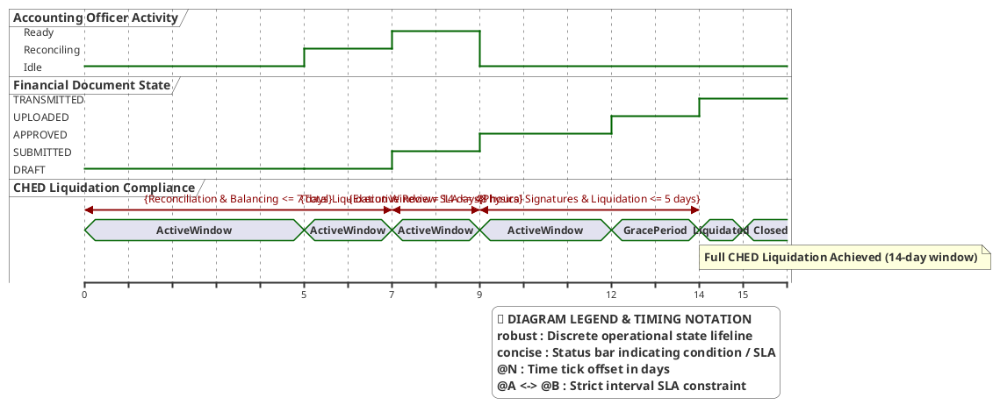

# Accounting Officer — Timing Diagram

> **Role:** `ACCOUNTING_OFFICER`  
> **Diagram Type:** Timing Diagram  
> **Scenario:** Financial Reconciliation, Zero-Variance Assertion, and Liquidation Deadlines  
> **Standard:** UML 2.5 Timing Specification

---

## 1. Purpose

The Timing Diagram shows the lifecycle states of financial documents, zero-variance calculation intervals, and liquidation deadlines mandated by CHED and university fiscal policies.

---

## 2. PlantUML Timing Diagram

---

## 3. Diagram Legend & Symbol Guide

| Visual Symbol | Syntax / Style | UML Timing Concept | MinSU Implementation Context |
|---|---|---|---|
| Lifeline Wave | `robust "Name"` | Continuous state value of an entity | Accounting Activity, Financial Document State |
| State Label | `Lifeline is STATE` | Active discrete status during interval | `IDLE`, `RECONCILING`, `DRAFT`, `SUBMITTED`, `APPROVED` |
| Compliance Bar | `concise "Name"` | Regulatory status during interval | `ActiveWindow`, `GracePeriod`, `Liquidated` |
| SLA Constraint | `@A <-> @B : {Label}` | Strict timing deadline or window | 14-day total liquidation window, 48h review SLA |

---

## 4. Timeline Milestones & Liquidation Deadlines

- **Day 0 to 5**: Accounting Officer ingests bank statements and verifies zero variance down to 0.00 Philippine Pesos.
- **Day 7**: Balanced financial annex submitted to Director review queue.
- **Day 9**: Campus Director endorses document within 48-hour SLA.
- **Day 12**: Wet-ink stamped physical document scan is uploaded.
- **Day 14**: Hard liquidation deadline; package dispatched to CHED and logged in outgoing transmittals.
