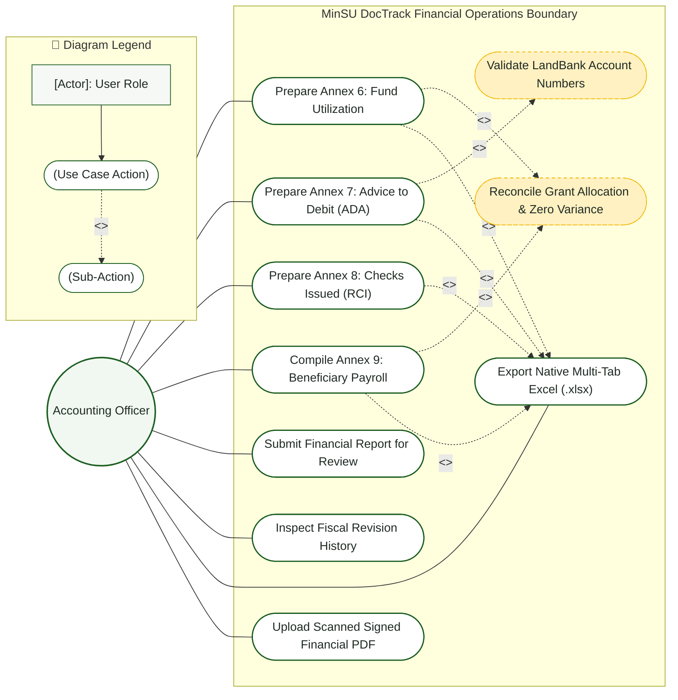
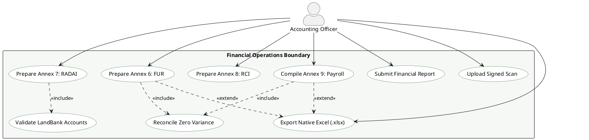

# Accounting Officer — Use Case Diagram

> **Role:** `ACCOUNTING`  
> **Diagram Type:** Use Case Diagram  
> **Standard:** UML 2.5 Use Case Specification

---

## 1. Purpose

The Use Case Diagram shows all financial operations executed by the Accounting Officer for Annexes 6, 7, 8, and 9, including balance reconciliation and multi-tab native ExcelJS export.

---

## 2. Mermaid Use Case Diagram

---

## 3. Diagram Legend & Symbol Guide

| Visual Symbol | Syntax / Style | UML Use Case Concept | MinSU System Implementation |
|---|---|---|---|
| `actor` / `[Actor]` | External Role | Financial officer responsible for accounts | Accounting Officer |
| `usecase` / `(["(Action)"])` | Use Case Unit | Financial operation or report | Prepare Annex 6/7/8/9, Reconcile Totals, Export Excel |
| `-->` Solid Arrow | Actor Association | User initiates financial action | Accounting submits reports, exports workbooks, uploads scans |
| `..>` / `-.->` Dashed Arrow | Stereotyped Dependency | Relationship between use cases | `<<include>>` (Mandatory reconciliation) or `<<extend>>` (Optional Excel export) |

---

## 4. PlantUML Use Case Diagram

