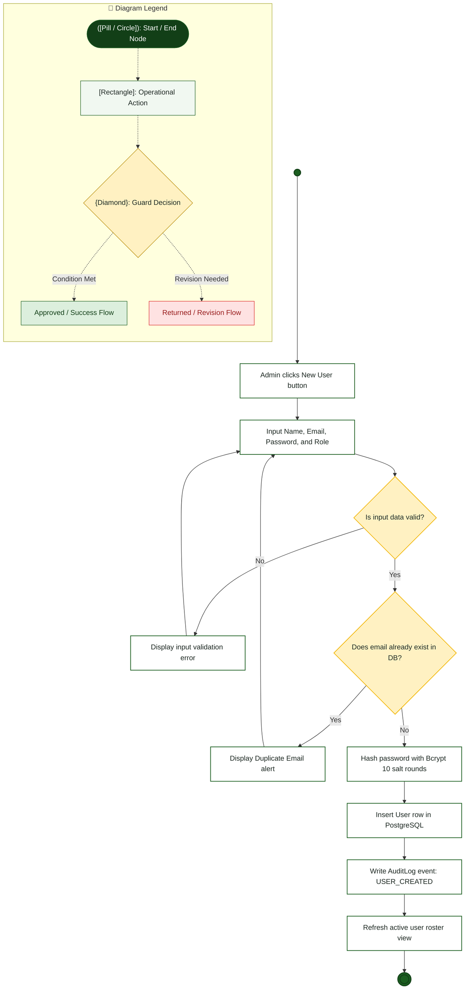

# System Admin — Activity Diagram

> **Role:** `SYSTEM_ADMIN`  
> **Diagram Type:** Activity Diagram  
> **Workflow:** User Account Provisioning & Role Assignment

---

## 1. Purpose

The Activity Diagram shows the step-by-step workflow for provisioning new institutional accounts. It shows validation checks, error handling, password hashing, and audit record generation.

---

## 2. Mermaid Activity Diagram

---

## 3. Diagram Legend & Symbol Guide

| Visual Symbol | Syntax / Node Type | Technical Role | MinSU Domain Meaning |
|---|---|---|---|
| `([Pill / Circle])` | `([Start / End])` / `(( ))` | Initial or terminal workflow boundary | Workflow entry point, queue initiation, terminal archive closure |
| `[Rectangle]` | `["Action"]` | Operational task or software routine | Inspecting forms, computing sums, generating receipt, updating status |
| `{Diamond}` | `{"Decision"}` | Mutually exclusive condition / guard | "Compliance verified?", "Variance == 0.00?", "Quota available?" |
| `──▶` | Solid Line `-->` | Sequential flow transition | Standard forward progression between operational activities |
| `-->|Label|` | Guarded Branch | Conditional execution path | "Yes / Approved", "No / Return with Remarks" |
| 🔲 Subgraph | `subgraph Lane` | Departmental Swimlane Boundary | Segregates duties across roles and authority boundaries |
| 🟢 Green Tone | `#DCEFDD` / `#1B5E20` | Approved State / Forward Flow | Validated submissions, executive approvals, zero-variance checks |
| 🟡 Gold Tone | `#FFF1C2` / `#B88A00` | Evaluation / Inspection Gate | Review queues, quota verification, decision checkpoints |
| 🔴 Red / Rose Tone | `#FEE2E2` / `#DC2626` | Return / Discrepancy Alert | Ineligible applications, returned documents, ledger adjustments |

---

## 4. Workflow Procedure

1. Admin clicks the "New User" button on `/users`.
2. Admin enters account name, email address, password, and institutional role.
3. System validates email format and password complexity.
4. If invalid, the system displays validation feedback.
5. If valid, the system verifies email uniqueness in PostgreSQL.
6. If the email already exists, the system halts with an alert.
7. System generates a secure bcrypt hash of the password.
8. System creates the `User` record in the database.
9. System creates an immutable `AuditLog` entry documenting the creation.
10. System closes the modal and refreshes the user roster.
