# System Admin — Class Diagram

> **Role:** `SYSTEM_ADMIN`  
> **Diagram Type:** Class Diagram  
> **Standard:** UML 2.5 Class Specification

---

## 1. Purpose

The Class Diagram shows the domain models, attributes, operations, and relationships for the System Administrator role, covering user account management, 2FA security, audit log forensics, Landing Page CMS, institutional branding, and rate limiting controls.

---

## 2. Mermaid Class Diagram

```mermaid
classDiagram
    direction TB

    class Role {
        <<enumeration>>
        STAFF
        STUDENT
        DIRECTOR
        ACCOUNTING
        SYSTEM_ADMIN
    }

    class User {
        +String id
        +String name
        +String email
        +String passwordHash
        +Role role
        +Boolean active
        +Boolean twoFactorEnabled
        +String twoFactorSecret
        +DateTime createdAt
        +create(data) User
        +updateRole(newRole, adminId) User
        +toggleActivation(adminId) Boolean
        +resetTwoFactor(adminId) Void
    }

    class Session {
        +String id
        +String userId
        +String token
        +DateTime expiresAt
        +revoke() Boolean
    }

    class AuditLog {
        +String id
        +String actorId
        +String action
        +String entity
        +String entityId
        +Json details
        +DateTime createdAt
        +filter(filters) List~AuditLog~
        +exportCSV() Buffer
    }

    class LandingPageConfig {
        +String id
        +Json publishedSections
        +Json draftSections
        +Boolean hasUnpublishedChanges
        +DateTime publishedAt
        +saveDraft(sections) Void
        +publishDraft(adminId) Void
    }

    class SystemBranding {
        +String id
        +String institutionName
        +String primaryLogoUrl
        +String partnerLogoUrl
        +Json themeTokens
        +updateBranding(adminId, config) SystemBranding
        +uploadLogo(file) String
    }

    class RateLimitConfig {
        +Boolean enabled
        +Int maxLoginAttempts
        +Int windowMinutes
        +toggleRateLimiting(adminId, state) Void
    }

    class Announcement {
        +String id
        +String title
        +String content
        +String audience
        +Boolean pinned
        +publishSystemAnnouncement(adminId) Announcement
    }

    User "1" -- "0..*" Session : owns
    User "1" -- "0..*" AuditLog : triggers as actor
    User "0..1" -- "0..*" LandingPageConfig : edits
    User "0..1" -- "0..*" SystemBranding : configures
    User "1" -- "0..*" Announcement : broadcasts
    User ..> Role : assigned
    User ..> RateLimitConfig : controls

    %% ─── 📌 VISUAL LEGEND ───
    note "<b>📌 DIAGRAM LEGEND & UML NOTATION</b>\n+ Public Attribute / Operation\n- Private / Internal Field\n*-- Strong Composition (Cascade Delete)\no-- Aggregation (Reference)\n-- Multiplicity Association\n..> Dependency / State Transition\n&lt;&lt;enumeration&gt;&gt; Strict Enum Domain"
```

---

## 3. Diagram Legend & Symbol Guide

| Symbol / UML Notation | Meaning & Syntax | Technical Function | MinSU Domain Example |
|---|---|---|---|
| `+` | Public Visibility | Readable attribute or callable method | `+updateRole()`, `+publishDraft()`, `+toggleRateLimiting()` |
| `-` | Private Visibility | Encapsulated field | Password hashes, session secrets |
| `<<enumeration>>` | Enum Classifier | Strict closed set of categorical values | `Role` (`SYSTEM_ADMIN`, `DIRECTOR`) |
| `--` | Multiplicity Association | Association relationship between database entities | One user owns multiple sessions or triggers audit records |
| `..>` | Dependency | Usage or control relationship | Admin configures global `RateLimitConfig` |

---

## 4. Operations & Domain Rules

- `updateRole()` changes an account role and triggers an immutable `USER_ROLE_UPDATED` audit entry.
- `resetTwoFactor()` clears a user's lost TOTP secret after verifying administrative identity.
- `publishDraft()` copies staging sections to production in `LandingPageConfig` and sets `hasUnpublishedChanges` to false.
- `toggleRateLimiting()` allows Administrators to temporarily disable brute-force blocks during mass registration events.
