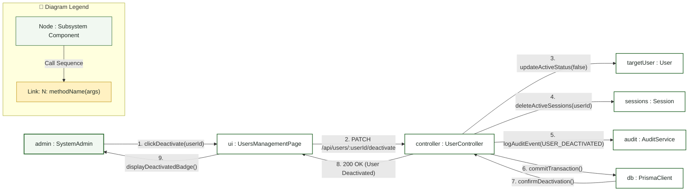
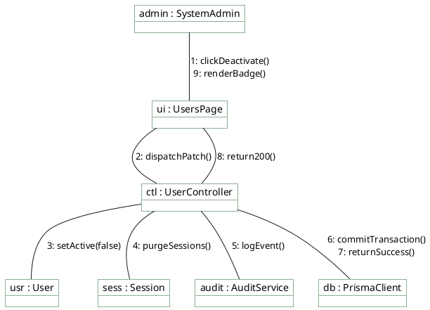

# System Admin — Communication Diagram

> **Role:** `SYSTEM_ADMIN`  
> **Diagram Type:** Communication Diagram  
> **Scenario:** Account Deactivation and Active Session Revocation  
> **Standard:** UML 2.5 Communication Specification

---

## 1. Purpose

The Communication Diagram shows the objects involved when an Administrator deactivates an account and revokes active sessions. It highlights object links with numbered message sequences.

---

## 2. Mermaid Communication Diagram

---

## 3. Diagram Legend & Symbol Guide

| Element | Format / Syntax | Technical Meaning | MinSU Implementation Context |
|---|---|---|---|
| Subsystem Node | `[N: name : Class]` | Structural software participant | Controllers, Workflow Engines, Prisma Client, Storage Adapters |
| Link Connector | `-- "..." -->` | Directed communication channel | HTTP request, RPC method call, or database query |
| Numbered Prefix | `1:`, `2:`, `10:` | Chronological message sequence number | Sequential execution order from client event to persistence and UI update |
| Method Signature | `methodName(params)` | Invoked operation contract | `verifyRole(token)`, `checkVariance()`, `writeAuditLog()` |
| 🟢 Green Tone | `#F1F8F1` / `#1B5E20` | Core Subsystem Component | Institutional controllers, persistence adapters, and business engines |
| 🟡 Gold Tone | `#FFF1C2` / `#B88A00` | Guard & Dispatch Relay | Access guards, validation checks, and notification dispatchers |

---

## 4. PlantUML Communication Diagram

---

## 5. Numbered Message Steps

1. Admin clicks "Deactivate User" in the user management interface.
2. UI submits the `PATCH` request to the backend.
3. Controller sets `active = false` on the target `User` instance.
4. Controller deletes all active sessions associated with the user.
5. Controller logs the deactivation event with the target user ID.
6. Controller executes the database transaction via Prisma.
7. Database confirms commit.
8. API returns HTTP 200 OK.
9. UI updates the user status badge to red ("Inactive").
