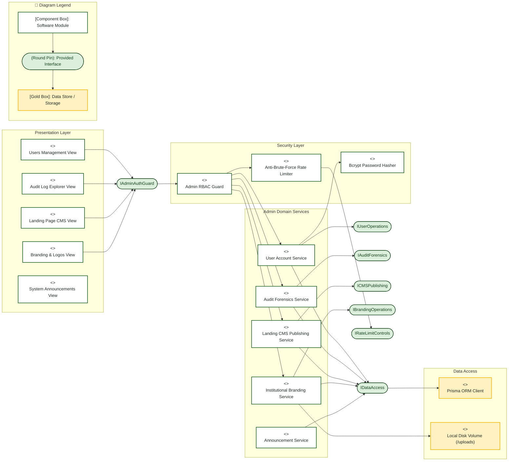

# System Admin — Component Diagram

> **Role:** `SYSTEM_ADMIN`  
> **Diagram Type:** Component Diagram  
> **Standard:** UML 2.5 Component Specification

---

## 1. Purpose

The Component Diagram shows the software components, provided interfaces, and required dependencies within the administrative subsystem, covering user governance, 2FA management, audit log forensics, Landing Page CMS, branding, and rate limiting controls.

---

## 2. Mermaid Component Diagram

---

## 3. Diagram Legend & Symbol Guide

| Visual Symbol | Syntax / Style | UML Component Meaning | MinSU Implementation |
|---|---|---|---|
| `[Component]` | `["<<component>>\nName"]` | Autonomous modular unit with internal logic | User Account Service, CMS Service, Rate Limiter |
| `(Interface)` | `(["IName"])` | Formal contract or API boundary | `IUserOperations`, `IAuditForensics`, `ICMSPublishing` |
| `Solid Arrow` | `-->` | Direct dependency or invocation | Views invoke domain operations through guarded interfaces |
| `Data Component` | Gold Tone `#FFF1C2` | Persistence or storage component | Prisma client and uploaded logo storage volume |

---

## 4. Component Responsibilities

- **Users Management View (`UsersUI`)**: Renders active accounts, role assignment modals, and 2FA reset tools.
- **Audit Forensics Service (`AuditService`)**: Ingests chronological security logs and streams forensic CSV exports.
- **Landing CMS Publishing Service (`CMSService`)**: Manages draft and published landing sections with split-screen live preview.
- **Institutional Branding Service (`BrandingService`)**: Validates SVG/PNG logo uploads and updates global headers.
- **Anti-Brute-Force Rate Limiter (`RateLimiter`)**: Tracks failed IP attempts and allows global override toggling.
