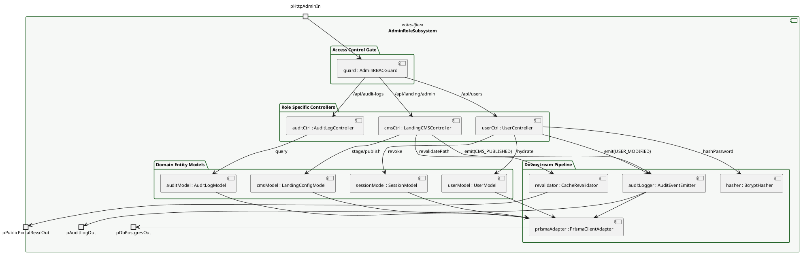

# Composite Structure Diagram: System Administrator Domain

> **Role:** `SYSTEM_ADMIN`  
> **Diagram Type:** Composite Structure Diagram  
> **Classifier:** `AdminRoleSubsystem`

---

## 1. Purpose

This Composite Structure Diagram depicts the internal architecture of the `AdminRoleSubsystem`. It shows how incoming administrative requests route through the role guard to the specific controllers, how controllers connect to in-memory domain models, and where data moves downstream to security utilities, database persistence, audit event sinks, and public cache revalidation.

---

## 2. Mermaid Composite Structure Diagram

```mermaid
flowchart TB
    %% Styling Classes
    classDef classifierStyle fill:#F6F8F6,stroke:#1B5E20,stroke-width:2.5px,color:#1F2A24
    classDef portStyle fill:#FFF1C2,stroke:#F2B705,stroke-width:2px,color:#1F2A24
    classDef guardStyle fill:#F1F8F1,stroke:#1B5E20,stroke-width:1.5px,color:#123F17
    classDef ctrlStyle fill:#EFF6FF,stroke:#2563EB,stroke-width:1.5px,color:#1E3A8A
    classDef modelStyle fill:#FAF5FF,stroke:#9333EA,stroke-width:1.5px,color:#581C87
    classDef svcStyle fill:#FEFCE8,stroke:#CA8A04,stroke-width:1.5px,color:#713F12
    classDef adapterStyle fill:#DCEFDD,stroke:#164D1C,stroke-width:2px,color:#123F17

    subgraph SUBSYSTEM["«classifier» AdminRoleSubsystem"]
        direction TB

        %% Boundary Ingress Port
        pHttpAdminIn["Port: pHttpAdminIn<br/>(Admin HTTPS Requests / API Routes)"]:::portStyle

        %% Layer 1: Security Guard
        subgraph LAYER_SECURITY ["Access Control Gate"]
            guard["guard : AdminRBACGuard<br/>• verifySessionToken()<br/>• enforceRole('SYSTEM_ADMIN')"]:::guardStyle
        end

        %% Layer 2: Role Specific Controllers
        subgraph LAYER_CONTROLLERS ["Role Specific Controllers"]
            userCtrl["userCtrl : UserController<br/>• getUsers()<br/>• createUser()<br/>• updateUserRole()<br/>• toggleUserActive()"]:::ctrlStyle

            auditCtrl["auditCtrl : AuditLogController<br/>• getAuditLogs()<br/>• filterByCategory()<br/>• exportAuditCSV()"]:::ctrlStyle

            cmsCtrl["cmsCtrl : LandingCMSController<br/>• getLandingConfig()<br/>• saveDraftSections()<br/>• publishLandingPage()"]:::ctrlStyle
        end

        %% Layer 3: Domain Entity Models
        subgraph LAYER_MODELS ["Domain Entity Models"]
            userModel["userModel : UserModel<br/>- id: String<br/>- email: String<br/>- passwordHash: String<br/>- role: Role<br/>- active: Boolean"]:::modelStyle

            sessionModel["sessionModel : SessionModel<br/>- id: String<br/>- userId: String<br/>- token: String<br/>- expiresAt: DateTime"]:::modelStyle

            auditModel["auditModel : AuditLogModel<br/>- id: String<br/>- actorId: String<br/>- action: String<br/>- entity: String<br/>- details: Json"]:::modelStyle

            cmsModel["cmsModel : LandingConfigModel<br/>- id: 'default'<br/>- draftSections: Json<br/>- publishedSections: Json<br/>- hasUnpublishedChanges: Boolean"]:::modelStyle
        end

        %% Layer 4: Downstream Services & Persistence ("Where it goes after")
        subgraph LAYER_DOWNSTREAM ["Downstream Pipeline & Event Emitters"]
            hasher["hasher : BcryptHasher<br/>• hashPassword(saltRounds=10)<br/>• verifyHash()"]:::svcStyle

            auditLogger["auditLogger : AuditEventEmitter<br/>• emit('USER_CREATED')<br/>• emit('USER_UPDATED')<br/>• emit('LANDING_PUBLISHED')"]:::svcStyle

            revalidator["revalidator : CacheRevalidator<br/>• revalidatePath('/')<br/>• revalidatePath('/portal')"]:::svcStyle

            prismaAdapter["prismaAdapter : PrismaClientAdapter<br/>• user.create() / update()<br/>• session.deleteMany()<br/>• auditLog.create() / findMany()<br/>• landingPageConfig.upsert()"]:::adapterStyle
        end

        %% Boundary Egress Ports
        pDbPostgresOut["Port: pDbPostgresOut<br/>(PostgreSQL Connection Pool)"]:::portStyle
        pAuditLogOut["Port: pAuditLogOut<br/>(Append-Only Audit Sink)"]:::portStyle
        pPublicPortalRevalOut["Port: pPublicPortalRevalOut<br/>(Next.js ISR Revalidate Stream)"]:::portStyle

        %% Ingress to Guard
        pHttpAdminIn -->|"HTTPS /api/*"| guard

        %% Guard to Controllers
        guard -->|"/api/users"| userCtrl
        guard -->|"/api/audit-logs"| auditCtrl
        guard -->|"/api/landing/admin"| cmsCtrl

        %% Controllers to Utilities & Models
        userCtrl -->|"Hash plain password"| hasher
        userCtrl -->|"Hydrate / Validate"| userModel
        userCtrl -->|"Revoke active tokens on deactivate"| sessionModel

        auditCtrl -->|"Query / Filter criteria"| auditModel

        cmsCtrl -->|"Stage draft / Publish layout"| cmsModel

        %% Models to Persistence Adapter
        userModel -->|"Save User Entity"| prismaAdapter
        sessionModel -->|"Revoke Sessions"| prismaAdapter
        auditModel -->|"Read / Write Logs"| prismaAdapter
        cmsModel -->|"Save CMS State"| prismaAdapter

        %% Controllers to Downstream Event Emitters
        userCtrl -->|"Emit mutation event"| auditLogger
        cmsCtrl -->|"Emit CMS publish event"| auditLogger
        cmsCtrl -->|"Trigger ISR cache refresh"| revalidator

        %% Downstream Emitters to Persistence & Boundary Ports
        auditLogger -->|"Persist audit row"| prismaAdapter
        prismaAdapter -->|"SQL Transactions / Port 5432"| pDbPostgresOut
        auditLogger -->|"Stream to external SIEM / log"| pAuditLogOut
        revalidator -->|"Broadcast cache purge"| pPublicPortalRevalOut
    end

    class SUBSYSTEM classifierStyle

    %% ─── 📌 VISUAL LEGEND ───
    subgraph LEGEND ["📌 Diagram Legend"]
        direction TB
        L_Class["<<classifier>><br/>Encapsulating Unit"]:::classifierStyle
        L_Port["Port: pName<br/>(Interface Gate)"]:::portStyle
        L_Part["part : InternalComponent"]:::partStyle
        L_Port -->|Delegation| L_Part
    end
```

---

## 3. Diagram Legend & Symbol Guide

| Visual Symbol | Syntax / Style | UML Structural Role | MinSU System Implementation |
|---|---|---|---|
| Outer Classifier | `subgraph UNIT` (`#F6F8F6`) | Encapsulating software unit | Domain engine or controller containing internal operational logic |
| 🟨 Port Node | `pName` (`#FFF1C2` / `#F2B705`) | Interaction boundary / gate | Inbound HTTP ports, state change events, database ports |
| ⬜ Internal Part | `part : Class` (`#FFFFFF` / `#1B5E20`) | Component instance owned by classifier | Schema validators, state machines, PDF compilers, audit loggers |
| `-->` Connector | Solid Arrow | Internal connector or port delegation | Linking external ports to internal validators and persistent adapters |

---

## 4. PlantUML Alternative Syntax

---

## 5. Subsystem Parts, Ports, and Roles

### 4.1 Boundary Ports
| Port Name | Direction | Interface / Protocol | Responsibility |
|---|---|---|---|
| `pHttpAdminIn` | Inbound | HTTPS (JSON / REST) | Receives administrative HTTP requests from the browser for `/api/users`, `/api/audit-logs`, and `/api/landing/admin`. |
| `pDbPostgresOut` | Outbound | TCP / SQL (Port 5432) | Connects to the managed PostgreSQL database through Prisma connection pooling. |
| `pAuditLogOut` | Outbound | Event Stream | Transmits immutable audit log records to external compliance monitoring systems. |
| `pPublicPortalRevalOut` | Outbound | Internal RPC / Next.js ISR | Purges public landing page static cache when the administrator publishes layout updates. |

### 4.2 Role Controllers
| Controller Part | Concrete Handler File | Key Responsibilities |
|---|---|---|
| `userCtrl : UserController` | `src/app/api/users/route.ts` | Validates full name and email syntax, enforces password security rules, hashes credentials, creates users, and updates roles. |
| `auditCtrl : AuditLogController` | `src/app/api/audit-logs/route.ts` | Authenticates administrator access, filters logs by entity and date ranges, paginates records, and compiles export datasets. |
| `cmsCtrl : LandingCMSController` | `src/app/api/landing/admin/route.ts` | Stages draft landing page section arrangements, verifies section quotas, publishes live layouts, and logs content edits. |

### 4.3 Domain Entity Models
| Model Part | Prisma Schema Model | Core Attributes Captured |
|---|---|---|
| `userModel : UserModel` | `User` | `id`, `name`, `email`, `passwordHash`, `role` (`SYSTEM_ADMIN`, `DIRECTOR`, etc.), `active`, `createdAt`. |
| `sessionModel : SessionModel` | `Session` | `id`, `userId`, `token`, `expiresAt`, `createdAt`. |
| `auditModel : AuditLogModel` | `AuditLog` | `id`, `actorId`, `action`, `entity`, `entityId`, `details`, `createdAt`. |
| `cmsModel : LandingConfigModel` | `LandingPageConfig` | `id` ("default"), `draftSections`, `publishedSections`, `hasUnpublishedChanges`, `publishedAt`. |

### 4.4 Downstream Pipeline ("Where It Goes After")
| Downstream Part | Technology / Module | Action Taken After Controller / Model Mutation |
|---|---|---|
| `hasher : BcryptHasher` | `bcryptjs` (`src/lib/auth.ts`) | Hashes raw user passwords with a minimum of 10 salt rounds before the user model touches the persistence layer. |
| `prismaAdapter : PrismaClientAdapter` | `@prisma/client` (`src/lib/prisma.ts`) | Executes SQL `INSERT`, `UPDATE`, and `DELETE` queries wrapped in atomic transactions. |
| `auditLogger : AuditEventEmitter` | `src/lib/audit.ts` (`logAudit`) | Automatically emits an immutable audit event (`USER_CREATED`, `USER_UPDATED`, `LANDING_CONFIG_PUBLISHED`) to guarantee compliance. |
| `revalidator : CacheRevalidator` | `next/cache` (`revalidatePath`) | Automatically invalidates cached public portal routes so students instantly see published landing page updates. |
