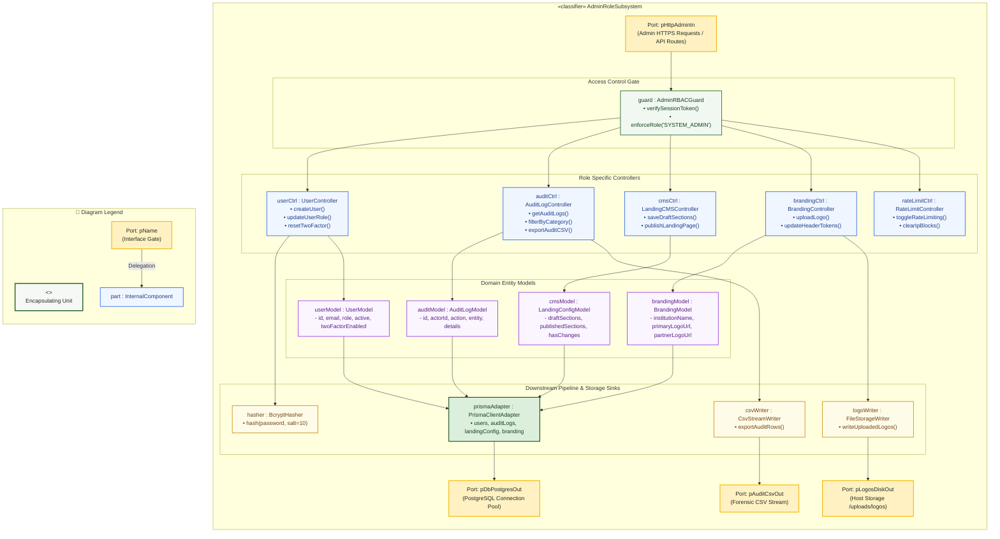

# Composite Structure Diagram: System Administrator Domain

> **Role:** `SYSTEM_ADMIN`  
> **Diagram Type:** Composite Structure Diagram  
> **Classifier:** `AdminRoleSubsystem`

---

## 1. Purpose

This Composite Structure Diagram depicts the internal architecture of the `AdminRoleSubsystem`. It shows how administrative requests route through the role guard to controllers for user accounts, 2FA security, audit log forensics, Landing Page CMS, branding, and rate limits, connecting downstream to database adapters and disk sinks.

---

## 2. Mermaid Composite Structure Diagram

---

## 3. Diagram Legend & Symbol Guide

| Symbol | UML Concept | Technical Function | MinSU Operational Meaning |
|---|---|---|---|
| `«classifier»` | Subsystem Classifier | Encapsulates internal structural parts | `AdminRoleSubsystem` |
| `Port` | Port Boundary | Ingress/egress interaction gate | HTTP Ingress, Logo Storage Out, PostgreSQL Out |
| `part` | Internal Component Part | Role controller or internal service | `UserController`, `LandingCMSController`, `BrandingController` |
| `-->` | Connector | Structural delegation or data flow | Routes administrative commands to database persistence |
