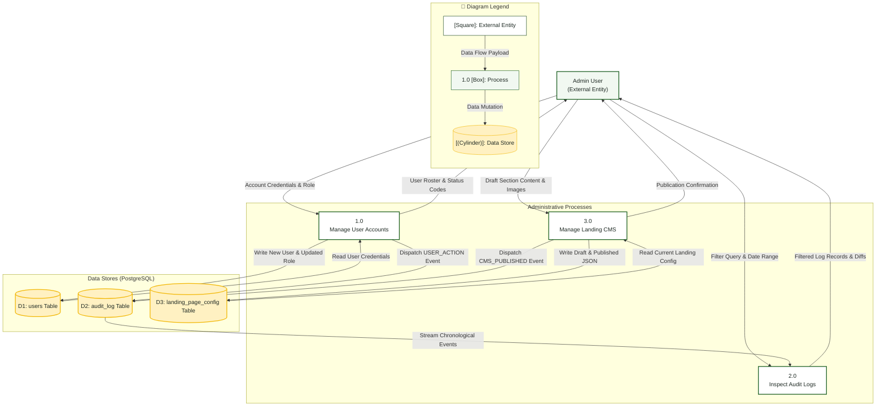

# System Admin — Data Flow Diagram (DFD)

> **Role:** `SYSTEM_ADMIN`  
> **Diagram Type:** Data Flow Diagram (Level 1)  
> **Focus:** Account Management, Audit Ingestion, and CMS Operations

---

## 1. Purpose

The Data Flow Diagram shows how administrative data enters the system, changes through processes, and reaches persistent data stores. It does not show control flow or execution time.

---

## 2. Mermaid Data Flow Diagram (Level 1)

---

## 3. Diagram Legend & Symbol Guide

| DFD Element Shape | Gane & Sarson / Yourdon Notation | Technical Role | MinSU System Implementation |
|---|---|---|---|
| `[Rectangle]` | External Entity | Source or sink outside the process boundary | Students, Staff Coordinator, Campus Director, Accounting, CHED Agency |
| `(("((Double Circle))"))` | Context Process (Level 0) | Top-level system boundary | Entire MinSU DocTrack system |
| `["1.0 Process"]` | Operational Process (Level 1) | Data transformation or business logic step | Intake Applications, Validate Annexes, Executive Review, Financials |
| `[("[(Cylinder)]")]` | Persistent Data Store | Relational table or permanent data repository | Users & Sessions, Applications, Documents, Transmittals, Audit Logs |
| `-->|Data Flow|` | Named Flow Arrow | In-transit data packet or payload | Forms, tracking codes, financial records, audit rows |
| 🟢 Green Box | Process Node | Active workflow processing unit | Core backend services and transaction coordinators |
| 🟨 Gold Cylinder | Data Store Node | Persistent PostgreSQL / File store | Secure database tables with RLS and foreign key integrity |

---

## 4. Data Dictionary

- **Account Credentials & Role**: Full name, institutional email address, initial password, and selected Role enum.
- **Filter Query & Date Range**: Search terms for actor ID, target entity, or timestamp intervals.
- **Filtered Log Records & Diffs**: List of action verbs, actor names, affected UUIDs, and field change payloads.
- **Draft Section Content & Images**: Landing page banners, announcement headlines, and scholarship guidelines.
