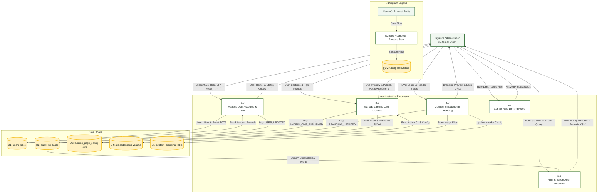

# System Admin — Data Flow Diagram (DFD)

> **Role:** `SYSTEM_ADMIN`  
> **Diagram Type:** Data Flow Diagram (Level 1)  
> **Focus:** Account Governance, Audit Ingestion, CMS, Branding & Rate Limiting

---

## 1. Purpose

The Data Flow Diagram shows how administrative inputs move through governance processes to persistent data stores, logo volumes, and audit sinks.

---

## 2. Mermaid Data Flow Diagram (Level 1)

---

## 3. Diagram Legend & Symbol Guide

| Visual Symbol | Syntax / Style | DFD Concept | MinSU Implementation |
|---|---|---|---|
| `[Entity]` | `["Name"]` | External Source or Sink | System Administrator |
| `(Process)` | `["N.0\nName"]` | Transformation of data packets | Account management, audit forensics, CMS editing |
| `[(Data Store)]` | `[("DN: table")]` | Relational table or storage volume | PostgreSQL tables (`users`, `audit_log`), `/uploads/logos` |
| `-->` | Directed Arrow | Flow of data packets | User credentials, forensic CSV stream, SVG buffers |

---

## 4. Data Flow Descriptions

- **1.0 Manage User Accounts & 2FA**: Provisions institutional accounts, updates RBAC roles, and resets user 2FA TOTP secrets.
- **2.0 Filter & Export Audit Forensics**: Queries the append-only `audit_log` table by actor and date range and streams forensic CSV exports.
- **3.0 Manage Landing CMS Content**: Allows drafting, previewing, and publishing landing page sections.
- **4.0 Configure Institutional Branding**: Validates uploaded logos, stores them in `./storage/uploads/logos`, and saves branding styles.
- **5.0 Control Rate Limiting Rules**: Enables administrators to temporarily disable anti-brute-force rate limiting during mass registration drives.
