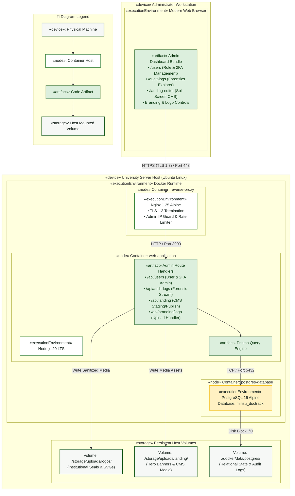

# System Admin — Deployment Diagram

> **Role:** `SYSTEM_ADMIN`  
> **Diagram Type:** Deployment Diagram  
> **Standard:** UML 2.5 Deployment Specification

---

## 1. Purpose

The Deployment Diagram shows the hardware devices, Docker container boundaries, network ports, and persistent storage mounts that host the System Administrator subsystem.

---

## 2. Mermaid Deployment Diagram

---

## 3. Diagram Legend & Symbol Guide

| Visual Symbol | Syntax / Style | UML Deployment Concept | MinSU Implementation |
|---|---|---|---|
| `«device»` | Double Angle Bracket | Hardware computational machine | Administrator Workstation, MinSU Linux Server Host |
| `«node»` | Container Box | Virtualized runtime environment | Reverse proxy, Node.js web application, PostgreSQL |
| `«artifact»` | Shaded Component | Executable software code or bundle | Admin client bundle, route handlers, query engine |
| `«storage»` | Volume Node | File system partition on host | Mounted logos volume, landing media volume, PostgreSQL data |

---

## 4. Deployment Specifications

- **Administrator Workstation**: Authenticated client accessing `/users`, `/audit-logs`, `/landing-editor`, and branding controls.
- **Reverse Proxy**: Enforces TLS 1.3 encryption, CSP headers, and administrative route protections.
- **Application Container**: Executes bcrypt hashing with 10 salt rounds and streams forensic audit logs.
- **Host Volumes**: Stores institutional crests and banners with sanitized paths (`path.basename`) and SVG script prevention headers.
