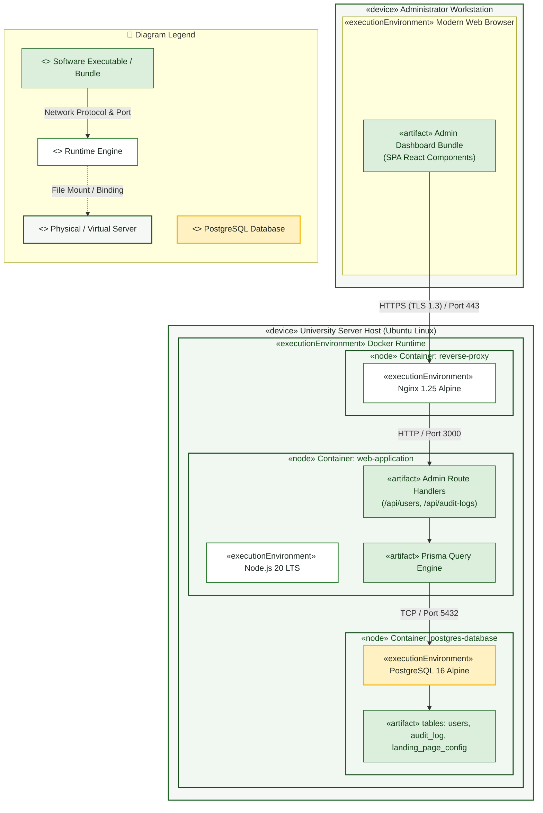
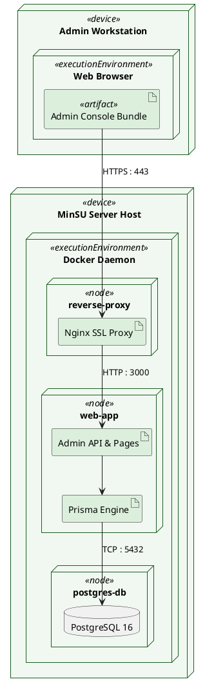

# System Admin — Deployment Diagram

> **Role:** `SYSTEM_ADMIN`  
> **Diagram Type:** Deployment Diagram  
> **Standard:** UML 2.5 Deployment Specification

---

## 1. Purpose

The Deployment Diagram shows how the administrative subsystem runs on physical and virtual nodes, including container boundaries, network ports, and storage partitions.

---

## 2. Mermaid Deployment Diagram

---

## 3. Diagram Legend & Symbol Guide

| Visual Symbol | Syntax / Style | UML Deployment Role | MinSU Infrastructure Context |
|---|---|---|---|
| `<<device>>` Box | `fill:#F6F8F6, stroke:#1B5E20` | Physical hardware or operating system host | Client Workstation, Ubuntu Linux Server |
| `<<node>>` Container | `fill:#F1F8F1, stroke:#164D1C` | Isolated containerized execution node | Docker containers: reverse-proxy, web-application, postgres-database |
| `<<executionEnvironment>>` | `fill:#FFFFFF, stroke:#2E7D32` | Application runtime or software engine | Node.js 20 LTS, Nginx 1.25 Alpine, Headless Chromium |
| `<<artifact>>` | `fill:#DCEFDD, stroke:#1B5E20` | Packaged deployable binary or file | Next.js standalone build, Prisma engine, nginx.conf |
| 🟨 Database Engine | `fill:#FFF1C2, stroke:#F2B705` | Relational database runtime | PostgreSQL 16 Alpine Server |
| `-->` Solid Arrow | Network Communication Link | Transport protocol and network port | Port 443 (HTTPS), Port 3000 (Internal HTTP), Port 5432 (Internal TCP) |
| `-.->` Dashed Arrow | Storage Mount / Stream | Host volume bind mount or disk I/O | `./uploads` (Signed PDF scans) and `pgdata` (PostgreSQL WAL files) |

---

## 4. PlantUML Deployment Diagram

---

## 5. Deployment Principles

- Admin traffic enters over HTTPS with HTTP-only secure cookie validation.
- Administrative APIs run inside the isolated `web-application` container.
- Direct database access is restricted to the internal Docker bridge network on port 5432.
