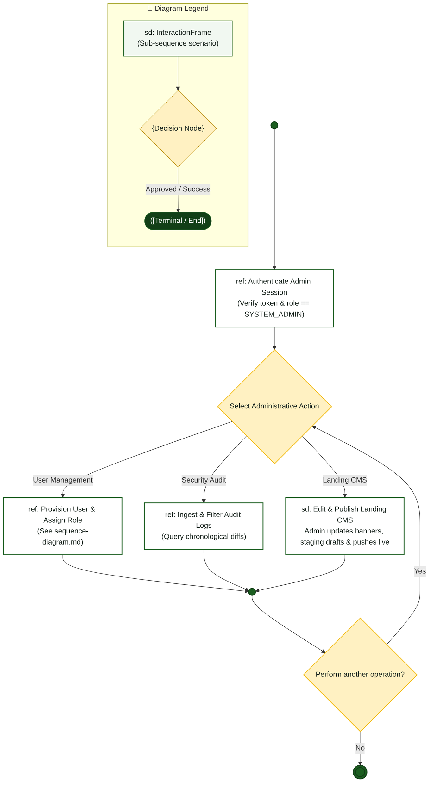

# System Admin — Interaction Overview Diagram

> **Role:** `SYSTEM_ADMIN`  
> **Diagram Type:** Interaction Overview Diagram  
> **Workflow:** Administrative Governance & CMS Orchestration

---

## 1. Purpose

The Interaction Overview Diagram combines high-level procedural control flow with detailed interaction sequence frames across administrative operations.

---

## 2. Mermaid Interaction Overview Diagram

---

## 3. Diagram Legend & Symbol Guide

| Symbol / Element | Syntax / Type | Technical Meaning | MinSU Interaction Context |
|---|---|---|---|
| `sd: FrameName` | `["sd: ..."]` | Sequence interaction scenario frame | Encapsulates an entire sequence scenario (e.g., `Authenticate`, `ReviewQueue`) |
| `{Decision}` | `{"Decision"}` | Activity decision branch point | Critical decision gate (e.g., approval vs. return, variance check) |
| `([Pill Node])` | `([Start / End])` | Lifecycle start or terminal archive node | Initiating semester operations or locking final records in archive |
| `-->` Solid Arrow | Control Flow Connector | Sequential hand-off between frames | Passing control from one interaction frame to the next |
| `-->|Label|` | Guarded Branch | Conditional scenario path | "Yes: Approved", "No: Discrepancy", "Return with Remarks" |
| 🟢 Green Box | `#F1F8F1` / `#1B5E20` | Successful Workflow Phase | Forward operational processing and executive approval |
| 🟡 Gold Diamond | `#FFF1C2` / `#B88A00` | Institutional Checkpoint | Evaluation queue and zero-variance fiscal math check |

---

## 4. Interaction Frames Table

| Frame Name | Type | Reference / Scope | Purpose |
|---|---|---|---|
| `Authenticate Admin Session` | Sequence (`ref`) | `src/lib/auth.ts` | Validates session token and enforces `SYSTEM_ADMIN` privilege. |
| `Provision User & Assign Role` | Sequence (`ref`) | [`sequence-diagram.md`](file:///c:/Users/Paolo%20Amor%20P.%20Palma/Desktop/NICKO/docs/diagrams/admin/sequence-diagram.md) | Validates credentials, executes bcrypt hash, and logs audit event. |
| `Ingest & Filter Audit Logs` | Sequence (`ref`) | `src/app/api/audit-logs` | Queries PostgreSQL audit logs with actor and entity filters. |
| `Edit & Publish Landing CMS` | Inline (`sd`) | `src/app/(dashboard)/landing-editor` | Saves draft changes and updates published JSON config. |
