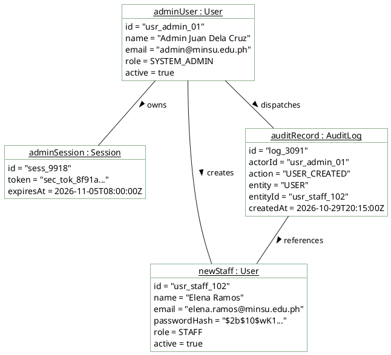

# System Admin — Object Diagram

> **Role:** `SYSTEM_ADMIN`  
> **Diagram Type:** Object Diagram  
> **Scenario:** Runtime Snapshot of Staff Account Creation and Audit Logging  
> **Standard:** UML 2.5 Object Specification

---

## 1. Purpose

The Object Diagram shows a concrete runtime snapshot of objects and attribute values created when an administrator provisions a new staff coordinator account.

---

## 2. Mermaid Object Diagram

```mermaid
flowchart TD
    %% Styling Classes
    classDef objStyle fill:#FFFFFF,stroke:#1B5E20,stroke-width:2px,color:#1F2A24;

    adminObj["<u>adminUser : User</u><br/>id = 'usr_admin_01'<br/>name = 'Admin Juan Dela Cruz'<br/>email = 'admin@minsu.edu.ph'<br/>role = SYSTEM_ADMIN<br/>active = true"]:::objStyle

    sessionObj["<u>adminSession : Session</u><br/>id = 'sess_9918'<br/>token = 'sec_tok_8f91a...'<br/>expiresAt = 2026-11-05T08:00:00Z"]:::objStyle

    newStaffObj["<u>newStaff : User</u><br/>id = 'usr_staff_102'<br/>name = 'Elena Ramos'<br/>email = 'elena.ramos@minsu.edu.ph'<br/>passwordHash = '$2b
flowchart TD
    %% Styling Classes
    classDef objStyle fill:#FFFFFF,stroke:#1B5E20,stroke-width:2px,color:#1F2A24;

    adminObj["<u>adminUser : User</u><br/>id = 'usr_admin_01'<br/>name = 'Admin Juan Dela Cruz'<br/>email = 'admin@minsu.edu.ph'<br/>role = SYSTEM_ADMIN<br/>active = true"]:::objStyle

    sessionObj["<u>adminSession : Session</u><br/>id = 'sess_9918'<br/>token = 'sec_tok_8f91a...'<br/>expiresAt = 2026-11-05T08:00:00Z"]:::objStyle

    newStaffObj["<u>newStaff : User</u><br/>id = 'usr_staff_102'<br/>name = 'Elena Ramos'<br/>email = 'elena.ramos@minsu.edu.ph'<br/>passwordHash = '$2b$10$wK1...'<br/>role = STAFF<br/>active = true"]:::objStyle

    auditObj["<u>auditRecord : AuditLog</u><br/>id = 'log_3091'<br/>actorId = 'usr_admin_01'<br/>action = 'USER_CREATED'<br/>entity = 'USER'<br/>entityId = 'usr_staff_102'<br/>createdAt = 2026-10-29T20:15:00Z"]:::objStyle

    adminObj ---|holds| sessionObj
    adminObj ---|provisions| newStaffObj
    adminObj ---|triggers| auditObj
    auditObj ---|records| newStaffObj
0$wK1...'<br/>role = STAFF<br/>active = true"]:::objStyle

    auditObj["<u>auditRecord : AuditLog</u><br/>id = 'log_3091'<br/>actorId = 'usr_admin_01'<br/>action = 'USER_CREATED'<br/>entity = 'USER'<br/>entityId = 'usr_staff_102'<br/>createdAt = 2026-10-29T20:15:00Z"]:::objStyle

    adminObj ---|holds| sessionObj
    adminObj ---|provisions| newStaffObj
    adminObj ---|triggers| auditObj
    auditObj ---|records| newStaffObj

    %% ─── 📌 VISUAL LEGEND ───
    subgraph Legend ["📌 Diagram Legend"]
        direction TB
        L_Inst["instanceName : ClassName<br/>attribute1 = value<br/>attribute2 = value"]:::legInst
        L_Link["Link: --predicate-->"]:::legLink
        L_Inst --> L_Link
    end
    classDef legInst fill:#F1F8F1,stroke:#1B5E20,color:#1F2A24;
    classDef legLink fill:#FFF1C2,stroke:#B88A00,color:#1F2A24;
```

---

## 3. Diagram Legend & Symbol Guide

| Visual Symbol | Syntax / Format | UML Role | MinSU Instance Context |
|---|---|---|---|
| Instance Node | `instanceName : ClassName` | Concrete runtime instance in memory/DB | Active users, specific scholarship calls, concrete annex documents |
| Attribute Values | `attr = 'value'` | Concrete state of instance properties | `status = 'APPROVED'`, `trackingCode = 'TDP-2026-0192'`, `slotQuota = 250` |
| `-->|predicate|` | Directed Association Link | Concrete relationship between runtime objects | User compiles document, director endorses record, transmittal dispatches |
| Subgraph Boundary | `subgraph GroupName` | Domain grouping boundary | Active Users, Intake Instances, Compiled Annexes, Transmittal Audits |
| 🟢 Green Container | `#F1F8F1` / `#1B5E20` | Operational Domain Entities | Authenticated staff/director records and approved scholarship documents |
| 🟡 Gold Node | `#FFF1C2` / `#B88A00` | Financial & Security Linkages | Ledger documents and audit log event tracking |


---

## 4. PlantUML Object Diagram



---

## 5. Snapshot Attributes

- Values show concrete data after successful execution of `POST /api/users`.
- The `auditRecord` contains foreign keys linking the action to both `adminUser` and `newStaff`.
- Password strings are always hashed before persistence.
